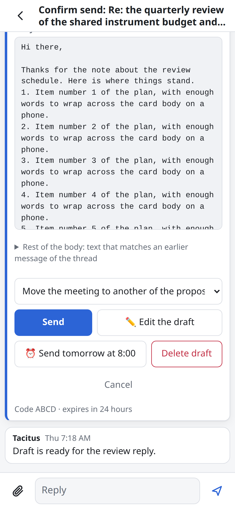
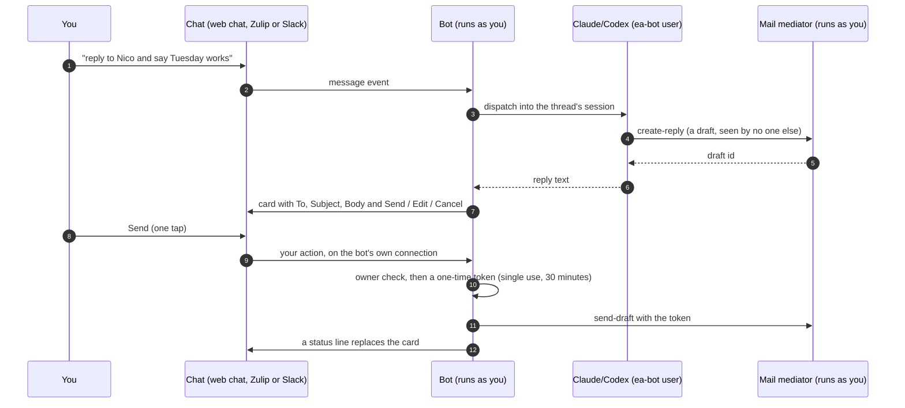
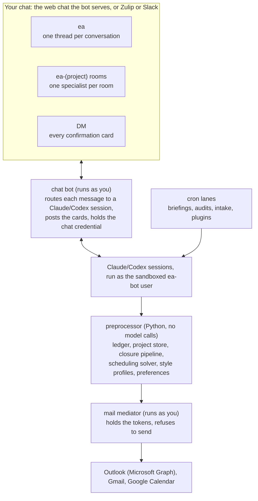

```text
==========================================================================================

ooooooooooooo       .o.         .oooooo.   ooooo ooooooooooooo oooooo     oooo  .oooooo..o
8'   888   `8      .888.       d8P'  `Y8b  `888' 8'   888   `8  `888.     .8'  d8P'    `Y8
     888          .8"888.     888           888       888        `888.   .8'   Y88bo.
     888         .8' `888.    888           888       888         `888. .8'     `"Y8888o.
     888        .88ooo8888.   888           888       888          `888.8'          `"Y88b
     888       .8'     `888.  `88b    ooo   888       888           `888'      oo     .d8P
    o888o     o88o     o8888o  `Y8bood8P'  o888o     o888o           `8'       8""88888P'

==========================================================================================
```

**The short tour is at [arpg.github.io/tacitus](https://arpg.github.io/tacitus/).** This README is the long one.

**Tacitus** is an executive assistant that you run yourself. Its
assistant, the EA, reads your mail, keeps a ledger of what you owe to
whom, drafts replies in your voice and finds meeting times across all
your calendars. You work with it in a private chat, from your desk or
your phone. It is built on [Claude Code](https://claude.ai/claude-code)
or [Codex](https://openai.com/codex/): the model reads and writes, and
plain Python does the rest.

The EA prepares and you decide. It cannot send an email, invite anyone
to a meeting, or move or delete an event until you tap the button on its
card. The check behind that tap is code that runs under your account.
The model runs as a separate Unix user that holds no mail token and no
chat credential, and it cannot change the code it runs.

Tacitus runs on one always-on Linux or macOS machine that you or your
department control. It needs a Microsoft 365 app registration with
delegated permissions ([docs/it-request.md](docs/it-request.md) lists
them for an IT group), a Claude or ChatGPT subscription, and Tailscale
to reach the chat from a phone. Tacitus runs no service that holds
your data: the tokens, the ledger and the chat history stay on that
machine. The code is free software under the AGPL, and every gate this
page names is in this repository.

## How you talk to it

You write to it from your phone as you would to a colleague: "Reply to
Nico and say Tuesday works." "Find a time with Ari and Oakley next
week." "That's done." "Open a channel for the field-trial proposal."

The chat is the web chat that the bot serves itself, with no chat server
to run. The bot keeps the conversation in a file on your machine and
serves it to your browser over your tailnet. On a phone, add it to the
Home Screen: it is a progressive web app (PWA), so it opens full screen
like an app, and a new card, a message in your DM or an alert arrives as
a notification while the app is closed.



The `ea` channel holds the conversations, one thread each. Your DM holds
every confirmation card. Each project gets a room of its own.

| You say | The EA does |
|---|---|
| "reply to Nico and say Tuesday works" | Drafts in your voice; a card with Send / Edit / Handled / Cancel lands in your DM |
| "that's done" / "snooze the vendor thread until Wednesday" | Closes or snoozes the ledger item and archives the mail |
| "find a time with Ari and Oakley next week" | Runs the solver over every calendar, proposes times, stages the invite behind a Create button |
| "fill the When2Meet in that email" | Reads the poll, shows the conflicts, fills it when you say so |
| "open a channel for the field-trial proposal" | Creates the project room and posts the project's context |
| "never show me DOE PAMS notices" | Records the rule in your words; every later briefing obeys it |

Off the tailnet, a phone reaches the web chat through a relay that sees
only ciphertext ([docs/webchat-relay.md](docs/webchat-relay.md)). If you
already run Zulip, the EA can live there instead, or the web chat can
run beside it: each post appears in both, and you answer in either.
Slack also works if you accept that Slack stores the conversation. New
chat features land in the web chat; Zulip and Slack keep working as they
are, and Zulip stays in the tree for a later setup with more than one
person in the room.
[docs/INSTALL.md](docs/INSTALL.md#choosing-a-chat-platform) compares the
three.

## Install

1. Send [docs/it-request.md](docs/it-request.md) to your IT group for the Outlook app registration. This is usually the longest wait.
2. On the machine, run `git clone https://github.com/arpg/tacitus.git ea-system && cd ea-system && ./install.sh`, or `curl -fsSL https://raw.githubusercontent.com/arpg/tacitus/main/install.sh | bash` from anywhere. `./install.sh --check` only lists what is missing.
3. The installer opens Claude Code on `/setup`, which offers a setup page: you answer the questions on your phone or laptop, one screen per topic.
4. Setup runs the rest. It stops only for a step that needs your password, a browser sign-in or your phone: [twelve steps](docs/INSTALL.md#your-steps) for the full install with the web chat.
5. Setup is done when the health check, `python3 scripts/ea-doctor.py`, reports no FAIL.

[docs/INSTALL.md](docs/INSTALL.md) walks through the install, upgrades
and removal. [docs/SETUP.md](docs/SETUP.md) is the reference behind each
step. To run in containers, read [docs/docker.md](docs/docker.md).

Start with the `email` profile, which takes about an hour once IT has
registered the app. Move to `assistant` when you want the chat and its
buttons.

| Profile | What you get |
|---|---|
| `email` (start here) | Triage, the ledger, drafts in your voice, meeting times proposed in the report (no holds or events: nothing places one without the chat buttons). Briefings land in `~/.ea/state/reports/<agent>-latest.md`, with a phone push if you want one. You send drafts from Outlook yourself. |
| `review-only` | `email` without drafting: the EA reads, tracks and briefs, and writes nothing to the mailbox. |
| `assistant` | Everything: the web chat (or Zulip or Slack), the Send and Create cards, project rooms, plugins. |

## What stays on your machine

Your mail stays with your mail provider. Tacitus keeps its own copy of
your work on your machine: the ledger, the project store, your rules,
the chat history and the tokens that open your mailbox. No Tacitus
service holds any of it. With the web chat, three things leave the
machine besides the calls to your mail and calendar provider:

- **Model calls.** Claude or Codex sees the text that a task needs. With
  a model you host and the mail gate on ([docs/llm-lanes.md](docs/llm-lanes.md)),
  that model reads the mail first, the hosted model works from its
  summaries, and a keep list holds the senders you name away from the
  hosted model.
- **Notifications.** Each one is encrypted to your browser and goes
  through your browser's push service (Google, Apple, Mozilla or
  Microsoft), which cannot read it. A card's notification shows only the
  card's title, never its fields or body; a message in your DM shows its
  first line.
- **Relay frames.** Off the tailnet, the phone and the bot seal each
  request and answer end to end. The relay passes ciphertext and sees
  only the install id, the kind and size of each frame, and the timing.
  A phone paired on your tailnet runs app code that the relay never
  serves.

The hosted relay is the only paid part of Tacitus, and it is not open
yet. You can run the same relay yourself. All of the code, the relay
included, stays under the AGPL.

## What a day looks like

- **A briefing waits when you wake up.** The EA reads the night's mail
  at 4 AM and holds the post until morning: what needs you today, which
  replies it has drafted, and which threads have waited too long.
- **Routine replies are already written**, in the voice you use with
  each person, each one on a card that you approve with one tap.
- **Scheduling is a sentence.** The EA reads Outlook and every Google
  calendar you name and applies your rules (working hours, lunch,
  no-meeting days, who gets priority). A constraint solver (OR-tools
  CP-SAT) finds the times on your real calendars; the model never works
  out free slots from its context. The same solver fills scheduling
  polls on When2Meet, WhenIsGood, Doodle, Framadate and Timeful.
- **Obligations close themselves.** When you reply, accept an invite or
  archive a thread, the matching ledger item closes. When you have to
  tell the EA that something is done, it logs that as a defect to fix.
- **Each project gets a room** with a specialist session that already
  knows the project's people, mail and decisions.

## Why you can trust it with your inbox

An assistant that can act on your mail is useful only if you can be
sure that it does not act as you. Code and the operating system enforce
this limit. By design, we take the position that the model is not
trustworthy, and we verify its output as we would that of a capable
human assistant.

- **Nothing leaves without your approval.** Sending mail, creating or
  moving an event, and deleting anything each need a one-time token. The
  chat bot mints that token only when you press the button on its card.
  The model holds no chat credential, so it cannot press the button.
- **The model holds no keys.** The model runs as a separate Unix user,
  `ea-bot`. Your Outlook and Google tokens belong to you and it cannot
  read them. It reads mail and writes drafts through a mediator that
  runs as you and refuses to send without an action that only you can
  take.
- **The model cannot change its own rules.** The code it runs is
  read-only to it. Changes come from your checkout and nowhere else.
- **You can read all of it.** The gates are in this repository.
  [docs/SECURITY.md](docs/SECURITY.md) has the threat model and a list of
  what a prompt injection cannot do.



The EA may undo only its own tentative holds without a button: an entry
on its own rules calendar, or an Outlook event it created as tentative,
tagged and without attendees.

## What it does

| Feature | Status | What it does |
|---|---|---|
| Triage and the obligations ledger | Stable | Reads the inbox before each briefing (morning, afternoon, weekly); on the `assistant` profile it also checks new mail every 10 minutes during business hours. Finds what needs a reply and which threads were dropped, ranks them, and tracks each one until it closes. |
| Drafts in your voice | Stable | Learns from 90 days of your sent mail how you write to each person: greeting, closing, length, formality. The draft to your dean reads differently from the draft to your student. |
| The review card | Stable | One card per draft with Send, Edit, Handled, Sent myself and Cancel. The text you approve is the text that goes out. Outlook and Gmail share the flow. |
| Scheduling | Stable | An OR-tools solver over Outlook and your Google calendars. Your rules live as recurring events on a calendar you edit in your calendar app. Detects reschedule requests within minutes. Fills When2Meet, Doodle and similar polls after you see the conflicts. |
| Rooms and memory | Stable | One session per conversation and one specialist per project room. A project store holds people, filed mail and a decision journal. Rules you state in chat are stored in your words and applied wherever they fit. |
| Web chat | Stable | The bot's own chat, installed on your phone as an app, with notifications and a relay for off the tailnet. Runs alone or beside Zulip. The chat that new features land in first. See [docs/webchat.md](docs/webchat.md). |
| Plugins | Stable | Personal and institution features live in plugins with declared capabilities, outside the core. See [docs/plugins.md](docs/plugins.md). |
| Local model for mail | Beta | Reads and summarizes mail, writes drafts, and posts digests on a model you host. See [docs/remote-llm.md](docs/remote-llm.md). |
| Letters of recommendation | Beta | Finds the matching letter in your files, uploads it to the portal, then reports. It matches by student name, so check that the letter fits the program. |
| Slide decks | Beta | Builds Slidev decks from your theme and serves them on your tailnet only, with a PDF. |

## How it works



Most of the work is plain Python that spends no model tokens: reading
the inbox, merging calendars, solving for meeting times, and closing
ledger items from evidence. The model does the judgment: the briefing,
the reply, the conversation. [docs/ARCHITECTURE.md](docs/ARCHITECTURE.md)
covers prompt construction, data flow and the approval gates.

## Documentation

**Using it**
- [docs/INSTALL.md](docs/INSTALL.md): prepare, install, upgrade, uninstall
- [docs/SETUP.md](docs/SETUP.md): the reference behind every setup step and health check
- [docs/setup-web.md](docs/setup-web.md): the setup page in a browser
- [docs/webchat.md](docs/webchat.md): the web chat, its API and its notifications
- [docs/webchat-relay.md](docs/webchat-relay.md): the relay for a phone off the tailnet
- [docs/SCHEDULING.md](docs/SCHEDULING.md): the solver and your scheduling rules
- [docs/zulip-switch.md](docs/zulip-switch.md): Zulip or Slack, and moving between them
- [docs/remote-llm.md](docs/remote-llm.md): running mail through a model you host
- [docs/RUNBOOK.md](docs/RUNBOOK.md): day-to-day operation and recovery

**Reviewing it**
- [docs/SECURITY.md](docs/SECURITY.md): threat model and the code-enforced gates
- [docs/mail-mediation-spec.md](docs/mail-mediation-spec.md): why the model holds no mail token
- [docs/it-request.md](docs/it-request.md): permissions, data flow and a security summary for your IT group

**Building on it**
- [docs/ARCHITECTURE.md](docs/ARCHITECTURE.md): rooms, prompts, data flow, approval gates
- [docs/llm-harness.md](docs/llm-harness.md): the resident session and how context is chosen
- [docs/plugins.md](docs/plugins.md): writing a plugin
- [docs/EVAL.md](docs/EVAL.md): evaluation and quality tracking
- [CONTRIBUTING.md](CONTRIBUTING.md): the code layout, the tests, and how to make a change
- [CHANGELOG.md](CHANGELOG.md): what each release contains

## Status and support

This is research software from a university robotics lab, with one
maintainer, who built it in a moment of desperation in March 2026 and has
improved and run it ever since.
Outlook is required today; Gmail works as a second account. Linux is the
primary platform and macOS is supported. Codex is generally supported
but is not thoroughly tested. Windows (WSL2 is untested), a Gmail-only
install and a hosted service are out of scope until someone contributes
them. Expect rough edges in the install.

- A question or help with an install: [Discussions](https://github.com/arpg/tacitus/discussions).
- A bug: [an issue](https://github.com/arpg/tacitus/issues/new/choose),
  with the output of `python3 scripts/ea-doctor.py --share` (it masks
  your addresses and account names).
- A feature: an Ideas discussion first. A capability for one person,
  one institution or one service is a [plugin](docs/plugins.md), which
  needs no change to the core.
- A vulnerability: a [private advisory](SECURITY.md), never a public issue.

Replies come within about a week ([SUPPORT.md](SUPPORT.md) has the
order of priority). Pull requests with tests move faster than issues.

The assistant inside Tacitus is the EA, and its name runs through the
system: the `ea-bot` user, the `~/.ea` directory and the `ea` chat
channels.

## Your responsibility

Tacitus is not an ordinary program. Running it, you give an assistant
read access to your mailbox and calendars and let it draft mail in
your voice, stage calendar events, fill polls, upload letters and
publish sites as you. Every send and every event still waits for your
click, and the EA cannot sign anything or move money, but it decides
what to draft, what to file and what to leave alone, and language
models make mistakes. What goes out under your name is yours: read
what you approve, keep your own eyes on the ledger, and do not run it
on an account whose mail you are not entitled to let a third party
read (a hosted model sees what the gate lets through; see
`docs/llm-lanes.md`). The authors do not review any install and have no
view into yours. The software comes with no warranty of any kind, as
the license below says in full; `/setup` shows this paragraph once and
records that you read it.

## License

Copyright (C) 2026 the authors listed in [AUTHORS](AUTHORS).

Tacitus is free software under the GNU Affero General Public License,
version 3 only (`AGPL-3.0-only`); see [LICENSE](LICENSE). You may use,
change and run it. If you offer a changed version as a network service,
you must publish your changes under the same license. The authors may
also offer Tacitus under other terms, so contributions come in under the
contributor license in [CONTRIBUTING.md](CONTRIBUTING.md).
