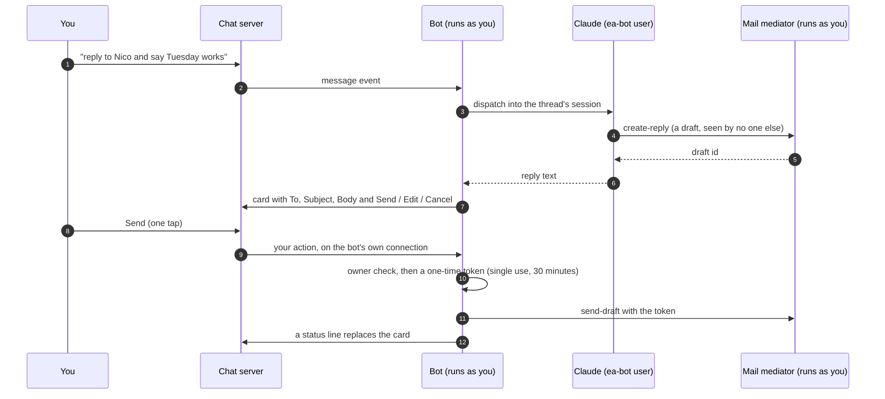
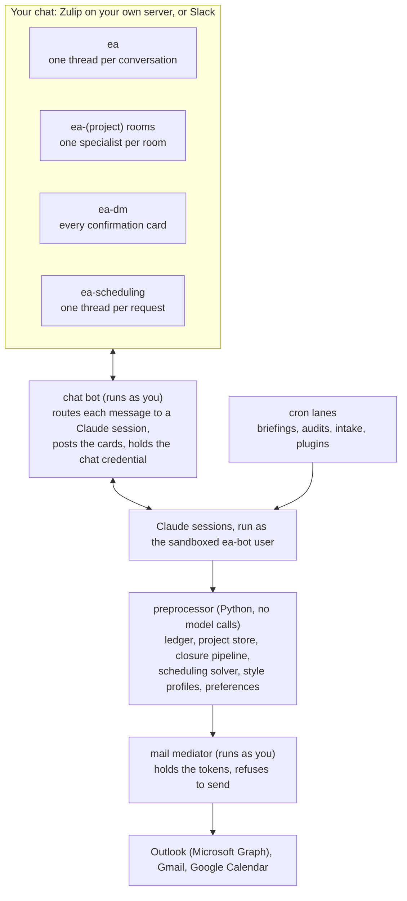

```text
==========================================================================================

ooooooooooooo       .o.         .oooooo.   ooooo ooooooooooooo oooooo     oooo  .oooooo..o
8'   888   `8      .888.       d8P'  `Y8b  `888' 8'   888   `8  `888.     .8'  d8P'    `Y8
     888          .8"888.     888           888       888        `888.   .8'   Y88bo.
     888         .8' `888.    888           888       888         `888. .8'     `"Y8888o.
     888        .88ooo8888.   888           888       888          `888.8'          `"Y88b
     888       .8'     `888.  `88b    ooo   888       888           `888'      oo     .d8P
    o888o     o88o     o8888o  `Y8bood8P'  o888o     o888o           `8'       8""88888P'

==========================================================================================
```

**Tacitus** is a self-hosted executive assistant for academics and
professionals, built on [Claude Code](https://claude.ai/claude-code).
Its assistant, the EA, reads your mail, drafts replies in your voice,
tracks what you owe to whom, and finds meeting times across all your
calendars. The EA cannot send an email or place a meeting without your
click.

You talk to it the way you talk to a colleague: in a private chat on a
server you run, from your desk or your phone. "Reply to Nico and say
Tuesday works." "Find a time with Ari and Oakley next week." "That's
done." "Open a channel for the field-trial proposal."

## What a day looks like

- **When you wake up, a briefing is waiting.** The EA read the night's
  mail at 4 AM and held the post until morning: what needs you today,
  which replies it has already drafted, and which threads have waited
  too long.
- **Routine replies are already written**, in the voice you use with
  each person. Each one waits on a card in your chat with Send, Edit and
  Cancel. You approve on the train with one tap.
- **Scheduling is a sentence.** The EA reads Outlook and every Google
  calendar you name, applies your rules (working hours, lunch,
  no-meeting days, who gets priority) and proposes times. A constraint
  solver (OR-tools CP-SAT) finds those times on your real calendars;
  the model never works out free slots from its context. The same
  solver's slots fill scheduling polls on When2Meet, WhenIsGood, Doodle,
  Framadate and Timeful. The invite waits behind a Create button.
- **Obligations close themselves.** When you reply, accept an invite or
  archive a thread, the matching item in the ledger closes. When you
  have to tell the EA that something is done, it logs that as a defect
  to fix.
- **Each project gets a room.** "Open a channel for the field-trial
  proposal" creates a private channel with a specialist session that
  already knows the project's people, mail and decisions.

| You say | The EA does |
|---|---|
| "reply to Nico and say Tuesday works" | Drafts in your voice; a card with Send / Edit / Handled / Cancel lands in your private line |
| "that's done" / "snooze the vendor thread until Wednesday" | Closes or snoozes the ledger item and archives the mail |
| "find a time with Ari and Oakley next week" | Runs the solver over every calendar, proposes times, stages the invite behind a Create button |
| "fill the When2Meet in that email" | Reads the poll, shows the conflicts, fills it when you say so |
| "open a channel for the field-trial proposal" | Creates the project room and posts the project's context |
| "never show me DOE PAMS notices" | Records the rule in your words; every later briefing obeys it |

## Why you can trust it with your inbox

An assistant that can act on your mail is useful only if you can bound
what it does. These limits are enforced in code and by the operating
system. They do not depend on the model following instructions.

- **Nothing leaves without your click.** Sending mail, creating or moving
  an event, and deleting anything each need a one-time token. The chat
  bot mints that token only when you press the button on its card. The
  model holds no chat credential, so it cannot press the button.
- **The model holds no keys.** Claude runs as a separate Unix user,
  `ea-bot`. Your Outlook and Google tokens belong to you and are
  unreadable to it. It reads mail and writes drafts through a mediator
  that runs as you and refuses to send.
- **The model cannot change its own rules.** The code it runs is
  read-only to it. Changes come from your checkout and nowhere else.
- **Your mail can stay home.** An optional local model (any
  OpenAI-compatible endpoint, such as vLLM or Ollama) reads incoming mail
  and writes the drafts. Claude then works from summaries.
- **Your conversations stay home.** The recommended chat platform is a
  Zulip server on your own machine, reached over your tailnet. Slack
  also works if you accept that Slack stores the conversation.
- **You can read all of it.** The gates are in this repository.
  [docs/SECURITY.md](docs/SECURITY.md) has the threat model and a list of
  what a prompt injection cannot do.



The EA may undo only its own tentative holds without a button: an entry
on its own rules calendar, or an Outlook event it created as tentative,
tagged and without attendees.

## What it does

| Feature | Status | What it does |
|---|---|---|
| Triage and the obligations ledger | Stable | Reads the inbox before each briefing (morning, afternoon, weekly); on the `assistant` profile it also checks new mail every 10 minutes during business hours. Finds what needs a reply and which threads were dropped, ranks them, and tracks each one until it closes. |
| Drafts in your voice | Stable | Learns from 90 days of your sent mail how you write to each person: greeting, closing, length, formality. The draft to your dean reads differently from the draft to your student. |
| The review card | Stable | One card per draft with Send, Edit, Handled, Sent myself and Cancel. The text you approve is the text that goes out. Outlook and Gmail share the flow. |
| Scheduling | Stable | An OR-tools solver over Outlook and your Google calendars. Your rules live as recurring events on a calendar you edit in your calendar app. Detects reschedule requests within minutes. Fills When2Meet, Doodle and similar polls after you see the conflicts. |
| Rooms and memory | Stable | One session per conversation and one specialist per project room. A project store holds people, filed mail and a decision journal. Rules you state in chat are stored in your words and applied wherever they fit. |
| Plugins | Stable | Personal and institution features live in plugins with declared capabilities, outside the core. See [docs/plugins.md](docs/plugins.md). |
| Local model for mail | Beta | Reads and summarizes mail, writes drafts, and posts digests on a model you host. See [docs/remote-llm.md](docs/remote-llm.md). |
| Letters of recommendation | Beta | Finds the matching letter in your files, uploads it to the portal, then reports. It matches by student name, so check that the letter fits the program. |
| Slide decks | Beta | Builds Slidev decks from your theme and serves them on your tailnet only, with a PDF. |

## How it works



Most of the work is plain Python that spends no model tokens: reading
the inbox, merging calendars, solving for meeting times, and closing
ledger items from evidence. Claude does the judgment: the briefing, the
reply, the conversation. [docs/ARCHITECTURE.md](docs/ARCHITECTURE.md)
covers prompt construction, data flow and the approval gates.

## Install

You need:

- an always-on Linux or macOS machine (WSL2 is untested);
- a Claude Pro or Max subscription;
- a Microsoft 365 / Outlook account, and an app registration from your
  IT group (send them [docs/it-request.md](docs/it-request.md); this is
  usually the longest wait);
- optionally, Google accounts for calendars and Gmail drafts.

Then, on that machine:

```bash
git clone https://github.com/arpg/tacitus.git ea-system && cd ea-system && ./install.sh
```

or, once the repository is public, from anywhere:

```bash
curl -fsSL https://raw.githubusercontent.com/arpg/tacitus/main/install.sh | bash
```

`install.sh` checks the prerequisites and names the command for anything
missing (`./install.sh --check` prints only that table). It installs
Claude Code and the Python packages, then opens Claude Code on the
`/setup` skill. Setup asks one question at a time, runs every command
for you, and ends when the health check passes.

Choose a profile. Start with `email`; move to `assistant` when you want
the chat rooms and buttons.

| Profile | What you get | Time to install |
|---|---|---|
| `email` (start here) | Triage, the ledger, drafts in your voice, meeting times proposed in the report (no holds or events: nothing places one without the chat buttons). Briefings land in `~/.ea/state/reports/<agent>-latest.md`, with a phone push if you want one. You send drafts from Outlook yourself. | About an hour, once IT has registered the app |
| `review-only` | `email` without drafting: the EA reads, tracks and briefs, and writes nothing to the mailbox. | About an hour |
| `assistant` | Everything: chat rooms on Zulip or Slack, the Send and Create cards, the scheduling channel, plugins. | About half a day, most of it for the chat server |

[INSTALL.md](INSTALL.md) is the full guide: what to prepare, what setup
asks, upgrades, and how to uninstall. To run in containers, read
[docs/docker.md](docs/docker.md).

## Documentation

**Using it**
- [INSTALL.md](INSTALL.md): prepare, install, upgrade, uninstall
- [SETUP.md](SETUP.md): the reference behind every setup step and health check
- [docs/SCHEDULING.md](docs/SCHEDULING.md): the solver and your scheduling rules
- [docs/zulip-switch.md](docs/zulip-switch.md): Zulip or Slack, and moving between them
- [docs/remote-llm.md](docs/remote-llm.md): running mail through a model you host
- [docs/RUNBOOK.md](docs/RUNBOOK.md): day-to-day operation and recovery

**Reviewing it**
- [docs/SECURITY.md](docs/SECURITY.md): threat model and the code-enforced gates
- [docs/mail-mediation-spec.md](docs/mail-mediation-spec.md): why the model holds no mail token
- [docs/it-request.md](docs/it-request.md): permissions, data flow and a security summary for your IT group

**Building on it**
- [docs/ARCHITECTURE.md](docs/ARCHITECTURE.md): rooms, prompts, data flow, approval gates
- [LLM_HARNESS_as_EA.md](LLM_HARNESS_as_EA.md): the resident session and how context is chosen
- [docs/plugins.md](docs/plugins.md): writing a plugin
- [docs/EVAL.md](docs/EVAL.md): evaluation and quality tracking
- [CONTRIBUTING.md](CONTRIBUTING.md): the code layout, the tests, and how to make a change
- [CHANGELOG.md](CHANGELOG.md): what each release contains

## Status and support

This is research software from a university robotics lab, with one
maintainer, who has run it on their own mail every day since March 2026.
Outlook is required today; Gmail works as a second account. Linux is the
primary platform and macOS is supported. Windows, a Gmail-only install
and a hosted service are out of scope until someone contributes them.
Expect rough edges in the install.

- A question or help with an install: [Discussions](https://github.com/arpg/tacitus/discussions).
- A bug: [an issue](https://github.com/arpg/tacitus/issues/new/choose),
  with the output of `python3 scripts/ea-doctor.py --share` (it masks
  your addresses and account names).
- A feature: an Ideas discussion first. A capability for one person,
  one institution or one service is a [plugin](docs/plugins.md), which
  needs no change to the core.
- A vulnerability: a [private advisory](SECURITY.md), never a public issue.

Replies come within about a week ([SUPPORT.md](SUPPORT.md) has the
order of priority). Pull requests with tests move faster than issues.

The assistant inside Tacitus is the EA, and its name runs through the
system: the `ea-bot` user, the `~/.ea` directory and the `ea` chat
channels.

## License

Copyright (C) 2026 the authors listed in [AUTHORS](AUTHORS).

Tacitus is free software under the GNU Affero General Public License,
version 3 only (`AGPL-3.0-only`); see [LICENSE](LICENSE). You may use,
change and run it. If you offer a changed version as a network service,
you must publish your changes under the same license. The authors may
also offer Tacitus under other terms, so contributions come in under the
contributor license in [CONTRIBUTING.md](CONTRIBUTING.md).
