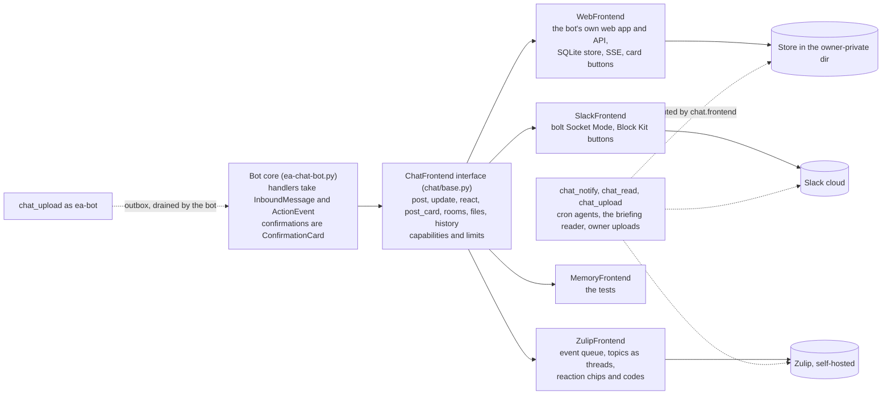

# EA System Architecture

Prompt construction, data flow, tool availability, and approval gates.

For the security threat model, autonomy tiers, and "what prompt
injection cannot do", see [SECURITY.md](SECURITY.md). For auth
pathways and token lifetimes, see [AUTHENTICATION.md](AUTHENTICATION.md).
For the resident-session lifecycle and per-dispatch context selection,
see [llm-harness.md](llm-harness.md).

**Keeping this document current**: A pre-commit hook warns when files
depicted here change without an update to this document. See
[Drift Detection](#drift-detection) at the bottom.

---

## One turn at a time per session

A message that arrives while its thread's session is still on the
message before it waits. The bot reacts with an hourglass at once,
takes the session's lock when the running turn has posted, swaps the
hourglass for eyes as the session starts reading, and ends with the
usual check or cross. The resident lane signals its queue the same way,
with the reaction and no text. A wait longer than twenty minutes ends
with a cross and one line asking for the message again.

## Deploys never silence a thread

The post-commit hook deploys every commit but restarts the bot only when
code the running process holds in memory changed (`ea-chat-bot.py`,
`preprocessor/*.py`, the deny lists, `requirements.txt`); skills, docs,
CLAUDE.md, config templates and agent definitions are read per dispatch
and are live as soon as the copy lands. Before a restart the hook waits
up to four minutes for `~/.ea/state/bot-inflight.json` to show no
per-thread run. The bot mirrors its live dispatches to that file; on
SIGTERM it stops taking new work, parks any message that arrives with a
one-line notice, gives the runs in flight up to eighty seconds to post,
and exits. The next instance re-dispatches whatever was interrupted or
parked, in its own channel and thread, with one line saying so; a
resident turn is left alone because its pane kept working and the
router delivers its reply.

## Signed releases update an install

A green push to `main` is a release: CI's `release` job signs the next
`vX.Y.Z` tag (SSH key in a repository secret; `.release-key.pub` is the
trust root). On an install with an update channel, `scripts/update.py`
runs hourly as the owner: it fetches the tags into an owner-private
cache, picks the channel's newest release that verifies against the
installed `.release-key.pub` and is newer than what runs, exports it to
`/opt/ea-system.releases/<tag>`, runs a smoke, waits until no chat turn
or cron lane runs, moves ea-bot's copy with `scripts/deploy.sh`, renames
a new `current` link over the old one (`/opt/ea-system` is a root-owned
link to it), restarts the bot and the mediator, and reads the bot's log
for 60 seconds: one main process, the frontend connected, no traceback.
A failure switches the link back and holds the version back. The
services resolve their own path at start, so each keeps the release it
started from until its restart; that is why every update restarts both,
and why the release before stays on disk. A tree the post-commit hook
writes, with no channel set, is left to the hook, and the hook leaves a
release layout alone. Design: docs/updates.md.

## Rooms follow their project, and Slack decides what is archived

The room hygiene pass reads Slack's archived flag for every private
channel each cycle and records who archived a room in the channel
registry: "bot" when it did because the project went dormant or closed,
"user" when the owner did it in Slack. A room the owner archived stays
archived and its project journal says so; only a room the bot archived
reopens when the project is active again. `open a channel for <project>`
reopens an archived room, reposts the pack and journals the reopening.
The board and App Home badges carry the archived state.

A project created during a Slack turn gets its room without a second
command: after detection, each lane asks the store for projects created
since the run started (`projects_created_since`) and, for every active
one with no registered channel, runs the same `_open_project_channel`
path the command uses (private channel named `#ea-<id>`, owner invited,
registry row, opening pack), then posts the link in the thread and a
link back to the thread in the room. The check is idempotent on the
registry, so a concurrent dispatch that sees the same new row opens
nothing. A room for a project that already exists is asked for either
as the direct command (`open|create|make|start|spin up … channel|room
for <project>`, answered without Claude) or, in any other words, by the
model staging `pending-channel.json` with the project id; that staged
kind (`open_channel`) rides the same claim protocol as the calendar
files, is swept by the events poller when written out of band, and runs
`_open_project_channel` with the thread announcement and back-link.

A room request that names no known project does not bounce. The
resolver (`_resolve_project_candidates`) opens a room only for an exact
id or a clear winner from the store's matcher; anything weaker, or no
match at all, returns fuzzy candidates (`project_store.suggest_projects`:
the strict hits first, then token overlap and difflib similarity over
ids, names and aliases) and the reply is a Block Kit picker: the closest
projects as Open buttons, a `static_select` of every active project,
and a Create button. Open and the menu run `_open_project_channel` from
the click and turn the picker into a status line. Create dispatches one
instruction into the thread's own Claude session (`_dispatch_room_create`,
the same `handle_message_async` path the App Home desk uses): register
the project from the conversation with `add-project`, link its ledger
items, people and URLs, say nothing about a room; the row it writes
brings the room through `projects_created_since`. "open a channel for
this project" (or "for it", or a bare "open a channel") resolves the
project from the thread (`_open_project_channel_from_thread`): a project
room answers itself, otherwise the thread text goes through the matcher
and the ledger ids the EA named in backticks are followed to their
projects; one clear winner opens, anything else is the picker.

## The review interface

Every draft the EA creates gets one :lock: block in the owner's DM. It
shows the recipients, the subject, the files on the draft and the body.
When the body proposes meeting times, a preflight line checks each one
against the user's calendars (`validate-draft`) and the internal recipients'
own (`check-attendees`), for the length the draft states; a calendar
invite's Create card carries the same invitee check. It has five
buttons: Send (mints the token and sends), Edit (opens the body in
a modal; Save runs `update-draft` and redraws the block so the reviewed
text is the sent text), Handled (deletes the draft, archives the source
thread and closes the ledger row: the owner dealt with it or no reply is
owed; when the delete fails or a send holds the draft's lock, it archives
and closes nothing and says so), Sent myself (closes and archives, the mail went out from Outlook)
and Cancel (keeps the draft, asks what to do instead). When two or more
blocks are posted within about a minute, one Send-all card follows; its
button repeats the single-Send gate for each draft that is still live.

Which ledger rows a send closes (`_close_ledger_for_draft`, shared by
Send, Sent myself, Handled and a send found in Outlook; the closure policy
above): the rows the draft names, whatever their type, and then the reply
row on its conversation; every other open row on the thread gets a
proposal. A draft names a row with `--ledger-id` on `create-draft`,
`create-reply` or `update-draft` (Outlook or Gmail); the id rides on the
draft-events record, and a draft id quoted in a row's notes or last
action counts too. The reply row is a detector row first, then a
`response_needed`, `follow_up` or `draft_pending` row
(`ledger.closes_on_reply`). A task, deadline or meeting row on the same
thread that the draft does not name stays open, and so does any row
waiting on someone else: a thread carries more than one obligation, and
a reply in it can be about any of them.

The requesting thread gets a one-line pointer to the block's permalink,
posted with unfurls off: Slack unfurls a message permalink as a copy of
the message, buttons included and clickable, and a click on the copy
would edit the pointer while the real block kept its buttons (and, for
a staged event, consume the payload the real button needs). The Slack
frontend resolves every click through `SlackFrontend._resolve_card`,
which maps a click arriving on an unfurl (`attachments[].is_msg_unfurl`)
back to the channel and ts of the block it shows, so the `ActionEvent`
each handler and the stale guard receive names the real card, and
pointers posted before the change still resolve correctly.

A click reaches the bot as an interaction payload on its own Socket
Mode websocket, opened with the app-level token; the bot verifies no
Slack signature and checks the clicker against `EA_SLACK_OWNER_ID`. On
Zulip the same card is a message in the `ea-dm` stream with a one-time
code: the owner reacts with a check (or a cross to cancel) or replies
with the code, led by the action's word for anything but the primary
action (`handled <code>`, `cancel <code>`). A card that withholds its
approval (more than one card shows) has no primary: a thumbs up or a
bare code there selects nothing (`ConfirmationCard.no_default`). A draft
outcome (Send, Sent myself, Handled, a send or delete found in Outlook)
names the ledger rows it closed on its one status line, never in a post
per row; a card settled outside chat is filed (`ChatFrontend.file_card`):
on Zulip it moves to the private `ea-dm-done` stream, where the owner is
not subscribed, so an edit no longer leaves it unread in the Inbox. See
the Chat front-end layer section.

## Reschedule requests: detected in minutes, answered by the solver

`preprocess.detect_scheduling_requests` also matches reschedule
phrasing ("no longer works", "can't make it", "push our meeting",
"something came up") and tags each request `kind: reschedule | new`.
Both the hourly scheduling check and the ten-minute intake run it,
register new requests in the ledger (`register_new_scheduling_requests`,
one `sched-` row per message so nothing re-notifies) and merge them into
`~/.ea/state/scheduling-proactive-queue.json` (`write_proactive_queue`:
a union by conversation id with a three-day expiry, never an overwrite,
so a second writer cannot drop an entry the bot has not opened). The
bot's proactive tick (every five minutes, outside quiet hours) opens one
queued request per tick as a thread in the scheduling channel. For a
reschedule the seed instruction runs `scheduling_engine.py
reschedule-brief --conversation-id <id>` first: one mediated, read-only
call that returns the thread, the upcoming meeting(s) with the sender
and their Outlook event ids, the sender's history with the user (usual
weekday, median start, typical length), the solver's `propose-meeting`
options re-ranked by that history, any sender-proposed `--times`
validated, and a `recommendation` decided in code
(`recommend_reschedule`): `stage_reschedule` when exactly one meeting
matches and either a proposed time validates clean or the best-fit
option is unconditional at fit 0.75 or better; otherwise
`offer_options` with the reason. The lane then writes
`pending-event-update.json` (the Reschedule button appears in the DM
with a pointer in the thread) or proposes the top three as a scheduler
would. The move itself never bypasses the button.

## Holds the EA may clear itself

Two kinds of hold exist, and both are released without a button. On
the EA-Managed Google calendar every event is the EA's own (no
attendees, rewritten by the reconciler), so `google_calendar_client.py
update-event` and `delete-event` run un-gated; the mediator shim
(`mail_mediation.is_ea_managed_autohold`) accepts them with no
`--calendar-id` (the client defaults to EA-Managed and
`_require_ea_managed` refuses every other calendar) or with the
EA-Managed id, and refuses any other calendar; `create-event` still has
to name the calendar because its client default is the primary. On
Outlook a hold is an event staged with `"hold": true` and no attendees:
`create-event --hold` makes it `showAs: tentative` with the "EA Hold"
category (`graph_client.EA_HOLD_CATEGORY`), and `graph_actions.py
clear-hold --event-id` (SAFE, mediated) deletes it only when
`graph_client.is_ea_hold` accepts it: tagged, tentative, no attendees,
the user as organiser. Those four together describe nothing but the
EA's own holds, so the general `delete-event` stays token-gated and
`clear-hold` is not a route around it; a refusal names the failed check
and points at `pending-event-delete.json`. `calendar-view` rows carry
`categories` and `ea_hold`, and it is the source of Outlook event ids
for every reschedule or delete.

## Guestless events need no Create card

A staged Outlook event with no attendees and no optional attendees mails
no one, so `_post_staged_action` creates it through
`_create_guestless_event` before any card is drawn: the bot mints the
token and runs `create-event` exactly as a click would
(`_execute_event_create`), then posts one line in the thread listing what
it created. The card stays for an event with any guest, for every Google
calendar event (a family calendar shows it to others), past
`_GUESTLESS_PER_HOUR` creates in an hour, and after a failed create. A
subject and times already created within a week are skipped
(`guestless-events.json` in the owner-private dir). Update and delete
keep their buttons.

Cron agents label their drafts `EA_RUN_ID=cron-<agent>-<ts>`; the
router's sweep posts those blocks at the channel root as soon as it
sees them, so the morning briefing's drafts are reviewable the moment
the briefing lands. The morning briefing drafts every routine reply and
scheduling proposal itself and surfaces only the decisions it cannot
make.

## Timed alerts and page watches

A stream post is read when the owner opens the stream; the morning
briefing is one such post at 04:00. A moment with a clock time (tickets
on sale at 10:00, a registration that opens at noon, a portal that
closes at 5 pm) needs a notification that reaches a device, so it has a
channel of its own:

- `preprocessor/chat/direct.py` is the one place that sends or schedules
  a direct message to the owner. On Zulip a direct message is pushed to
  the owner's devices, and a scheduled one is held and delivered by the
  Zulip server, so it fires whatever the bot is doing. On Slack there is
  no server-side schedule: `send_direct` falls back to an urgent post in
  the personal channel and `schedule_direct` raises. On the web chat
  alone, `schedule_direct` queues the post in the web chat's store
  (`scheduled_posts`) and the bot's tail thread posts it in the DM channel
  at its moment; `cancel_scheduled` drops it (docs/webchat.md, CLI
  senders).
- `preprocessor/alert.py schedule --id <ledger id> --at <ISO local>
  [--lead 15]` schedules that message for `lead` minutes before the
  moment and records it on the row (`alert_at`, `alert_scheduled_id`),
  so the verb is idempotent and `cancel` can undo it. A lane without the
  owner's chat credential (the resident runs as ea-bot) appends the
  request to `state/pending-alerts.jsonl`; the owner's cron runs
  `alert.py flush` every five minutes. When the chat block runs the web
  chat, `direct.web_notify` also queues the alert as a Web Push for the
  same moment, which the bot's push worker sends.
- `preprocessor/page_watch.py` watches a URL for a sentence to
  disappear (`--absent`) or appear (`--present`); the owner's cron runs
  `check` every 15 minutes, and a change sends the direct message, posts
  to the personal channel and annotates the linked ledger row, once per
  flip. Watches live in `state/page-watches.json`, results in
  `state/page-watch-state.json`.
- The briefing scorer treats a row whose `follow_up_after` or
  `snooze_until` is today as due today (reason `window opens today`,
  with the clock time from its description), and the briefing skill
  puts it first and checks that an alert exists.

Both scripts write into resident space through `resident_io` and are
registered with the boundary tripwire. They are granted to the agent
lanes (`run-agent.sh`) and the chat lane (`_BASH_ONLY_TOOLS`).

## Resident turns and late drafts

The resident bridge posts a dispatch's reply when the segment between
its marker and the next one ends in turn-final text. A background
subagent breaks that reading: the model ends its turn when it launches
one, so `resident_bridge.segment_background_pending` holds the dispatch
open while the segment has more "Async agent launched" tool results than
task notifications, in both the live await and the router's late-reply
recovery. The primer keeps the email-author subagent in the foreground
and forbids background agents from creating drafts or staging events.
A launch is resolved by its task notification or by a blocking
`TaskOutput` read of that task, and the hold is bounded; the late-reply
path never holds. A dispatch marker can arrive folded into a tool result
when the TUI queued the paste mid-turn, so marker matching reads tool
results too, and a late reply frees only the foreground slot its own
dispatch left held. If a draft still lands with no dispatch to claim it
(its journal record carries no run id), `_sweep_late_resident_drafts` in
the router attributes it to the resident completion, late reply or
routed background report whose window holds it and posts the Send block
in that thread once; a record nobody owns after five minutes gets its
block at the EA channel root. The sweep is guarded by the
draft-confirmation registry and skipped while a resident turn is in
flight. It runs on every router tick whether or not the resident pane is
on, as do the outbox drain and the check that retires a block whose
draft was sent or deleted in Outlook; with `resident_mode: false` the
sweep is what gives a cron agent's or a shell's draft its Send block.

## Install profiles

`profile` in `~/.ea/config/ea-config.json` (`ea_config.get_profile`,
`profile_features`) names the loadout: `email` (Outlook, ledger,
drafting, reports in `~/.ea/state/reports/`, no chat platform; with
nothing to read `pending-event.json`, proposed holds and events stay
text in the report), `review-only` (`email` minus drafting, enforced by
`scripts/disallowed-tools.review-only.txt` in every launcher) and
`assistant` (the full system). `scripts/install/setup.sh --profile` installs the cron
lines for it (the bot's system unit comes from
`deploy/harden-permissions.sh`), `run-agent.sh` writes every report to
`~/.ea/state/reports/<agent>-latest.md` and posts to Slack only when the
profile has it, and `scripts/ea-doctor.py --profile` checks only what
the profile needs. The `/setup` skill (`.claude/skills/setup/SKILL.md`)
asks for the profile first.

## Capability plugins

A plugin is one directory with a `plugin.json` at its root, in its own
repo (docs/plugins.md). A v1 manifest decides for itself, as before. A v2
manifest declares capabilities, and the owner's lock
(`<private_dir>/plugins.lock.json`, written by `scripts/ea-plugin.py`)
decides what acts: the source commit, the SHA-256 of every file, the
manifest (its `context` grants included) and the capability digest the
owner accepted. Owner processes act on the locked manifest copy, never
on the live file, and a directory whose name is in the lock is never read
as a v1 plugin, whatever its live `plugin.json` says
(`plugin_registry.locked_names`; `run-plugin.sh` and `scripts/install/setup.sh` follow
the same rule). The install policy comes only from the owner-private
`plugins-policy.json`.

Where the core reads the lock:

- **Approval pipeline.** A card a plugin declares joins the staged-action
  claim protocol (`PLUGIN_ACTION_FILES` in `ea-chat-bot.py`, swept by
  `_plugin_cards_poller`). On a click the bot claims the card once, mints
  a one-time token for that card and item (`plugin_cards.mint_token`,
  into the owner-private directory on a mediated install) and runs the
  declared executor, as the resident or, for an owner-zone plugin, as the
  owner. A resident executor's `consume_token` is the mediated SAFE verb
  `plugin_cards consume-token`, so the mediator takes the token as the
  owner and no token file the resident writes counts.
- **Mediated verbs.** An owner-zone plugin's verb travels as tool
  `plugin:<name>` (`plugin_verbs.py`, or an alias on a core tool such as
  `graph_actions.py <verb>`). `mail_mediation` classifies it from the lock
  in the owner's process; `mail_mediator` runs it from the private plugin
  dir after the owner and integrity checks.
- **Auth.** `graph_client.authenticate` asks owner-zone auth sources for a
  token after the MSAL cache and before any interactive sign-in; a token
  with the Outlook audience routes requests to the Outlook REST API.
- **Owner commands.** An owner plugin's verbs and cron jobs run with
  `EA_CORE_DIR` and the core's preprocessor directory on `PYTHONPATH`
  (`plugin_registry.owner_command_env`). Code that needs a verb's output
  calls `plugin_verbs.call_alias`, as the preprocessor does for the Teams
  DMs the teams-dms plugin reads (`graph_actions.py get-teams-dms`).
- **Prompts and tools.** Chat triggers load plugin skills; tool grants and
  denials join every lane; `claude_cli.plugin_dir_flags()` gives the chat
  lanes `--plugin-dir` for declared Claude Code plugins.
- **Mail and network.** Mail rules reach the closure scrubber and the
  remote model's keep list; local endpoints reach the resident's network
  policy.

## Remote LLM layer (experimental, off by default)

The parts in place, their switches and worked examples:
`docs/llm-lanes.md`.

`preprocessor/remote_llm.py` is an owner-side client for an outside
OpenAI-compatible endpoint, configured only in the private
`remote-llm.json` with the key in the private `secrets.env`. Two parts
sit behind it, each with an `off` / `shadow` switch and an end date:
`mail_privacy.py` (per-message extraction, the calendar shim, a reduced
briefing) and `sched_agent.py` (a scheduling agent whose tools run as
ea-bot through the mediator, with every write recorded and none run).
In shadow mode nothing reaches the Claude lanes: the bot hands each
finished scheduling turn to the agent after posting, the mediator notes
which threads each mail read released after answering, and the button
executors note what the user created. The remote endpoint receives every
message; the `keep_from_anthropic` list labels the mail an enforce mode
would leave to the remote model alone. One part is live rather than shadow:
drafting (`draft_ab.py`). For a new Outlook draft written by the
email-author subagent in a bot run, the remote model's body (same context
as the subagent) goes in the draft before `_surface_run_drafts` posts the
Send card: always in the `remote` mode, where the remote model is the
writer and Claude's body is the fallback, or on a blind coin flip in the
`ab` mode. `_execute_send` reads the body being sent and records the
user's edits after the send, and Cancel records a rejection. The Send button and its token gate are unchanged.

The mail switch also reads `enforce`, with no end date. Then the
preprocessor builds a `mail_gate.Gate` over the mail each run fetched:
the detectors still read the raw inbox, but what they return reaches the
ledger, the scheduling queue and the lanes' JSON as the remote model's
records, with FYI and kept mail left out and unread mail held for a later
run. `mail_gate.py digest` posts the left-out mail to its own Zulip
stream from code. The mediator refuses a `cron-` run's read of a kept
thread (`mail_privacy.release_precheck` / `release_filter`), and the
tagger calls the remote model. Two things keep an ask from falling
through that gate. A needs-response item that carries a remote record
is typed by it when it becomes a ledger row (`preprocess.mail_row_kind`):
a dated todo or decision is a `deadline` row, an undated one a `task`
row, the rest the `response_needed` row as before, so a nudge about owed
work tracks the work and archiving the nudge does not close it. A kept
message that asks for something, which no lane will ever see, gets a
row from the owner's mail tick instead (`mail_privacy.sync_kept_rows`):
the subject, the remote model's one-line summary, its ask and deadline,
typed the same way, under a `kept-` id that no archive closes and that
the thread's own records close (the user's reply, or a later message
that asks nothing). Email bodies come from the mediated
`email_writer.py write`, which the mediator runs on a thread of its own
(`ASYNC_TOOLS`) so a slow call never holds the queue; the `email-author`
subagent is the fallback. With `briefings` at `remote`, `run-agent.sh`
runs `remote_briefing.py` instead of Claude for the morning briefing and
the afternoon update: code numbers the candidates, one remote call picks
them by ref, code applies the rails (an afternoon pick the sent folder or
the EA channel already shows the user on leaves "since this morning" for
an "Already in motion" line), drafts through the writer and renders
the post, and the open-claims audit asks Claude about every row the post
shows (remote verdicts when Claude fails). Each project room with items
in the post then gets its slice in a new topic (`briefing_rooms.py`,
switch `briefing_rooms`), posted only to rooms the owner's record names. An
item's project is its ledger link, its filed thread, or the mail tagger's
project call on its mail when the item's words show a trace of that project;
with no tagger call, the word match alone. The nightly reconcile links rows by
the same test. Items the
remote model cannot handle go to a queue the bot drains each tick
(`_remote_escalation_tick`): the pending hand-offs (up to two, the rest
next tick) share one EA topic and one Claude session, which reads each
item's thread and reports one numbered line per item, under a turn limit
of 600 s per item up to 1200 s. With `audits` at `remote`,
`remote_audit.py` writes the Sunday audit the same way from the ledger,
the briefing JSON and the closure numbers, and queues its hand-offs to
that tick; off, or on any failure, the Claude lane runs.

Two further values close the remaining reads. With the mail switch at
`sealed`, the mediator's `release_filter` passes every lane's
`get-message`, `get-conversation`, `search-mail` and `list-mail` output
through `mail_privacy.seal_output`: each message's text becomes the
remote model's record, a message it has not read is extracted inside the
mediator within a budget, and any failure refuses the read. At the end of
each `mail_privacy.py tick`, `sync_briefs` composes a `thread_brief` for
every open ledger row with a conversation id (one line per message, the
user's own replies extracted too, the latest ask, deadline, offered
times and people) and writes it into the row's metadata through
`ledger.set_metadata`, so a room reads `ledger.py get` and needs no mail
read; the briefing's hand-offs carry the same brief in the prompt. A
thread is fetched again when mail arrives in it or when the user sends in
it (the tick keeps `own_sent`, his latest send per conversation, from its
listing, which spans Sent Items). The record of the user's own message
keeps what he asked the recipients (`asked_of_them`, `awaits_reply`);
when the thread ends on such a message the brief carries
`waiting_on_reply`, and for `ledger.WAITING_DAYS` the row stays off the
ranked queue and the do-list and sits on the post's "Waiting on replies"
line. After that it returns tagged "no answer to your question since". With
the scheduling switch at `enforce`, `handle_message_async` calls
`_remote_scheduling_live` for a scheduling-channel or proactive turn
before it would spawn Claude: `sched_agent.run_live` runs the agent with
its writes real (drafts, holds and decisions as the resident under the
turn's run id; staged events written to the resident's state with the
thread's routing keys; a poll fill refused), and the handler's own
post-run steps surface the Send and Create buttons as for Claude. A turn
that wrote nothing and has no reply hands the turn to Claude; one that
wrote something and stopped gets a code-written reply. Full design,
measures and pass levels: `docs/remote-llm.md`; the state of play and
worked examples: `docs/llm-lanes.md`.

One owner-private table sits over the switches: the routing table
(`model_routing.py`, `docs/llm-lanes.md` 1.1). It gives each task
(`mail`, `tagging`, `drafting`, `digests`, `briefing`, `audit`,
`scheduling`, `chat`, `review`) `local`, `hosted` or `auto` (the switch
decides, every task's default but `review`), and each lane asks it where
it reads its switch: `remote_llm.mode` for the mail and scheduling
parts, `local_for` in the writer, the digests, the briefings, the audit
and the tagger, and `model_tiers.resolve` for the chat and scheduling
lanes, where a topic's own tag, pin or name still outranks it. Two
floors sit under it: `review` is hosted only, and `mail` and `tagging`
take `hosted` only while the keep list is empty. The table is
`<private_dir>/routing.json`, written by the web chat's Settings screen
(`/api/settings/routing`) and `model_routing.py set`; owner processes
never read the `routing` block in `ea-config.json`.

Neither cutover is set blind. `mail = ghost` and `scheduling = shadow`
open a dated week (`ghost_week.py`) in which every lane's mail read is
sealed on the side and recorded, every scheduling turn is shadowed, and
a daily judge grades both against what the turn did; the week ends in
GO, NO-GO or NOT ENOUGH DATA per part, and `remote_llm.py set` refuses
`mail sealed` and `scheduling enforce` without a GO. `ghost_backtest.py`
runs the same judge on past exchanges from the EA's transcripts.

## Operating instructions: core plus topic guides

`CLAUDE.md` is the short core every lane reads: identity, voice rules,
autonomy tiers, personal rules, the rooms, the safety gates and the
numbered rules. Each workflow lives in one guide under `docs/ea/`
(drafting voice, scheduling, LoR, polls, list digests, reimbursement,
Gmail, briefing data, web reading, scheduled sends and snooze, inbox
completion, project store). `prompt_logic.detect_needed_modules` names
the modules a message needs and `build_claude_md` assembles their guides
(`TOPIC_FILES`) for the chat per-thread and cron lanes; interactive
sessions read a guide with the Read tool. A chat turn runs in the
deployed tree, where Claude Code loads CLAUDE.md and CLAUDE.local.md
itself, so its prompt embeds only the guides.
`claude_cli.discovered_memory(args, cwd)` decides this: a `--bare` run
(the remote arm) or a directory without the file (the context export
runs in ea-bot's home) gets the core and the overlay in the prompt
instead. Email and letter
bodies come from the `email-author` subagent in `.claude/agents/`, which
carries its own model.

Two prompts carry all their instructions: the scheduling prompt
(`prompts/CLAUDE-scheduling.md`, and its compact form for the remote arm) and
the slim reply prompt. They run outside the tree, each in its own
directory under the resident's `~/.local/state/ea-lanes/`
(`slack_sessions.LANES`, `prepare_lane_dir`), so Claude Code adds no
CLAUDE.md or CLAUDE.local.md to them. Claude Code also reads memory
files above the working directory, and `~/.ea` holds a copy of
CLAUDE.md, which is why the directories are not under `~/.ea`;
`claude_cli.memory_on_path` checks the whole way up, and a lane whose
directory cannot be made clean runs in the tree. Only the project
subagents are mirrored in. A session's transcript lives in its working
directory's project folder, so a resume runs where the session began
(`slack_sessions.session_cwd`), and the paths those prompts use are
absolute.

The core names no person and no institution. The install's own facts
(the user, the institution's domains and video platform, the chat
streams, the sites, the digested lists, and free-form notes in
`~/.ea/config/install-notes.md`) are rendered from config by
`preprocessor/install_overlay.py render` into
`~/.ea/config/CLAUDE.install.md`. `install_overlay.py install` copies it
beside CLAUDE.md in the resident's deployed tree as `CLAUDE.local.md`
(gitignored), which Claude Code loads in that directory with no approval
step. It reads the rendered file with the resident's access, a link
refused, and skips any tree outside resident space: the text is the
resident's, so an owner's own checkout never loads it. `build_claude_md`
appends the rendered copy only for a run that does not load
`CLAUDE.local.md` itself. Institution values in
code come from the profile's `institution` block through
`preprocessor/institution.py`; the directory under `config/examples/` is
the worked example for one institution. Dated evidence behind the rules lives in
`docs/ea/incidents.md`.

The cron lane (`run-agent.sh`) runs claude from ea-bot's home, where no
`CLAUDE.local.md` is discovered, so it puts the overlay into the prompt
itself: it reads `~/.ea/config/CLAUDE.install.md` as ea-bot through
`scripts/owner-io.sh read`, drops the file's title line and appends the
text to the skill under `## Install facts (CLAUDE.local.md)`. A missing
overlay is a log line, not a failed run. When the profile has no chat
platform (`ea_config.py feature chat` fails: the email and review-only
profiles), it also appends a `## No chat channel` block, since the
skills are written for the chat case and only the bot reads a staged
file or posts a button: stage no `pending-event*.json` or
`pending-schedule-send.json`, leave a draft in Drafts for the user to
send from Outlook, describe each proposed event and draft as text, skip
the chat-replies step, and write the report for
`~/.ea/state/reports/<agent>-latest.md` and the phone push. The user
rules (`preferences.py render --skill`) come after both blocks.

The scheduling channel is the lane with the shortest memory: each
thread is one `claude -p` session on `prompts/CLAUDE-scheduling.md` (the
scheduler's own operating file), started with the scheduling rules, the
staged-event guide and the scheduling-scoped user rules in the prompt.
A new thread starts from nothing and runs on `models.scheduler` from
`ea-config.json` (empty means the per-thread default). The resident,
the room binding and the conversation index never touch it; what it knows is on the
calendar, in the staged files and in its own thread.

## Chat front-end layer

The bot core talks to its chat platform through one interface,
`ChatFrontend` (`botcore/botcore/chat/base.py`, aliased as
`preprocessor/chat/base.py`). The web chat, which the bot serves
itself, is the recommended platform; Zulip, self-hosted, suits an
install that runs it already, and the web chat can mirror it (shadow
mode); Slack is the alternative and behaves exactly as it did before the
layer existed (an install with no `chat` block runs Slack); an
in-memory frontend serves the tests. The platform is `chat.frontend`
(and `chat.shadow`) in the chat block, which owner processes read from
`~/.ea-private/chat.json`, and `chat.load_frontend()` builds it at
startup. The bot binds the result to the module name `FRONTEND`.

The senders outside the bot follow the same block. `chat_notify` (the
briefings, the digests, the plugins' posts, the quiet-hours flush) runs
in owner processes: on Slack a webhook, on Zulip the bot's key, on the
web chat a writer-only web front end that adds each post to the store
the bot serves, whose tail thread pushes it to the open streams. The
resident holds no credential and may not open that store, so
`chat_upload` run as ea-bot stages its file or thread text in the outbox
(`slack_outbox`), and the bot posts it through its own front end, in the
channel the thread key names (docs/webchat.md, CLI senders).



The core never names a platform: it asks `supports()` for a capability,
posts a `ConfirmationCard`, and receives one `ActionEvent` whether the
owner clicked a button, tapped a reaction chip or typed a code.

**The interface.** Every call the core makes to a chat platform is a
method: `start`, `run_forever`, `ping`, `supports(cap)`; `post`,
`update`, `react`, `unreact`; `post_card`, `update_card`,
`replace_card_with_status`, `message_posted_at`; `dm_channel`, `is_dm`,
`channel_info`, `mention`, `room_url`, `permalink`, `thread_replies`,
`recent_messages`; `create_private_room`, `invite`, `set_description`,
`archive`, `unarchive`, `archived_map`; `upload`, `download`; and, for
the LLM, `prompt_strings` and `llm_tool_grants`. `publish_home` and
`open_modal` are Slack-only and return False elsewhere. Each frontend
declares `capabilities` (`buttons`, `modals`, `home_tab`, `codes`,
`registers_cards`, ...) and `limits` (message, card body, room name and
topic lengths); the core asks `supports()` instead of naming a platform.
Neutral types live in `chat/types.py`: `InboundMessage`, `ActionEvent`,
`ViewEvent`, `MessageRef`, `RoomRef`, `FileRef`, `ChannelInfo`, and the
`Status` enum whose values are today's reaction names (eyes, hourglass,
check, cross, ...).

**The adapters.**

- `SlackFrontend` (`chat/slack_frontend.py`) owns the bolt App and the
  WebClient and runs Socket Mode. It translates Slack events into the
  neutral types (`_inbound`, `_action_event`, `_view_event`), resolves a
  click on a permalink unfurl back to the real card (`_resolve_card`),
  and renders each card to the exact Block Kit the bot built before the
  layer existed; `tests/fixtures/slack_cards` holds those blocks as
  goldens. Slack error strings map to the typed `ChatError` family
  (`RoomNameTaken`, `NotPermitted`, `AlreadyArchived`, `NotSupported`).
- `ZulipFrontend` (`chat/zulip_frontend.py`) uses the bot's API key and
  long-polls the bot's own event queue. Nothing reaches it by an inbound
  webhook. At start it reads the realm limits, resolves the private
  streams `ea`, `ea-dm` and (when set) the scheduling stream, and
  refuses to start when one is public, missing or lacks the bot. The
  queue id and the last event and message ids persist in the private
  directory, so a restart resumes the same queue; after a
  `BAD_EVENT_QUEUE_ID` it registers anew and the restart catch-up fills
  the gap from `recent_messages`. Outbound text passes through
  `chat/text.py:mrkdwn_to_zulip`, so the LLM writes Slack mrkdwn on every
  platform. A stream rename arrives as an `InboundMessage` with subtype
  `channel_rename`, so the core's room-rename branch runs unchanged.
- `MemoryFrontend` (`chat/memory_frontend.py`) records every outbound
  call and lets tests inject messages, clicks, reactions and typed codes
  through the same registry and resolvers the real frontends use.
- `WebFrontend` (`chat/web_frontend.py`) is Tacitus's own chat: the bot
  process serves a phone-first web app (`chat/webui/`, static files, no
  build step) and a JSON API over loopback HTTP, stdlib only. Messages,
  cards, reactions and files live in a SQLite store; the browser follows
  one server-sent event stream with replay from the last seen sequence.
  The owner reaches it over the tailnet on an origin of its own
  (`tailscale serve --https=<port>` proxies a path to the port; its
  identity header is the login, on tailscaled's own connection only) or
  by a pair token. It serves only the owner-private chat block, from
  private files outside the resident's tree (docs/SECURITY.md, Web
  chat). With the app closed, a new card, a bot message in the DM and a
  loud alert arrive as Web Push notifications (`chat/web_push.py`:
  VAPID and `aes128gcm` with the `cryptography` package, to the
  browser vendors' push services only). The contract is
  `docs/webchat.md`.
- `ShadowFrontend` (`chat/shadow_frontend.py`) drives a primary (Zulip)
  and mirrors every post, update, card, status line, reaction and file
  into a shadow (the web front end) under the primary's ids, and takes
  the owner's input from either side: a web message is posted into the
  primary as the bot with a `**You (web):**` mark, its primary id kept in
  the web chat's owner-private list (which the history copy and
  `chat_read.py` go by, never the mark), then dispatched to the core as
  the owner. A shadow failure is logged and never reaches
  the core. `chat.shadow` in the chat block names it. At start it copies
  the last `web.backfill_days` of the primary's history on a daemon
  thread, as quiet rows (no event, never unread), and only the rooms the
  bot made for the owner (`room_filter`). Writes the primary makes on
  its own (Zulip's card codes, edit-window reposts, stream changes) reach
  it through the primary's optional `on_outbound` hook.

**The handler registry, and why the name `app` survives.** Each frontend
carries a `HandlerRegistry` with `action`, `view` and `event`
decorators. The bot binds `app = FRONTEND.registry`, so the decorator
text `@app.action("approve_send")` that tests pin stays byte-identical
while the handlers take neutral events. A frontend translates a click,
a reaction or a typed code into one `ActionEvent` (its `source` says
which) and dispatches it; the handler does not know the difference.
Messages arrive as `InboundMessage` through `dispatch_message`, and
`on_message` keeps its gate order (EA channel, scheduling channel, DM,
project and session rooms, owner-only in rooms, dashboard marker,
subtypes). On Slack, `start()` registers one catch-all bolt listener per
kind that acks first and then dispatches, so ack timing is as before.

**Cards and the card registry.** A confirmation (send a draft, create,
move or delete an event, a scheduled send, a plugin's card, the
send-all card, the room picker) is a neutral `ConfirmationCard`
(`chat/cards.py`): title, fields, body, actions, an optional select,
footer. Each `CardAction` has an id, a label, a value, a style and a
`word`, the verb the owner types on a platform without buttons. The
frontend renders the card: Block Kit buttons on Slack; on Zulip a
message in the `ea-dm` stream, under a topic of its own
(`lock <code> <subject>`) that the bot reacts on once per action
(`cards.action_reactions`: thumbs up for the primary, thumbs down for
cancel, the label's emoji for the rest), so one tap on a chip picks that
action; the text names each chip and the typed fallback (`<word> <code>`).
The row keeps the chip map (`reactions`), read before the generic roles,
and the chips come off when the card is answered. `CardRegistry` is a JSON file
(`chat-cards.json`, atomic replace, a 7-day sweep) with one row per live
card: kind, channel, message id, posted time, code, the actions with
their values and words, the thread and the EA channel, and status. The
core writes the row after `post_card`, except on a frontend with the
`registers_cards` capability (Zulip), which writes it itself because the
code must appear in the rendered text. Codes are four characters from
an alphabet without 0, O, 1 or I, unique among live rows and single
use. The pure resolvers `resolve_reaction` and `resolve_code` read only
the row, so a card survives a restart; both reject any user other than
the owner before the lookup. The 48-hour stale guard reads the card's
posted time from the registry first, then from the frontend.

**The private directory.** `~/.ea/state` is ea-bot-owned and setgid
group-writable, so anything there can be replaced by the LLM user.
State the bot must trust lives in `EA_PRIVATE_DIR`, default
`/home/<you>/.ea-private/` (owner-only `0700`): the card registry, the Zulip
queue file (`zulip-queue.json`), the button stores
(`button-payloads.json`, `draft-confirmations.json`) and the Slack
webhook file. See [SECURITY.md](SECURITY.md) Layer 3.

**Thread identity.** `channel` and `thread_ts` keep their names through
the core and are opaque strings whose shape belongs to the frontend.
Slack values are Slack's own bytes (channel ids, message ts), so every
state file keyed by them stays valid. Zulip values are `stream:<id>` for
a channel, `stream:<id>:topic:<percent-encoded topic>` for a thread, and
`str(int)` for a message id; the `ea-dm` stream stands in for the
owner's DM, so a topic there is a conversation too, and a real 1:1 DM to
the bot is `dm:<user_id>` with one rolling thread. Threads behave as on
Slack without the owner naming a topic: the frontend moves the owner's
post in a stream's general chat into a new topic and dispatches it as
that thread's first message. The name comes from `thread_namer`, the
core's `_thread_title` (one call to the remote model, never Claude,
20 s timeout), or from the post's first line when that returns None (no
remote model configured, or the call failed), then `unique_topic` against the stream's topics; the naming, the
move and the dispatch run on a worker thread so the event loop keeps
serving reactions and codes. Everything the bot starts (a post with no
thread, a card, a notifier post) opens a topic not in use, named from
its first line. A room's own context posts at `channel_top(channel)`,
general chat on Zulip (None on Slack), through `_post_room_intro`. A
topic renamed, moved or merged so that the old topic is empty reaches
the core as a `thread_moved` event {old, new}; `_follow_thread_move`
re-keys the session registry, the card registry, the draft
confirmations, the scheduling seen file and the resident tracker, and
the frontend's `zulip-moves.json` redirects any later post, card,
upload or read aimed at the old key. A card
code typed in general chat is consumed before any move. Every key passes
`THREAD_KEY_RE` (no whitespace, no `]`), so it survives inside the
bridge's `[slack-dispatch thread=... id=...]` and `[deliver:...]`
markers, whose literals are unchanged. `ea_channels` accepts
`stream:<id>` beside Slack ids, and room slugs take their length from
`FRONTEND.limits.room_name_chars`.

**Notifier, reader and upload CLIs.** Three modules carry chat traffic
outside the bot process, each routed by the same `chat` config:

- `preprocessor/chat_notify.py`: the zero-token notifier for cron
  agents, plugins and the preprocessor. `post()` holds the quiet-hours
  gate and the `SPLIT_MARKER` split, then sends Slack webhook payloads
  byte for byte, or on Zulip one bot-key message per part to the stream
  `chat.zulip.notify[<channel_key>]` names, all parts in one new topic
  named from the post's first line unless the entry pins a `topic`. `post_as_bot()`
  is the direct bot post that `scheduled_sends` and owner plugins use
  for alerts. `chat_notify.py llm-grants` prints the chat tools the LLM
  gets on the configured platform. `slack_notifier.post_to_slack` is a
  shim over it, so `run-agent.sh`, `run-plugin.sh` and every plugin
  work unchanged.
- `preprocessor/chat_read.py`: the owner-side history reader for the
  briefing (`fetch_recent_messages`, `summarize_for_briefing`), with the
  dict shape `slack_reader` always produced. `slack_reader.py` is a shim.
- `preprocessor/chat_upload.py`: the LLM-runnable upload and thread-post
  CLI, with `slack_upload.py`'s flags and JSON output. With a credential
  it calls the frontend; without one (the ea-bot case) it stages the job
  through `slack_outbox` for the bot to deliver. `slack_upload.py` is a
  shim.

**LLM-facing strings.** The prompt sites and `resident_context` take the
platform wording from `prompt_strings()` (the frontend) or
`chat.prompt_strings_for_config()` (no client built). On Slack the
strings are the sentences the prompts always had, so assembled Slack
prompts are byte-identical. `llm_tool_grants()` is the three Slack MCP
read verbs on Slack and empty on Zulip; `_MCP_TOOLS` holds only the
Gmail grants and the chat grant is appended per frontend.

**Config.** `ea_config.DEFAULTS["chat"]` is
`{"frontend": "slack", "zulip": {"site", "bot_email", "owner_user_id",
"stream": "ea", "sched_stream": "", "dm_stream": "ea-dm", "notify":
{...}}}`; `ea_config.get_chat()` fills every missing key. The default
means a Slack install needs no config change. The only new secret is
`ZULIP_API_KEY` in the owner-private `~/.ea-private/secrets.env` (`0600`),
and owner processes take the chat block from `~/.ea-private/chat.json`
(docs/SECURITY.md, "Owner trust rules"). Slack keeps its
`SLACK_BOT_TOKEN`, `SLACK_APP_TOKEN` and the `EA_SLACK_*` lines in
`.env`. `ea_config feature chat` is an alias of `feature slack`. The
unit name stays `ea-chat-bot.service` on every frontend.

```
  Slack (Socket Mode)          Zulip (bot event queue)       tests
        |                            |                          |
  SlackFrontend               ZulipFrontend               MemoryFrontend
  _inbound / _action_event    inbound_from_message,       inject_message,
  Block Kit renderers         reaction_action, code_action click, type_code
        \___________________________|__________________________/
                                    |
                     InboundMessage / ActionEvent / ViewEvent
                                    |
                  FRONTEND.registry  (bound as `app` in the bot)
                                    |
             on_message, @app.action handlers, @app.view handlers
                                    |
           dispatch to Claude (resident / per-thread), post-run detection
                                    |
         FRONTEND.post / post_card / react / upload   CardRegistry (private dir)
                                    |
                       back out through the same frontend

  cron agents, plugins -> slack_notifier shim -> chat_notify -> webhook | Zulip bot key
  briefing             -> slack_reader shim   -> chat_read   -> frontend (read only)
  LLM (ea-bot)         -> chat_upload         -> frontend, or slack_outbox -> bot
```

## 1. System Overview

Two entry points, one shared execution model.

```
                  SCHEDULED (cron)                      REAL-TIME (Slack)
                  ~~~~~~~~~~~~~~~~                      ~~~~~~~~~~~~~~~~~~
                  run-agent.sh                          ea-chat-bot.py
                       |                                (systemd daemon)
                       |                                     |
               --------+--------                    ---------+----------
               |               |                    |                  |
       preprocess.py     skill .md file       on_message()       @app.action()
       (zero tokens)     (one per agent)      (user text)        (button clicks)
               |               |                    |                  |
               v               v                    v                  |
        briefing-latest.json   |   chat_sessions=resident & pane up?   |
               |               |          (resident_bridge.py)         |
               +-------+-------+           yes |      | no (fallback)  |
                       |                       |      |                |
                       v                       v      v                |
              PROMPT assembly         tmux inject    per-thread        |
                       |              into RESIDENT  session:          |
                       v              interactive    claude -p         |
              sudo -u ea-bot          Claude         --resume <uuid>   |
              claude -p <stdin        (ea-bot, tmux  (slack_           |
              --allowedTools "..."    ea-resident)   sessions.py)      |
                       |                   |             |             |
                       v                   v             |             |
              validate output         reply via          |             |
                       |              transcript         |             |
                       v              segment match      |             |
              slack_notifier.py            |             |             |
              (post to channel)            +------+------+             |
                       |                          |                    |
              may also stage                      v                    |
              pending-*.json         detect drafts (journal)           |
                       |             + CLAIM staged files              |
                       v                          |                    |
              sweeper threads                     |                    |
              (bot daemons, 60s tick,             |                    |
               age-gated fallback)                |                    |
                       |                          |                    |
                       +--------------------------+                    |
                                                  |                    |
                                                  v                    |
                                     :lock: confirmation               |
                                     block in Slack                    |
                                     [Send] [Cancel]                   |
                                                                       |
                                            user clicks a button       |
                                                  +--------------------+
                                                  v
                                     PYTHON ONLY — ZERO LLM:
                                     verify clicker == channel owner
                                     issue one-time confirm token
                                     execute the preformed gated action
                                     (send-draft / create-event / ...)
```

**Key invariants**:
- Claude always runs as `ea-bot` Unix user (process isolation)
- Source code is read-only for `ea-bot` (OS-enforced)
- Claude never holds `SLACK_BOT_TOKEN`. Dispatch replies are relayed by the bot;
  out-of-dispatch runs (cron/plugin/external) post via post-only incoming
  webhooks in `slack_notifier.py`. Webhooks reach the channel but cannot
  thread, so file uploads AND thread-targeted text stage to `state/outbox/`
  for the bot to send (`slack_outbox.py`).
- Button-required actions need a cryptographic token the LLM cannot generate
- A `:lock:` block has three producers: the post-run scan on a Slack
  dispatch (mono lane and resident lane), and two 60s daemon sweepers for
  staging files written with no dispatch behind them (cron, plugin,
  maintenance shell). Each staged file has exactly ONE owner, taken by an
  atomic rename, and all producers render through the same
  `_post_staged_action`. Widening who can *stage* an action leaves who can
  *approve* one unchanged. See §5, "Staged actions and the claim protocol".

---

## 2. Scheduled Agent Flow (`run-agent.sh`)

Invoked by cron (morning, afternoon, weekly) or manually.

```
  cron / manual invocation
       |
       v
  run-agent.sh <agent-name> [--model sonnet|opus] [--rerun]
       |
       v
  AGENT-TO-SKILL MAPPING (case statement -- exactly eight arms)
  +-------------------------------+---------------------------+
  | Agent                         | Skill file                |
  +-------------------------------+---------------------------+
  | morning-briefing              | morning-briefing.md       |
  | afternoon-catchup             | afternoon-catchup.md      |
  | weekly-audit                  | weekly-audit.md           |
  | list-digest                   | list-digest.md            |
  | admissions-digest             | admissions-digest.md      |
  | scheduling-check              | (none -- preprocessor     |
  | priority-check                |  only, no Claude)         |
  | intake-check                  |                           |
  +-------------------------------+---------------------------+
       |
       v
  PREPROCESSOR (Python, zero Claude tokens)
  preprocess.py --mode <full-daily|full-weekly|scheduling-check|...>
       |
       +---> graph_client.py         Outlook mail + calendar
       +---> google_calendar_client  2 Google Calendar accounts
       +---> slack_reader.py         Recent Slack messages
       +---> ledger.py               Open obligations from SQLite
       +---> scheduling_engine.py    Merged availability
       |
       v
  briefing-latest.json (DELTA: only new items since last run)
       |   (per-mode outputs since 2026-08-11: priority-check writes
       |    priority-latest.json, scheduling-check writes
       |    scheduling-latest.json — the stub modes no longer clobber
       |    the daily briefing that resident dispatches read all day.
       |    full-daily also now emits: today_top / everything_else
       |    (priority queue scored in code), handled_by_reply
       |    (sent-mail cross-referencing incl. new-thread replies to
       |    the same person+subject), and per-item mentioned_in_slack.)
       v
  DELTA SIZE CHECK
  Is delta empty AND agent is NOT always-run?
       |                    |
      yes                  no
       |                    |
       v                    v
  "Nothing new"       PROMPT CONSTRUCTION
  (post to Slack,     PROMPT = preamble
   skip Claude)              + cat(skills/<agent>.md)    [INLINED]
                             + path to briefing JSON     [REFERENCED]
                             + path to CLAUDE.md         [REFERENCED]
                             + output format rules
                             + forbidden patterns
                             + workflow order
                      |
                      v
                 ALLOWED_TOOLS (full set, always the same):
                   MCP: ENUMERATED, never wildcarded --
                        MCP_GMAIL (5 read/draft verbs),
                        MCP_GCAL  (4 read verbs),
                        MCP_SLACK (3 read verbs)
                   Bash: graph_actions, gmail_client,
                         google_calendar_client, scheduling_engine,
                         ledger, project_store, style_profiles,
                         closure_metrics, fetch_url, email_to_pdf,
                         doc_text, poll_filler, booking_link, compile_letter,
                         each plugin entry point (plugin_registry
                         tool-grants; never a state dir), cat, ls
                   File: Read, Write, Edit
                   Web: WebFetch, WebSearch
                   plus --disallowedTools from
                        scripts/disallowed-tools.txt
                      |
                      v
                 printf %s "$PROMPT" | sudo -u ea-bot claude -p
                   --model $MODEL --allowedTools "$TOOLS"
                      |
                      v
                 OUTPUT VALIDATION
                   - Empty? FAIL
                   - Meta-commentary ("state updated")? FAIL
                   - Missing format anchor (:sunny: / :coffee:)? FAIL
                   - On failure: retry once with explicit instructions
                      |
                      v
                 slack_notifier.py --> post to Slack channel
```

**Always-run agents** (never skipped even with empty delta):
morning-briefing, afternoon-catchup, weekly-audit
These three default to `--model opus` (the daily digests are the
product); every other agent defaults to sonnet. `--model` overrides.

**Preprocessor-only agents** (no Claude invocation):
scheduling-check, priority-check, intake-check -- these run the
preprocessor and exit. scheduling-check and priority-check post
notifications directly via `slack_notifier.py`; intake-check is silent
(it captures ordinary needs-response mail into the ledger, which
surfaces on the desk / App Home rather than in Slack).

**admissions filter and admissions-digest** (prospective-student mail,
`preprocessor/admissions_filter.py` + `skills/admissions-digest.md`;
optional per install, off unless ea-config.json sets
`admissions_filter.enabled`): `admissions_filter.py sweep` runs from a five-minute owner cron and at
the start of every inbox-reading preprocess mode (`ADMISSIONS_SWEEP_MODES`
in preprocess.py). It judges each new outside inbox message in code
(applicant-intent patterns on the subject and the new body text) and
moves matches to the Outlook folder `admissions-inquiries`, created on
first use. Never moved: internal senders, anyone the user has written to
(style-profiles.db plus 30 days of sent mail, by address or name), a
conversation the user sent in, an internal colleague on the message, a reply to
the user, a third-party referral, a list, a VIP. A moved message the user
drags back is detected by its conversation and received time, and its
sender and conversation are allowed for good. State and the move log are
owner-private (`admissions-filter.json`, `admissions-filter.jsonl`). The
weekly `admissions-digest` agent (Monday 08:00) reads the folder's last
seven days grouped by sender and posts one ranked summary; it moves,
drafts and ledgers nothing, and an empty week exits before Claude.
After a reply goes out on an applicant thread (Send, "Sent myself", or
an Outlook send the bot detects) the bot runs `file-conversation`, which
moves that conversation's inbound mail into the folder. The bot's
`_reconcile_vanished_drafts` tick (every five minutes) retires any live
Send block whose draft left Drafts outside the card: "Sent from Outlook"
when the user's own mail went out in the conversation after the block
was posted (then the same ledger close and filing as Send), "Deleted in
Outlook" otherwise.

**list-digest** (mailing-list digests and newsletters,
`preprocessor/list_digest.py` + `skills/list-digest.md`): the
preprocessor finds each mail named in `~/.ea/config/list-digests.json`
in the inbox, splits it into items (plain-text digests by their dash
rules; HTML newsletters one item per content link, with section, due
date, NEW flag, and click-tracking redirects resolved to the real page
under fetch_url's address policy) and drops job posts in code; Claude
judges the rest against the user's profile, in `filter` mode (post the
few relevant snippets) or `prioritize` mode (fetch each candidate's page
with fetch_url.py, check eligibility, post a ranked shortlist), and
writes the post (or the one-line `NOTHING_RELEVANT` sentinel, which
suppresses it); run-agent.sh posts, THEN calls `list_digest.py archive`
on the mails. A failed run, a failed
validation or a failed post leaves them in the inbox for the next pass.
No digest in the inbox exits before Claude with no Slack message.
The worked example (`list-digests.json` under `config/examples/`)
configures three lists: a public robotics digest (filter) and two
university funding newsletters (both prioritize; one newsletter's layout
puts a whole section in one table cell, so the newsletter parser
segments each item's line around its link). Mail from a configured list
is invisible to every other inbox detector (`preprocess._is_list_mail`):
it is never a needs-response row, a dropped thread, a deadline or a
priority alert.

A plugin's schedules run through `run-plugin.sh`, not this script
(docs/plugins.md). A plugin job that needs the owner's approval stages
its card's pending file, and the bot posts the cards (the
manuscript-reviewers plugin's weekly coverage check is one example).

The `reply`, `triage`, `thread-digest`, `rsvp-handler`,
`deadline-watchdog`, `compose-letter`, `recruiter-pipeline`,
`dispute-tracker`, `family-sync` and `calendar-bridge` arms were removed
from this script on 2026-08-22 (audit B7-17): no cron entry, no in-repo
caller and no log family ever invoked them here. Those skills are still
live -- the Slack bot's keyword router (`prompt_logic.SKILL_SIGNALS`)
loads them.

---

## 3. Slack Bot Message Flow (`ea-chat-bot.py`)

> **Re-architected 2026-06-10.** The former pre-brain pipeline
> (regex complexity classifier → Haiku decomposer → parallel step
> executor → regex fast-path handlers) is GONE (~950 lines deleted).
> It split single intents into blind parallel steps ("update the
> draft" → two new drafts) and intercepted nuanced requests with
> pattern matching. The model now plans its own work inside a
> persistent conversation.

Two dispatch lanes, in priority order:

### 3a. Resident orchestrator (primary) — `resident_bridge.py`

A long-lived INTERACTIVE Claude Code session runs as ea-bot in tmux
session `ea-resident` (attach: `~/attach-ea.sh`). It is the
orchestrator: one continuous conversation, billed on the Max
subscription, watchable and typeable by the owner.

```
  Slack message arrives
       |
  on_message() ---- filter: our channel? not bot? not edit/delete?
       v
  handle_message_async()  [background thread, deduped by msg timestamp]
       |
       +---- "usage"/"quota"? --> zero-token report, return
       +---- context-export in thread? --> 3-phase flow, return
       |
  _detect_skill(msg) --> skill .md instructions by keyword match
       |
  resident_mode enabled AND thread NOT sticky to per-thread lane?
       |
  _try_resident_dispatch():
       ensure_healthy()            pane up + TUI at input prompt
       _load_briefing_extract()    entity-grounded obligations data
       inject via tmux:            [slack-dispatch thread=<ts> id=<msg_ts>]
                                   + message + briefing extract + skills
                                   + protocol block
       (bracketed paste; if the orchestrator is mid-turn the TUI
        QUEUES the input — no lock-waiting, no spill-on-busy)
       |
  dispatch_and_await():            reply matched to THIS dispatch by
                                   transcript SEGMENT (between its
                                   marker and the next marker), read
                                   via sudo tail of the session JSONL
       |
  post reply to thread; then post-run detection (see 3c)
```

**Context selection (`resident_context.py`).** The dispatch is not the
same boilerplate every turn. Because the resident is one continuous
conversation, the durable operating primer + house STYLE_RULES are
injected ONCE per session; a 2-line guardrail and the entity-matched
briefing extract ride EVERY dispatch; skill `.md` blobs and scheduling
rules are gated per (session, thread). A session-keyed tracker
(`~/.ea/state/resident-context.json`) records what each thread has already
been sent this session; rotation changes the `session_id`, which
auto-resets the tracker. `build_dispatch()` is pure and unit-tested. Full
detail: [llm-harness.md](llm-harness.md) §4.

Long tasks: the orchestrator launches BACKGROUND subagents (Agent
tool), replies immediately, and stays responsive. Completion reports
are turns starting `[deliver:<thread_ts>]`; the bot's
`resident_router_loop` (5s transcript tail) posts them to the right
Slack thread (uuid-deduped via `resident-router.json`).

Dispatch failure modes: a turn that exceeds the response window is retained as a
pending entry and delivered late by the router; a turn that hits a Claude
usage/session limit raises `ResidentUsageLimitError` (detected from the transcript
slice, with a pane-capture fallback for an already-blocked prompt), and the bot
posts a `:warning:` with the reset time instead of timing out silently.

The pane runs `--dangerously-skip-permissions`: the ea-bot UNIX USER
is the sandbox (see SECURITY.md "Resident Pane"); the
`--disallowed-tools` deny list and the code-level confirm-token gates
still apply. An interactive permission prompt would otherwise freeze
the lane with nobody at the keyboard.

Multi-event confirmations: `pending-event.json` may be a JSON ARRAY —
one dispatch yields N :lock: Create buttons together (each still
individually click-gated).

Lifecycle: `scripts/ea-resident-pane.sh ensure|status|stop|rotate`;
a crashed pane resumes the SAME session id. Sentinel check:
`resident_pane`.

### 3b. Per-thread sessions (fallback) — `slack_sessions.py`

Used when the pane is down, or for threads already sticky to this
lane. Each Slack thread maps to a persistent headless Claude session:
first message runs `claude -p --session-id <uuid>` with the FULL
assembled prompt (below); replies run `--resume <uuid>` with a slim
continuation. Resume failure → invalidate + fresh session with the
full prompt (thread history is fetched every reply exactly for this
fallback). A timeout (600 s; 1200 s for a turn in a project or
session room) is not a resume failure: the session keeps the turn so
far and stays bound (a room thread stays on its room's session), so
the next message, `continue`, resumes it. The prompt goes to claude on
stdin, since one argument is capped at 128 KiB.
Registry: `~/.ea/state/slack-sessions.json` (7d resume window, 14d
prune).

### 3c. Post-run detection (both lanes)

Drafts are detected via the DRAFT-EVENTS JOURNAL (`draft_events.py`):
graph_actions.py (Outlook) and gmail_client.py (Gmail, records stamped
`system: gmail` with the account) record create/update/delete mutations
to `~/.ea/state/draft-events.jsonl` in code; the bot snapshots the
offset before the run and nets the events after (created − deleted →
:lock: Send confirmation; updated → existing button stays valid and the
live block is re-rendered with the revised body and files). This
replaced stdout-regex scanning (8 historical fixes in that mechanism).
The per-thread lane runs this netting (`_surface_run_drafts`) after a
timed-out run as well, with the staged event actions, since the records
name that run's id and the late-draft sweep leaves such records to their
dispatch. The claude.ai Gmail connector's draft verbs are denied (its
create_draft rewrote every link as a google.com/url?q= redirect), so a
Gmail draft comes from gmail_client.py and is journalled. The detectors
for a draft made through the connector stay as a backstop; such a draft
passes through no CLI, so it is found three other ways, in order: the id in the MCP tool result,
captured as the run streams (`ClaudeResult.gmail_draft_ids`); the id
quoted in the reply text; and, when the run called the Gmail
`create_draft` tool and neither produced an id, `gmail_client.py
list-drafts --since <run start>` (a read the bot runs as the owner). Each
detector skips ids the confirmation registry already holds, so a draft
gets one block.

A file the reply names goes on the thread after it (`reply_files.py`,
`_attach_reply_files`): in the resident lane (the foreground reply and
the late one), the per-thread lane and the router's async deliveries.
Each full path in the reply (absolute, or `~/` for ea-bot's home) of a
type a person opens (PDF, Office, CSV, image, zip) is read as ea-bot
through `slack_outbox.materialize_for_owner`, with `newer_than` the turn
start and a 10 MB cap checked on the descriptor that is read, and no
owner fallback. A file the turn uploaded itself (`chat_upload.py
--file`) is skipped, and a (thread, sha256) log that the outbox drain
also writes sends the same bytes to one thread once. An async report has
no turn start, so it counts files changed in the two hours before it.

The Gmail client writes every Gmail draft, as plain text. A reply names
the message it answers (`create-draft --reply-to-message-id`, or
`--thread-id`) and the client sets threadId, In-Reply-To and References,
defaulting the subject and recipient from the original, and quotes the
original below the new text ("On <date> <sender> wrote:", `>` lines;
`--no-quote` leaves it out). `update-draft` takes the new text only: it
reads the draft's threading, its quoted history (`mail_links.quote_start`)
and its attachment parts back and keeps all three. `attach-file --draft-id --file [--max-image-px N]` adds files to an
existing draft: the Gmail API has no attachment endpoint, so the draft
is read raw, rebuilt as multipart/mixed with the new parts (id, thread,
headers and prior attachments kept) and written with drafts().update;
`--max-image-px` re-encodes photos so a batch fits the 25 MB cap. Both
are SAFE mediated verbs; `--file` is staged and confined like every
FILE_FLAGS input.

The Send and Schedule cards warn about redirect links
(`mail_links.redirect_links`: `google.com/url?q=` and Outlook SafeLinks)
in the draft's new text. `_fetch_draft_body` looks in the Outlook HTML,
hrefs included, above the reply marker, and `get_draft` looks in the
Gmail text above the quote and the HTML above `gmail_quote`; a link in
the quoted email is the sender's. The line sits beside the scheduling
check.

The confined roots (`mail_mediation._allowed_roots`) are the EA's
`uploads/`, `receipts/`, `docs/`, `research/`, `state/` and `/tmp`.
`~/.ea/research/<topic>/` is the folder the owner and the EA both write:
group `ea`, setgid, default ACLs, so a file either side creates stays
editable by the other, and the owner's research tree reaches each folder
through a symlink at the old path. A project names its folder in
`instructions` (so `pack` carries the path); the EA's own notes stay in
`~/.ea/docs/<project>/`, linked into the folder as `ea-notes/`.

A Send click first claims the draft: `_claim_draft_for_send` moves the
confirmation entry from `live` to `sending` under the registry lock and
hands it to exactly one caller, so a double-click or a Slack-redelivered
interaction is refused with "already sending / already sent" instead of
firing a second send (the first deletes a Gmail draft, so a second would
404 over the "Sent" line). A send that fails because the draft is already
gone is recorded as the success it was; a real failure returns the entry
to `live`. The entry stores `email_system` and `gmail_email` so the bulk
"Send all" card routes each draft to its own client. A `deleted` journal
record for a draft whose block is still live retires that block
(`_retire_deleted_drafts`, in both lanes and the late sweep) and any
"Send all" card whose drafts are all handled, so a rewrite never leaves
dead buttons behind.

Every :lock: block is posted to the owner's DM with the bot; when the
originating conversation is a thread, the bot also drops a one-line
pointer with a permalink in that thread. After detection, each lane
compares the reply text with what the run posted
(`button_promises.promised`): a reply that names a button while the run
posted no block gets a :warning: line in the thread, so a missed draft is
reported instead of promised.

Calendar actions and deferred sends come from the staged `pending-*.json`
files, taken through the CLAIM PROTOCOL (§5, "Staged actions and the
claim protocol"): the dispatch calls `_claim_event_actions(newer_than=
<run start>)`, which atomically renames each staged file into
`state/event-claims/` before reading it. `newer_than` is what keeps a
dispatch to the files ITS OWN turn staged; anything older belongs to
whoever wrote it, and the out-of-band sweepers pick that up instead.

### 3d. Full-prompt assembly (per-thread lane, first message)

```
  === SINGLE-STEP CLAUDE PATH ===
       |
  _detect_needed_modules(msg)          [prompt_logic.py]
  (keyword scan: scheduling, polls, reimbursement, lor, snooze)
       |
  build_claude_md(needed_modules)      [prompt_logic.py]
  (the topic guides; the core and the overlay only when the run
   does not load them from its cwd: claude_cli.discovered_memory)
       |
  _load_briefing_extract(msg)
  (entity-score obligations from briefing, return top-N matches)
       |
  _build_scheduling_context(needed_modules)
  (inline scheduling-rules.md + scheduling-preferences.json
   ONLY IF "scheduling" module is detected)
       |
  _needs_mcp(msg, needed_modules)
  (return False if task is self-contained: scheduling, polls,
   drafts, ledger ops -- saves MCP server startup + tokens)
       |
  _build_allowed_tools(use_mcp)
  (if use_mcp: MCP tools + Bash tools
   else: Bash tools only + --strict-mcp-config,
   no connector)
       |
  PROMPT ASSEMBLY                      [see Diagram 4 for full structure]
       |
  sudo -u ea-bot claude -p --model $MODEL   (prompt on stdin)
    --output-format stream-json --verbose --allowedTools "$TOOLS"
    --permission-mode dontAsk
  (every claude -p command line, here and in run-agent.sh, run-plugin.sh
   and the owner tools, takes its login flags from preprocessor/claude_cli.py:
   the CLI's bare-mode opt-out when it lists one, never --bare or a key)
  (via _run_claude_streaming(): Popen + line-by-line event parsing,
   logs tool_use/tool_result in real time, returns ClaudeResult dataclass;
   a watchdog stops the run at its limit with SIGTERM, which sudo relays)
       |
  parse JSON response: { "result": "...", "usage": {...} }
       |
  draft_events.read_since(offset)      Outlook drafts via the journal
                                       (graph_actions writes it in code;
                                        no stdout regex — see §3c)
  _claim_event_actions(               atomically claim the pending-*.json
      newer_than=run_started)          files THIS run staged (single
                                       object OR array form)
  _post_claimed_actions(...)           render each claimed action's
                                       :lock: block, failures isolated
       |
       +---- draft found? --> _post_send_confirmation()
       |                      (:lock: block with Send/Cancel)
       |
       +---- event action? --> _post_event_*_confirmation()
       |                       (:lock: block with action/Cancel)
       |
  post response text to Slack thread (chunked at 3000 chars)
  append usage footer
  swap reaction: :eyes: --> :white_check_mark:
```

---

## 4. Prompt Construction

What Claude actually sees. Two different compositions depending on path.

### 4a. Slack Bot Prompt (conditional, token-optimized)

```
  PROMPT
   |
   +-- 1. Static preamble
   |      "You are the EA agent responding to a real-time Slack message."
   |
   +-- 2. CLAUDE.md  [CONDITIONALLY STRIPPED]
   |      |
   |      +-- Always kept:
   |      |     Your role, Communication style, Slack channel info,
   |      |     Calendars and scheduling (overview), Autonomy tiers,
   |      |     Safety rules, Confirmation gate, Pre-send review,
   |      |     Rules 1-15, File locations, Data sources
   |      |
   |      +-- Conditional sections (kept only when module keyword matches):
   |            Module            Trigger keywords (prompt_logic.py)
   |            ~~~~~~            ~~~~~~~~~~~~~~~~
   |            "lor"           : "letter of rec", "recommendation letter"
   |            "polls"         : "when2meet", "doodle", "fill poll", "timeful"
   |            "reimbursement" : "receipt", "reimburs", "expense"
   |            "snooze"        : "snooze", "remind me", "schedule send"
   |
   |      When a section is NOT needed, it's replaced with a one-liner:
   |      e.g., "Poll filling: ask-first. Detailed workflow loaded when relevant."
   |
   +-- 3. User profile (user-profile.json)
   |      Name, email, role, department, Slack channel
   |
   +-- 4. Briefing extract  [ENTITY-SCORED SUBSET]
   |      |
   |      +-- Top-N matching obligations
   |      |   (scored by person name, poll URL, keyword match)
   |      +-- Anti-hallucination warning (if no/low-confidence matches)
   |      +-- Pre-fetched inbox results  [CONDITIONAL, ~1-2s]
   |      |   When entities aren't matched in the ledger, _presearch_inbox()
   |      |   runs search-mail for up to 3 entities in parallel (ThreadPoolExecutor)
   |      |   and injects message IDs + subject + preview so the LLM doesn't
   |      |   waste a tool call searching during execution.
   |      +-- Pre-fetched email body  [CONDITIONAL, ~1-2s]
   |      |   When there's a high-confidence obligation match AND reply intent
   |      |   ("reply", "draft", "respond"), _prefetch_email_body() fetches the
   |      |   full email body (stripped HTML, max 5KB) so Claude can draft a reply
   |      |   in 1 tool call instead of 3. Only fetches top-1 match.
   |      +-- Merged availability (if scheduling/polls module needed)
   |      +-- Working hours
   |      +-- Matching deadlines
   |
   +-- 6. Skill instructions  [0-N skill .md files by keyword]
   |      Loaded by _detect_skill() keyword matching
   |      (prompt_logic.SKILL_SIGNALS):
   |        "reply to"        --> reply.md
   |        "letter", "lor"   --> compose-letter.md
   |        "fill poll"       --> fill-poll.md
   |        "archive"         --> triage.md
   |        "digest", "tldr"  --> thread-digest.md
   |        "rsvp"            --> rsvp-handler.md
   |        "deadlines"       --> deadline-watchdog.md
   |        "pipeline"        --> recruiter-pipeline.md
   |        "family schedule" --> family-sync.md
   |        "sync calendar"   --> calendar-bridge.md
   |        "export this"     --> context-export.md
   |        "dispute"         --> dispute-tracker.md
   |      Multiple skills can load if message spans concerns.
   |      Interactive PLUGINS contribute their own triggers through
   |      plugin_registry.plugin_signals (a skill that moved out of
   |      skills/ into a plugin keeps its triggers this way).
   |
   +-- 7. Scheduling context  [ONLY IF "scheduling" module detected]
   |      +-- skills/scheduling-rules.md (full workflow)
   |      +-- scheduling-preferences.json (working hours, VIPs, overrides)
   |
   +-- 8. Task block
   |      Thread history (if reply) or user message
   |
   +-- 9. Tools documentation block
   |      Available CLI commands + usage examples
   |
   +-- 10. Efficiency rules
          Turn budget, forbidden reads, entity accuracy rules
```

### 4b. Scheduled Agent Prompt (simpler, full-context)

```
  PROMPT
   |
   +-- 1. Preamble
   |      "You are running as the EA agent '<name>' at <timestamp>."
   |      + preprocessor warning (if stale briefing)
   |
   +-- 2. Skill file content  [SINGLE FILE, INLINED via cat]
   |      e.g., skills/morning-briefing.md (entire file)
   |
   +-- 3. File references  [PATHS ONLY -- Claude reads them via Read tool]
   |      +-- briefing-latest.json
   |      +-- CLAUDE.md
   |
   +-- 4. Output rules
   |      +-- Critical: only final turn's text is captured
   |      +-- Format anchor (:sunny: or :coffee: on first line)
   |      +-- Forbidden patterns (no meta-commentary)
   |      +-- Workflow order: read data -> update state -> write output
   |
   +-- 5. Allowed tools  [FULL SET, unconditional]
          All MCP tools + all Bash wrappers + Read/Write/Edit + Web
```

### 4c. Multi-Step Per-Step Prompt (`_build_step_prompt`)

> **Historical.** The decomposer pipeline described in §3 was removed on
> 2026-06-10 and `_build_step_prompt` went with it. Kept here because the
> per-step composition explains how the surviving building blocks
> (`prompt_logic.py`, briefing extract, scheduling context) were layered.

When the Slack bot decomposes a message into multiple steps, each step
gets a focused prompt:

```
  STEP PROMPT
   |
   +-- CLAUDE.md (conditionally stripped, same as 4a)
   +-- User profile
   +-- Briefing extract (filtered to step's entities, with inbox pre-search)
   +-- Step-specific skill instructions
   +-- Scheduling context (if step involves scheduling)
   +-- Step's prompt_fragment (from decomposition)
   +-- Context keys from prior steps (state injection)
   +-- Thread history
   +-- Tools block
   +-- SPEED RULES (1-3 tool calls target, bail on impossible tasks)
   +-- Output: write step-output-{step_id}.json for downstream steps

  STEP TIMEOUT: 420s (uniform, all steps)
```

---

## 5. Approval Gate Flow

How button-required actions move from Claude's intent to actual execution.

### Email Send Flow

```
  Claude subprocess                Bot (ea-chat-bot.py)           Slack UI
  (runs as ea-bot)                 (runs as the owner)             (user)
  ~~~~~~~~~~~~~~~~~~~~             ~~~~~~~~~~~~~~~~~~~~            ~~~~~~~~

  create-reply
  --message-id X --body Y
  (or create-draft)
       |
  Draft saved in
  Outlook Drafts
  (no external effect)
       |
  subprocess exits -------->  draft-events journal (§3c)
                              (Gmail MCP: output scan)
                                    |
                                    v
                              _post_send_confirmation()
                              Fetch draft from Outlook
                              Build Block Kit :lock: msg
                              showing To/CC/Subject/Body
                                    |
                                    v
                              :lock: Confirm send  ------>  User reviews
                              [Send] [Cancel]               full email text
                                                                 |
                              handle_approve_send()  <-----------+
                              (ActionEvent from the        (clicks Send;
                               frontend: Socket Mode        on Zulip: check
                               click, or a Zulip            reaction or code)
                               reaction or code)
                              _verify_button_user()
                                    |
                                    v
                              _execute_send()
                              1. preflight-check (empty body?
                                 missing recipients? Teams link?)
                              2. request-confirm --> one-time token
                                 (stored in pending-confirmations.json,
                                  30-min TTL, file-locked)
                              3. send-draft --confirm-token <token>
                                 (validated at CLI + library layers)
                                    |
                                    v
                              :white_check_mark: Sent.
                              Update Slack confirmation block
```

### Calendar Event Flow

Same pattern: Claude writes `pending-event.json` (create),
`pending-event-update.json` (reschedule), or
`pending-event-delete.json` (delete) --> bot claims the file -->
posts :lock: block --> user clicks --> bot issues token --> bot executes.

Any staged payload may hold a single object or a JSON ARRAY. The array
form fans out to one `:lock:` button per entry, posted together in one
pass, and every entry keeps its own click gate. Two OPTIONAL keys are
honoured on any staged payload: `thread_ts` and `channel`, which pin the
confirmation to the conversation that asked for it. They are routing
only -- `_post_staged_action` strips them before building the action, so
they never reach the event or the send.

A create entry with `"calendar": "<Google account>"` (an address in the
profile's `calendar_accounts`, or a Google key from
`scheduling-preferences.json`) goes on that Google calendar.
`_google_calendar_account` resolves it when the card is posted; an
unknown name or any attendee refuses the card with a line in the thread.
The click mints a `create_google_event` token bound to
`<account>:<title>` and runs `google_calendar_client.py create-event`
with it and the same repeat flags, and the client refuses every calendar
but EA-Managed without that token. The update and delete files take the
same key: the Reschedule or Delete click mints `update_google_event` or
`delete_google_event` bound to `<account>:<event id>` and runs the
client's `update-event` or `delete-event` with `--email` and the token.
Without a token those verbs edit EA-Managed only, and the mediation
carve-out never passes a request that carries one.

The card shows what the click sends. A Create card carries every
attendee and the whole event text as the calendar gets it
(`_invite_body_as_sent` adds the join block of an online invite). A
Reschedule or Delete card is built from the bot's own read of the event
(`_read_calendar_event`: `graph_actions.py get-event`, or the owner-only
`google_calendar_client.py get-event`), with the staged change shown as a
difference, and the payload keeps the read's fingerprint. At the click
`_event_unchanged_since_card` reads the event again; on a failed read, a
missing fingerprint or a different one, the executor mints no token,
replaces the card with a status line and posts a new card
(`_recard_event_change`). A card that cannot show all of it in one
message has only Cancel or Keep (`_withhold_event_approval`).

### Deferred Send Flow (`:lock:` Schedule)

The LLM cannot call `schedule-send` (denied in
`scripts/disallowed-tools.txt` and in `mail_mediation.GATED`) and cannot
call `request-confirm` to mint itself a token. It STAGES
`~/.ea/state/pending-schedule-send.json` with `draft_id`, `send_after`
(ISO), `description`, optional `ledger_id`, and the routing keys.

```
  LLM stages pending-schedule-send.json
       |
  claimed (atomic rename) by the dispatch scan, or by
  _pending_events_poller once it is old enough
       |
  _post_schedule_send_confirmation()  -->  :lock: [Schedule] [Cancel]
       |
  owner clicks  -->  handle_approve_schedule_send()
       |
  _execute_schedule_send():
    0. re-read the draft; its content fingerprint must equal the one
       the Schedule card stored (owner-private registry), else a new card;
       a draft whose whole text does not fit in one card is refused (that
       card has no Schedule button)
    1. preflight-check on the draft (it fires unattended, so this
       matters MORE here than on an immediate send)
    2. request-confirm --fingerprint FP --> one-time token (30-min TTL)
    3. graph_actions.py schedule-send --confirm-token <token>
         a. validate send_after parses as ISO, and the key is readable
            (both BEFORE the one-time token is consumed, so a missing
             key does not burn an approval)
         b. consume the one-time token; re-read the draft, FP must match
         c. scheduled_sends.make_send_token(draft_id, send_after, FP)
            -> HMAC-SHA256 (payload v2) keyed by
               ~/.ea/auth/scheduled-send-hmac.key (owner-only)
         d. scheduled_sends.py add --fingerprint FP --confirm-token=<HMAC>
       |
  */5 cron: scheduled_sends.py check (runs as the owner)
    re-verifies the HMAC over (draft_id, send_after, FP) before touching
    the Graph token; a queue entry ea-bot edited, re-timed, re-pointed or
    copied onto another draft fails and is dropped with a Slack alarm;
    then re-reads the draft and drops the send (alarm, nothing sent) when
    its content no longer has FP; a v1 entry is dropped too. The re-read
    and the send run under the draft's lock (draft_lock.py), which the
    mail mediator also holds around every draft-changing verb, and an
    owner-side graph_actions or gmail_client run of one takes itself
```

One human click authorises one draft at one time. See SECURITY.md
Layer 3 for why the signature, not the queue file, is the authority.

Events created through `graph_client.create_event` carry `showAs: "busy"` in
the Graph payload. Colleagues read the user's Outlook free/busy before
proposing a time, so an event that landed as Free would be invisible to the
people the event exists to inform. Graph defaults new events to busy today;
the payload now says so. `isOnlineMeeting` stays `False` in the same payload
to keep Teams from auto-attaching.

### Recurring series

A semester of lectures used to be N separate `create-event` calls with N
buttons, so it never made it onto the calendar at all. One event object can
now describe a whole series:

```
  pending-event.json (flat keys, alongside subject/start/end/...)
    "repeat":          "weekly" | "daily"
    "repeat_days":     "TU,TH"          weekly only, two-letter codes
    "repeat_interval": N                every N weeks/days (default 1)
    "repeat_until":    "YYYY-MM-DD"     last date of the series
    "repeat_count":    N                occurrences (alternative to _until)
       |
  _repeat_fields()          pulls the present keys out of the event dict
  _repeat_summary()         renders "weekly on TU,TH until 2026-12-03"
       |
       v
  :lock: block gains a "Repeats:" line, and the values ride along in the
  button payload so the click has everything it needs
       |
  user clicks Create
       |
  _execute_event_create() forwards them as --repeat / --repeat-days /
  --repeat-interval / --repeat-until / --repeat-count
       |
  graph_actions.cmd_create_event
    1. no --confirm-token?          -> BLOCKED  (unchanged, still first)
    2. _recurrence_from_args()      -> BLOCKED on a bad flag combination
    3. _validate_and_consume_token() -> token spent HERE
    4. graph.create_event(recurrence=...)
```

`start`/`end` describe ONE occurrence, so `_recurrence_from_args` rejects a
start and end on different days: that would turn a 2-hour lecture into a
15-week block. `graph_client.parse_repeat_days` maps `TU,TH` to Graph's
weekday names and raises on an unknown code, and `build_recurrence` assembles
the `{pattern, range}` object, resolving `repeat_until` to an `endDate` range
and `repeat_count` to a `numbered` range in the user's timezone.

The order in that gate list carries a safety property. Recurrence validation
sits after the no-token BLOCK and before the token is consumed, so a typo in
`--repeat-days` returns an error with the one-time approval still unspent and
the user can click Create again on the same block. With no `--repeat` flag,
`create-event` behaves as it always has.

The array form and the recurrence keys answer different questions: use the
array for events that differ, and one repeating event for a fixed weekly
pattern.

### Staged actions and the claim protocol

Five staging files carry an action from a Claude run to a `:lock:` block
(`STAGED_ACTION_FILES` in `ea-chat-bot.py`):

| Key | File | Sweeper set |
|---|---|---|
| `event_create` | `pending-event.json` | `CALENDAR_ACTION_FILES` |
| `event_update` | `pending-event-update.json` | `CALENDAR_ACTION_FILES` |
| `event_delete` | `pending-event-delete.json` | `CALENDAR_ACTION_FILES` |
| `schedule_send` | `pending-schedule-send.json` | `SCHEDULE_ACTION_FILES` |
| `open_channel` | `pending-channel.json` | `CHANNEL_ACTION_FILES` |

Each card an enabled plugin declares adds its own pending file as
`plugin_card:<plugin>:<card>` in `PLUGIN_ACTION_FILES` (docs/plugins.md).
A plugin can never take one of the files above.

Three consumers want those files: the mono lane's post-run scan, the
resident lane's post-turn scan, and the out-of-band sweepers. Until
2026-08-22 all three did a non-atomic `exists() -> read_text() ->
unlink()`, so the sweeper stole a live dispatch's event mid-turn and
posted its button at the channel root, and the read/unlink gap could
publish two live buttons for one event (audit B3b-01, B3b-02, B6-04).

**ONE OWNER, taken by an atomic rename:**

- `_claim_staged_file(name, min_age_s, newer_than)` `os.rename`s
  `state/<name>.json` into `state/event-claims/<name>.<pid>.<uuid8>`.
  The rename IS the claim: on POSIX exactly one racing consumer wins,
  and the winner then works from the inode it validated. Nothing ever
  deletes `state/<name>.json` by name again, so a delete can no longer
  destroy a newer staged write nobody has read.
- `_claim_event_actions()` claims EVERY eligible file in one pass (the
  old scan returned on the first hit and left the rest to the racing
  poller, B3b-20b) and tags each action with `_route` (the payload's
  `thread_ts`/`channel`) and `_mtime`.
- `_recover_abandoned_claims()` re-opens claim files whose owner died
  mid-post, so a bot restart cannot strand a staged action inside the
  claims directory.
- `_post_staged_action()` renders every kind, shared by all three
  consumers so the lanes cannot drift apart in what they show.
  `_post_claimed_actions()` wraps it per-action so event 2 of 3 failing
  cannot swallow event 3.

**Age gates.** A dispatch claims with `newer_than=<its own run start>`:
a file written before its turn began belongs to whoever wrote it. The
sweepers claim with `min_age_s` instead -- `EVENT_SWEEP_IDLE_AGE_S = 120`
when nothing is running, `EVENT_SWEEP_BUSY_AGE_S` when a dispatch
is live, `ROOM_TIMEOUT_SECONDS + 300` (longer than the turn ceilings,
`TIMEOUT_SECONDS` and `ROOM_TIMEOUT_SECONDS`, and the resident 420 s
await). So the sweeper is a FALLBACK for aged orphans, never a competitor.

```
  WRITER                       CONSUMER                          RESULT
  ~~~~~~                       ~~~~~~~~                          ~~~~~~

  Claude, inside a Slack  -->  _claim_event_actions(              :lock: in the
  dispatch                       newer_than=run start)            originating
                               (post-run, immediate)              thread

  cron agent / plugin /   -->  _pending_events_poller() for       :lock: routed
  maintenance shell            calendar + schedule_send;          by the payload's
                               _plugin_cards_poller() for         thread_ts, else
                               plugin cards (60s tick, age-gated) by the dispatch
                                                                  that was live
                                                                  when it was
                                                                  written, else
                                                                  channel root
```

Attribution beats the old `thread_ts=None`: a payload carrying
`thread_ts`/`channel` is posted there; failing that,
`_dispatch_that_could_have_written(mtime)` finds the single dispatch that
was running when the file was staged. Only a genuinely orphaned file
lands at the channel root. Every staged file belongs to exactly one
sweeper set, so a file written outside a dispatch can never sit on disk
with no buttons -- the 2026-08-04 silent drop this protocol exists to
prevent (pinned by `tests/test_schedule_send_flow.py`).

What does not move: the sweepers widen the set of writers that can raise
a confirmation. Approval still requires a click from the verified channel
owner, the token is still minted only by bot code after that click, and
`graph_actions.py` still refuses an untokened create/update/delete/send.

### The EA-Managed calendar and the protection reconciler

The EA-Managed calendar is the transparent rule store for scheduling:
every day/time preference is a visible, draggable event there rather
than a config value or a remembered instruction. Three kinds of event
live on it:

1. **Tokens** (`wh`/`nm`/`p0`/`p1`/`p2`/`wr`), hand-placed by the user.
   The solver reads them live each run; there is no config fallback.
   Full vocabulary in [SCHEDULING.md](SCHEDULING.md) and
   `skills/scheduling-rules.md`.
2. **Auto-holds**: non-token events the assistant creates to reserve
   proposed times. Reclaimable by design.
3. **`[auto]` mirrors**, written by
   `preprocessor/calendar_reconciler.py`: one for every timed
   commitment found on the real calendars (a recurring mirror per
   series, a single one per one-off meeting), whose token level
   declares that commitment's priority, and the solver uses that level
   in place of the raw event (`p0` immovable, `p1` blocks but offerable
   in relaxation, `p2` a penalty only, `[note]` free time). Level
   defaults come from the meeting shape (zero other people `p0`, 1:1
   inside the institution `p1`, 1:1 outside it `p0`, group `p0`, not accepted `p2`, family
   calendar `[note]`); a level on the source title wins; a deleted
   mirror returns as a `[note]`. Levels belong to the user afterward:
   the reconciler preserves level edits and manages times only.

The reconciler exists because protection used to live in inference. A
recurring, zero-attendee, shown-as-busy timed event (a lecture, a focus
block) is a standing commitment, and the movability heuristic once
classified that same shape as an offerable 1:1. The reconciler makes
the protection declarative: Exchange is scanned first through
`graph_actions.py` subprocesses (the mediated path that works for
ea-bot), then the blocking Google calendars; the same commitment on two
calendars is deduped by its weekly time signature, and the mirror is
anchored to the source series id, which is written into the mirror's
description together with the rule name.

Lifecycle is source-anchored. A moved series retimes its mirror; a
deleted series removes it; a single cancelled source instance cancels
the matching mirror occurrence, so a holiday-cancelled lecture releases
that afternoon. The user deleting a mirror is detected through
showDeleted tombstones, appended to `scheduling-decisions.json` as a
release decision, and never recreated. Safety properties: events
without the `[auto]` marker are never touched in either direction; a
failed source fetch (or a `calendar-view` response missing
`series_master_id`, the stale-code signature) freezes that source's
mirrors, because an outage and a mass cancellation are
indistinguishable from here; and Google-normalized RRULEs are compared
semantically so storage rewrites do not plan phantom retimes.

The reconciler sits OUTSIDE the confirmation-gate flow
above: it runs owner-side on cron (`7,37 * * * *`), writes only to the
attendee-less EA-Managed calendar (no invites can be sent), and its
write path is not a model-invocable tool. Every applied change posts
one summary to Slack, warning-prefixed only when protection decreased.
Dry-run is the default CLI behavior; `--apply` is required to write.
The mirrors also feed poll filling: when answering a Doodle or
When2Meet, `p0` overlaps are unavailable outright and `p1 [auto]`
overlaps are the overbook candidates offered for approval, so the
movability policy the user can read on the calendar is the same one
every scheduling surface applies.

### EA-Managed calendar writes (un-gated by design)

`update-event` and `delete-event` on `google_calendar_client.py` edit the
EA-Managed calendar with no confirmation token. That calendar is the
assistant's own rule store: preference tokens (`wh`/`nm`/`p0`/`p1`/`p2`/`wr`)
and attendee-less holds. Nothing on it mails anyone when it moves, and
`calendar_reconciler.py` already rewrites it on a 30-minute cron, so a human
in the loop adds nothing.

Both verbs call `_require_ea_managed()` first and refuse any other calendar
id, returning a hint pointing at `pending-event-update.json` /
`pending-event-delete.json`. That keeps them from becoming a path around the
button gate for real meetings, where a move or a cancellation notifies
attendees. The library write functions repeat the check themselves: any
other calendar needs a process-local approval the CLI mints after it has
consumed the button token, and an un-gated move or delete reads the event
first and needs no attendees and EA-Managed as its organizer.

Which calendar is EA-Managed: on the owner side (the mediator, its
children, the reconciler, and any process not known to be the resident)
the id and account in the owner-private `calendars.json`, and no calendar
write without that file; on the resident side the copy in
scheduling-preferences.json, a hint for the shim's pre-check.

`list-ea-managed` exists because the mutating verbs need an event id and
`get_events` returns solver-shaped availability with the ids dropped.

Until 2026-08-05 these verbs did not exist at all, while the bot's scheduler
tracer already listed them — so the assistant would try to move a hold, find
no such command, and report a permissions problem it did not have (the
account holds `owner` on the calendar).

---

### Action Gating Summary

```
  BUTTON-REQUIRED (code-enforced, cannot be promoted)
  ~~~~~~~~~~~~~~~~~~~~~~~~~~~~~~~~~~~~~~~~~~~~~~~~~~~
  Action                     Token validated at        Trigger
  ------                     ------------------        -------
  send-draft                 graph_actions.py +        :lock: Send button
                             graph_client.py
  create-event (always,      graph_actions.py +        :lock: Create button
   incl. attendee-less       graph_client.py           (one per event; a
   holds and series)                                    series is one button)
  create/update/delete-     google_calendar_client.py :lock: Create /
   event on a Google          (token bound to account   Reschedule / Delete
   calendar ("calendar"       and title, or account     (staged with
   key; not EA-Managed)       and event id)             "calendar": <account>)
  update-event               graph_actions.py +        :lock: Reschedule button
                             graph_client.py
  delete-event               graph_actions.py +        :lock: Delete button
                             graph_client.py
  schedule-send              graph_actions.py +        :lock: Schedule button
                             graph_client.py

  UNGATED (Claude calls directly via Bash)
  ~~~~~~~~~~~~~~~~~~~~~~~~~~~~~~~~~~~~~~~~~
  create-draft, create-reply, update-draft, delete-draft
  get-message, get-conversation, search-mail, list-mail,
  get-event, calendar-view
  scan-attachments, get-attachments, download-attachment, attach-file
  resolve-contact, preflight-check, create-todo
  archive-message / archive-conversation (usually via ledger close)
  snooze-message, wake-snoozed
  scheduling_engine.py (propose-meeting, validate-draft,
                        log-decision, review-patterns)
  google_calendar_client.py (get-events, list-ea-managed: plain reads in
                        mail_mediation.SAFE; create/update/delete-event pass
                        ONLY via the EA-Managed carve-out, which checks the
                        --calendar-id in mail_mediation on both the ea-bot
                        shim and the owner-side mediator, and is refused a third
                        time by _require_ea_managed in the client)
  gmail_client.py (search, get-message, get-thread, get-draft,
                        create-draft, update-draft, delete-draft,
                        list-attachments, download-attachment — all in
                        mail_mediation.SAFE; send-draft stays GATED behind
                        the :lock: Send button. download-attachment's
                        --output goes through the same OUTPUT_FLAGS staging
                        as the graph_actions twin)
  poll_filler.py (read-poll, fill-poll)
  booking_link.py (read, propose: cal.com/Calendly open slots over a public GET,
                        fed to propose-meeting; it has no booking verb)
  ledger.py (add, update, close, list, search, stats)
  project_store.py, style_profiles.py
  fetch_url.py, email_to_pdf.py
  doc_text.py (read-only text of a .docx, .xlsx, PDF or text file under ~/.ea)
  doc_write.py (a .docx from markdown, an .xlsx from CSV rows or a template)

  MCP TOOLS (ENUMERATED -- no wildcards anywhere)
  ~~~~~~~~~~~~~~~~~~~~~~~~~~~~~~~~~~~~~~~~~~~~~~
  Until 2026-08 run-agent.sh granted `mcp__claude_ai_Gmail__*` and
  `mcp__claude_ai_Google_Calendar__*`. Those globs also matched
  send_message / reply / forward / trash_* / create_event /
  update_event / delete_event / respond_to_event -- none of which the
  confirm-token gate, mail_mediation (it only sees Bash shell-outs) or
  the deny list could stop. Every grant is now spelled out. Keep
  run-agent.sh's MCP_GMAIL / MCP_GCAL / MCP_SLACK blocks and the bot's
  `_MCP_TOOLS` in sync; the resident pane has no allow list (bypass
  mode) and relies on scripts/disallowed-tools.txt alone.

  Gmail (4, read):
    search_threads, get_thread, list_drafts, list_labels
    (there is no read_message on the live connector -- reads come back
     through get_thread. create_draft and update_draft are in
     scripts/disallowed-tools.txt: create_draft rewrote every link as a
     google.com/url?q= redirect. Gmail drafts go through gmail_client.py)

  Google Calendar (4, READ-ONLY -- run-agent.sh only):
    list_calendars, list_events, get_event, search_events
    (suggest_time is deliberately omitted: scheduling_engine.py is the
     only sanctioned source of proposed times. The Slack bot and the
     resident grant NO gcal MCP at all -- they use
     google_calendar_client.py via Bash, because the MCP gcal tools are
     unreliable in subprocess environments.)

  Slack (3, READ-ONLY -- write via bot output):
    slack_read_channel, slack_read_thread, slack_read_user_profile

  Denied outright in scripts/disallowed-tools.txt (all lanes):
    Gmail send_message / reply / forward / trash_message /
    trash_thread / mark_*_spam; every Google Calendar write verb;
    Slack send_message / send_message_draft / schedule_message

  Disabled when _needs_mcp() returns False (per-thread lane only):
    scheduling ops, poll filling, draft revisions, ledger-only tasks
    (saves MCP server startup cost + token overhead)
```

---

## 6. Preprocessing Pipeline (`preprocess.py`)

Runs before Claude, consumes zero Claude tokens.

```
  preprocess.py --mode <mode>
       |
       +--- graph_client.py -----> Outlook inbox (last 48h)
       |                           Outlook sent (last 7d)
       |                           Outlook calendar (today + 7d)
       |                           Outlook drafts
       |                           Outlook working hours / mailbox settings
       |
       +--- google_calendar_client.py --> Google Calendar #1 (today + 7d)
       |                                  Google Calendar #2 (today + 7d)
       |
       +--- slack_reader.py -----> Slack channel (last 24h messages)
       |
       +--- ledger.py (SQLite) --> Open obligations
       |                           Stale obligations (no action > N days)
       |
       +--- config files --------> autonomy-tiers.json
       |                           scheduling-preferences.json
       |                           preprocessor-config.json
       |                           vip_senders.txt
       |                           group-senders.json
       |                           deadline-senders.json
       |
       v
  ANALYSIS (all Python, zero tokens)
       |
       +--- detect_dropped_threads()     new inbound with no reply
       +--- detect_needs_response()      emails signaling response expected
       +--- detect_scheduling_requests() availability / meeting requests
       +--- detect_unreimbursed_travel() unreimbursed trip findings
       +--- detect_deadlines()           upcoming deadline items
       +--- detect_pending_rsvps()       unanswered event invitations
       +--- detect_noisy_group_threads() group reply-all chains
       +--- compute_merged_availability() free slots across 3 calendars
       +--- analyze_writing_style()      per-contact greeting/closing/tone
       +--- enrich_with_attachment_hints() PDF attachment text extraction
       |
       v
  briefing-latest.json
  {
    "mode": "full-daily",
    "new_dropped_threads": [...],
    "new_needs_response": [...],
    "new_scheduling_requests": [...],
    "travel_reimbursement": [...],
    "deadline_items": [...],
    "pending_rsvps": [...],
    "recent_slack_messages": {...},
    "availability_merged": [...],
    "todays_events": [...],
    "tomorrows_events": [...],
    "writing_style": {...},
    "open_obligations": [...],
    "stale_obligations": [...],
    "working_hours": {...}
  }
```

**Modes** (`MODES` in `preprocess.py`):
- `full-daily`: Delta briefing (new items only) for morning/afternoon
- `full-weekly`: Complete briefing for weekly audit (resets delta tracking)
- `scheduling-check`: Preprocessor-only, posts scheduling alerts to Slack
- `priority-check`: Preprocessor-only, posts priority email alerts
- `intake-check`: Preprocessor-only and SILENT -- intraday capture of
  ordinary needs-response mail into the ledger, so an item does not have
  to wait for the 4 AM full-daily to exist. Writes `intake-latest.json`.

---

## 7. Process Isolation

**Owner services off the ea-bot tree (2026-09-28).** The bot and mail
mediator run as the owner but must not trust anything ea-bot controls.
`deploy/harden-permissions.sh` (a required install step, SETUP.md "Hardening")
runs both services from `/opt/ea-system` (parent root-owned) with the
interpreter from the owner's private home and `EA_MODEL` from an owner-owned
`~/.ea-private/bot.env`, not ea-bot's `.env`. State writes use `atomic_io`
(random temp names, so an ea-bot symlink cannot redirect them). Logs written
only by owner processes (crons, agents, plugins, sentinel, the mediator,
cost) go to `~/.ea-private/logs` via `log_paths.owner_log_dir()`; logs an
ea-bot process writes stay in the shared `~/.ea/logs` (`fetch-url.log`,
`missed-closures.log`). `ea-doctor` checks the service hardening. Full
rationale: docs/SECURITY.md, "Owner services off the ea-bot tree".


```
  +-----------------+          +-----------------+
  |  owner (you)    |          |  ea-bot (service)|
  |                 |          |                  |
  | ea-chat-bot.py |  sudo    | claude -p ...    |
  | (bot process)   | -------> | (LLM subprocess) |
  | run-agent.sh    |          |                  |
  |                 |          |                  |
  | Has access to:  |          | Has access to:   |
  |  - Everything   |          |  - Source (read)  |
  |  - Slack API    |          |  - State (read/   |
  |  - Issue tokens |          |    write)         |
  |  - Click-gate   |          |  - Config (read)  |
  |                 |          |  - Auth: NONE     |
  |                 |          |  - NOT owner home |
  +-----------------+          +-----------------+

  ea-bot CANNOT:
    - Modify source code (.py, .md, .sh) -- OS permission denied
    - Generate confirmation tokens -- only bot code can
    - Click Slack buttons -- clicks arrive only on the bot's own
      Socket Mode socket (app token, owner-only) and must carry the
      owner's user id; on Zulip it cannot react or type a code as the
      owner, and its own messages never count as codes
    - Access owner's home directory -- chmod o-x
    - Run arbitrary Python -- allowedTools whitelist
    - Read the mail tokens or send mail: owner-only 0600; read/draft
      go through the owner-side mail mediator, send/mutate refused (Layer 5)
```

Since 2026-07-13, ea-bot has **no** direct access to the Graph/Google
tokens (they are owner-only `0600`). The LLM's SAFE verbs (search, read,
draft) are forwarded to the owner-side `ea-mail-mediator` service that
holds the tokens; GATED verbs (send, calendar mutate) are refused at the
ea-bot shim and again, server-side, at the mediator. The scheduling solver
(`scheduling_engine.py`) is mediated the same way: it reads calendars but
never sends, so under mediation it runs owner-side with the token instead of
faulting when ea-bot cannot read the cache at `import graph_client`. One
scoped exception is un-gated: attendee-less holds on the dedicated
EA-Managed calendar (a personal block that emails no one). See
[SECURITY.md](SECURITY.md) Layer 5 and
[mail-mediation-spec.md](mail-mediation-spec.md).

The same boundary carries deck hosting. The deck tool itself (scaffold,
lint, build, render, PDF) is a plugin, not core: every owner builds
slides their own way, so the core keeps only what crosses the user
boundary. ea-bot builds in its own workspace against the owner's tree,
read through a read-only bind mount at `/srv/ea/presentations`; the
build, the loopback static server and the PDF are ea-bot's; the
`tailscale serve` route is a mediated verb (`preprocessor/deck_serve.py`,
re-validated owner-side: EA port range, ea-bot-owned listener, no
takeover, no Funnel) reached through the PATH shim
`scripts/deck-bin/tailscale`. The result is a tailnet-only URL; there is
no funnel verb anywhere in the EA. `deploy/enable-deck-builder.sh`
installs the mounts, node for ea-bot, linger and the mediator restart,
and reports whether ea-bot can read the theme a plugin's `deck.theme`
names.

---

## 8. Dispatch Instrumentation (`dispatch_log.py`)

Structured logging of every message dispatch decision. Not a feedback
loop — measurement for precision analysis. The user reviews data and
decides what to promote/intercept/pre-fetch.

```
  Message dispatched
       |
  dispatch_log.py records:
    - path: handler | fast_reschedule | claude_single | claude_multi
    - entities extracted + ledger match score + gap to runner-up
    - briefing IDs injected into prompt
    - Claude tool calls (name, elapsed, args summary)
    - redundant searches (Claude searched for data already in prompt)
    - used_preloaded_ids (Claude referenced pre-injected Message IDs)
    - outcome: draft, event, ledger op, user correction
    - auto-classified category
```

**Categories:**
| Category | Meaning |
|---|---|
| `handler-correct` | Python handler fired, no user correction |
| `handler-wrong` | Python handler fired, user corrected in thread |
| `claude-efficient` | Claude used pre-loaded IDs, minimal tool calls |
| `claude-redundant-search` | Claude searched for data already in prompt |
| `claude-needed-search` | Claude needed data NOT in prompt (pre-load gap) |
| `claude-complex` | Claude genuinely needed multi-turn reasoning |

**CLI:**
```bash
python3 preprocessor/dispatch_log.py stats           # Precision by category/path
python3 preprocessor/dispatch_log.py redundant       # What Claude searched unnecessarily
python3 preprocessor/dispatch_log.py gaps            # What we should pre-load
python3 preprocessor/dispatch_log.py recent          # Last 20 dispatches
```

**DB:** `~/.ea/state/dispatch-log.db` (SQLite, retained indefinitely)

---

## 9. Writing Style Measurement

Two components, split by the question they answer. Both measure sent
mail in Python and cost no Claude tokens; only the monthly
interpretation reaches a model.

**`style_profiles.py` — per contact, read at drafting time.**
SQLite at `~/.ea/state/style-profiles.db`. Three tables: `profiles`
(legacy running totals), `msgs` (one row per message), `snippets` (up to
3 real examples per contact). Aggregates are reduced from `msgs` on
read, not accumulated, because the questions that calibrate a draft
cannot be answered by a running total — a mean word count is dragged by
one outlier, and a last-write-wins `closing` column reports `Best` for
someone who signs off bare 84% of the time.

Ingestion is keyed per `(contact, sent_at)` and idempotent. Two feeds
overlap by design: `preprocess.py` folds each briefing's sent mail in as
a side effect (bodies are `bodyPreview`, capped at 255 chars), and a
weekly cron runs `sync --days 21` with real bodies, revisiting the same
window and upgrading rows in place. Every addressee of a thread up to
`MAX_CONVERSATION_RECIPIENTS` is credited; past that it is a broadcast
and no model for a draft to one person.

Quoted history, Outlook disclaimers and Zoom invite boilerplate are
stripped before any feature is extracted — invite text rides over the
signature on every hold and otherwise reads as the user's prose.

**`draft_capture.py`: what the user changed, not just what they write.**
`graph_actions.py` calls it on `create-draft`, `create-reply` and
`update-draft`, storing the EA-authored body under
`~/.ea/state/draft-bodies/`. `update-draft` overwrites (the baseline for
a diff is the last thing the EA wrote, not its first attempt) and
`delete-draft` drops the record (a discarded draft was never sent).

At harvest the captures are paired against sent mail on `conversationId`
— which survives the send, unlike the draft's own id — taking the
earliest message sent *after* the capture, with an exact-subject
fallback for a fresh draft that had no conversation yet.

Retention is one month, purged by the monthly harvest. These are a
shadow copy of outgoing mail, so they live exactly one cycle: long
enough to be learned from, not long enough to accumulate. The corpus
rates say how the user writes; these pairs say what they take *out* of
what the EA writes, which is the part a style guide keeps getting wrong.

**`style_analysis.py` — the whole corpus, monthly.**
Fetches ~90 days of sent mail with full bodies, reuses the same
extraction, and segments by audience (domain, with per-address
overrides in `~/.ea/config/style-audiences.json`). Snapshots to
`~/.ea/state/style-analysis/<YYYY-MM>.json`, diffs against the previous
month, and reports only movement past `DRIFT_FRACTION` on a segment with
at least `MIN_SEGMENT_MESSAGES` behind it.

Anything that moved is dispatched into the resident pane
(`resident_bridge.send`) with instructions to reconcile it against the
measured-voice section of `docs/ea/drafting-voice.md`. The measurement is deterministic;
deciding whether a drift is durable or a one-month artifact is not, and
that judgment is the only part that reaches a model. If the pane is
unreachable the digest posts to Slack directly, so a report is never
silently lost.

```bash
python3 preprocessor/style_profiles.py get --contact name@example.edu
python3 preprocessor/style_analysis.py run [--dispatch] [--corpus dump.json]
python3 preprocessor/style_analysis.py show
```

---

## 10. Personalization (`preferences.py`)

The judgment that makes the EA one user's assistant (what to surface, what
to skip, who they are eligible for, how high the bar sits) has one home:
`~/.ea/config/preferences.json`, a store of scoped rules in the user's own
words (`kind`: instruction, prefer, avoid, fact; `scopes`: `*`, `briefing`,
`mail-triage`, `funding`, `newsletters`, `newsletters:<list>`, `scheduling`,
`drafting`, `manuscripts`) plus a calibration log of how past runs landed.
Before 2026-09-01 that judgment was hardcoded into skills (the briefing's
compliance-noise rules), written as CLAUDE.md prose, or held only in a
developer's memory, so a correction was a commit and a deploy.

```
  skill.md  <!-- scopes: briefing, mail-triage -->      plugin.json "scopes": [...]
       |                                                         |
       v                                                         v
  run-agent.sh ---- preferences.py render --skill ----> appended to SKILL_CONTENT
  run-plugin.sh --- preferences.py render --skill --scope ...  (same)
  ea-chat-bot.py _detect_skill -- preferences.render_for_skills(loaded) -> skill blob
  list_digest.py -- preferences.select(newsletters, newsletters:<list>, list.scopes)
                    -> entry["rules"] inside list-digest-latest.json
```

The rendered block (`## User rules (scopes: ...)`) states that it outranks
the skill text. Selection: a rule scoped `a` applies to requests for `a`
and `a:child`; `*` applies everywhere; retired rules never render. Writes
(`add`, `calibrate`, `retire`) are a read-modify-write under one `flock`,
in place, because both the owner (dev shell) and ea-bot (the resident,
recording a correction the user made in Slack) write the same file and
the config directory is not group-writable. CLAUDE.md "Personal rules"
tells every lane to record corrections with `preferences.py add` and
never in a skill. Tests: `tests/test_preferences.py`.

The store starts empty, so the first week fills it one question a day
(`preprocessor/onboarding.py`, the bank in
`config/onboarding-questions.json`). `preprocess.py` puts the day's
question in the briefing JSON as `onboarding_question`
(`onboarding.next_questions(count=1)`, which records it as asked); it is
null while a question asked today is still open, once the bank is done or
`stop` ran, or when `onboarding.enabled` in ea-config.json is false. The
morning briefing on a chat profile ends with it, and the turn that reads
the user's answer runs `onboarding.py answer`, which adds a rule through
`preferences.py` (kind and scope from the question, the answer as the
quote, source `onboarding`, id `onboarding-<question id>`). State is
`~/.ea/state/onboarding.json`. The email profile answers the bank in one
sitting (`onboarding.py ask --count N`, `scripts/install/user_init.py --phase
preferences`). The chat bot's and `run-agent.sh`'s tool lists allow
`onboarding.py`.

## Drift Detection

A pre-commit hook (`.githooks/pre-commit`) warns when files depicted in
this document change without this document also being updated.

The manifest of tracked files is at `.githooks/architecture-manifest.txt`.
If you add new files to the architecture or change how they interact,
update both this document and the manifest.

To install the hooks (once per clone):
```bash
git config core.hooksPath .githooks/
```

---

## File Index

Files that participate in prompt construction and action execution:

| File | Role in architecture |
|------|---------------------|
| `run-agent.sh` | Scheduled agent orchestrator; prompt assembly, output validation |
| `ea-chat-bot.py` | Slack daemon; message routing, prompt assembly, confirmation gates; daemon pollers for staging files written outside a dispatch (`_pending_events_poller`, `_plugin_cards_poller`) |
| `preprocessor/prompt_logic.py` | Module detection (the message, plus the thread as context for one case: a drafting request in a thread about meeting someone also loads the scheduling guide, since a yes to a meeting carries times), complexity classification, CLAUDE.md stripping, briefing extraction (each obligation row with its conversation id and a one-line thread brief, and the rule to read the thread by that id rather than search for the person) |
| `preprocessor/draft_capture.py` | EA draft bodies retained one month; paired against sent mail so the monthly harvest can learn from the user's edits |
| `preprocessor/style_profiles.py` | Per-contact writing style; per-message rows reduced on read (sign-off, median/p90 length, question/exclamation/hedge rates) + real examples to mimic |
| `preprocessor/style_analysis.py` | Monthly corpus-wide voice measurement; audience segmentation, month-over-month drift, dispatches the interpretation to the resident pane |
| `preprocessor/preprocess.py` | Zero-token briefing generation from mail/calendar/Slack; the sent-reply index (same thread, recipient+subject, and recipient alone: mail to the sender in another thread after theirs sets `wrote_to_since` on the open item, which the afternoon update holds out of "since this morning") |
| `preprocessor/preferences.py` | Personalization layer: the user's scoped rules (`~/.ea/config/preferences.json`), rendered into every skill that declares matching scopes; written from any lane under a lock |
| `preprocessor/admissions_filter.py` | Moves prospective-student mail to the `admissions-inquiries` folder (5-min cron + every preprocess mode), never a known contact or internal thread; `collect` feeds the weekly admissions-digest agent |
| `preprocessor/list_digest.py` | list-digest agent's code half: splits digests and newsletters into items, resolves tracking redirects, drops job posts, attaches the user's rules per list, archives after the post |
| `CLAUDE.md` | Operating instructions; conditionally stripped per-message |
| `skills/*.md` | Task-specific instructions loaded by keyword match |
| `preprocessor/graph_actions.py` | Outlook CLI with confirmation-token gating; HTML body stripping for get-message and get-conversation (which reads a whole thread in one GET on conversationId, quoted history stripped); `--repeat*` flags on create-event, validated before the token is consumed |
| `preprocessor/graph_client.py` | MSAL auth + Graph API library (defense-in-depth token validation); search_messages uses single-page fetch (not graph_get_all); `parse_repeat_days`/`build_recurrence` for series; `showAs: busy` on created events |
| `preprocessor/scheduling_engine.py` | Calendar math: five subcommands (`propose-meeting`, `validate-draft`, `check-attendees`, `log-decision`, `review-patterns`) plus `reschedule-brief`; `--ignore-event <id>` treats one of the user's own events as free for a call; an open proposal returns separate windows while offered times and a poll reply (`ENUMERATE_FROM` options) keep every quarter-hour start; an attendee's `timezone` (and `hours`) becomes stated availability of their working hours on the user's clock; `[note]` marker drops informational events from busy intervals; `_is_movable_block` treats only exactly-one-attendee events as offerable 1:1s; all-day events classified and reported as `all_day_events` for LLM judgment ([SCHEDULING.md](SCHEDULING.md)) |
| `preprocessor/calendar_reconciler.py` | Protection reconciler: mirrors standing attendee-less commitments onto EA-Managed as `p0 [auto]` holds; source-anchored lifecycle incl. per-occurrence release; user deletion = logged permanent release; cron `7,37 * * * *`, dry-run by default; posts only protection-reducing or failed actions, to `calendar_channel_key()` (the scheduling stream), never routine creates |
| `preprocessor/poll_filler.py` | Scheduling poll automation (Playwright + Timeful API) |
| `preprocessor/ledger.py` | SQLite obligations ledger CLI. One word per meaning: a main-EA row's `type` is one of `TYPES` (response_needed, follow_up, scheduling, task, deadline, waiting, reimbursement, dispute, draft_pending; `ledger.py types`), other spellings fold in through `TYPE_ALIASES` and any other word is refused; plugin rows keep their own types. `status` is open, follow_up, snoozed or completed (readers still accept the old `closed`). `--set` keys fold hyphens and old names onto their columns, so a misspelt column never lands in metadata; `date_identified` is stored as `YYYY-MM-DDTHH:MM:SSZ`. `normalize [--apply]` folds existing rows the same way |
| `preprocessor/chat/` | Chat front-end layer: `ChatFrontend` interface and `HandlerRegistry` (`base.py`), neutral types, `ConfirmationCard` and `CardRegistry` (`cards.py`), text conversion, the Slack, Zulip, web, shadow and memory frontends; each of these modules is the same object as its namesake in `botcore/botcore/chat/`, and `__init__.py` (`load_frontend`) builds the frontend the chat block names |
| `preprocessor/chat_notify.py` | Zero-token notifier routed by the chat frontend (Slack webhooks or Zulip bot key); `post_as_bot`; `llm-grants` |
| `preprocessor/chat_read.py` | Recent EA-channel messages for the briefing, through the configured frontend |
| `preprocessor/chat_upload.py` | LLM-runnable upload and thread post; stages through `slack_outbox` when no credential is readable |
| `botcore/botcore/chat/web_frontend.py` | `WebFrontend`, the bot's own web chat: serves the static app (`chat/webui/`, no build step) and a JSON API over loopback HTTP, stdlib only; keeps messages, cards, reactions and files in a SQLite store in the owner-private directory; one server-sent event stream with replay from the last seen sequence. The owner signs in by the Tailscale login header on tailscaled's own connection, or by the pairing cookie; it serves only the owner-private chat block, and refuses another origin before auth (docs/webchat.md, docs/SECURITY.md "Web chat") |
| `botcore/botcore/chat/shadow_frontend.py` | `ShadowFrontend`: drives a primary (Zulip or Slack) and mirrors every post, update, card, status line, reaction and file into the web front end under the primary's ids; takes the owner's input from either side (a web message goes into the primary as the bot, its id kept in the owner-private list); copies the last `web.backfill_days` of history at start; a shadow failure is logged and never reaches the core |
| `botcore/botcore/chat/web_push.py` | Web Push for the web chat: a VAPID key pair made on first use, each payload encrypted to the subscription (RFC 8291, `aes128gcm`, the `cryptography` package) and padded, sent only to the browser vendors' push hosts with no redirect; a card shows only its title, a DM message its first line; one push per thread in 30 seconds |
| `botcore/botcore/chat/relay_client.py` | The bot side of the relay: `start_relay` from the `web` block's `relay` block; a thread that long-polls the relay (outbound only), opens each sealed request, replays it on the loopback web chat with the pairing cookie and seals the answer, with bounds on whatever the relay hands it and no redirect followed; the owner-private key file (`KeyStore`), pairing links, device approval by a code from the handshake (a DM notice per new device), revocation that ends a device's streams, relay-origin devices that read and chat once paired against the signed app bundle (card buttons only when the owner approves the device with `cards`; one paired without the hash only when `chat.json` opts in), `rotate` (a new relay token, install id and client key, with a backup of the old file; the running client takes it at its next poll), and the CLI behind `scripts/webchat-relay.py` (docs/webchat-relay.md) |
| `botcore/botcore/chat/relay_crypto.py` | The relay protocol with no I/O: the pairing link, a Noise-IK-shaped X25519 handshake, HKDF-SHA256 into one AES-256-GCM key per direction, sealed frames with a counter and a replay window, the pairing code from the transcript hash; `tests/fixtures/relay_vectors.json` fixes its bytes for the app's WebCrypto copy. Also the web app's Ed25519 signing: the canonical manifest, the bundle hash, `sign_manifest`, `verify_manifest` |
| `botcore/botcore/chat/web_bundle.py` | The web app's signed bundle: every file under `webui/` and its sha256, signed at start with the key from the relay key file (docs/webchat.md, Code integrity); served at `manifest.sig.json` and `/api/bundle`, checked against the disk, signed again by `refresh_bundle()`; `webui/bundle.js` and `sw.js` check it in the browser |
| `botcore/botcore/chat/relay_qr.py` | The app's QR encoder (`webui/qr.js`) in Python, module for module, so `webchat-relay.py pair` draws the pairing link on a terminal |
| `relay/relay_server.py` | The relay: one stdlib script with no repository imports that matches phones and bots by install id and forwards frames it cannot read; one in-memory route per online install, nothing on disk, no frame content in its log, per-install limits, a bot's token and a phone's key checked before any body is read; optional `--static` copy of the web app (on a hostname of its own only) and `--allow-file` of install ids |
| `relay/install.sh`, `relay/snippets/` | The operator's install of the relay: a named commit (or a tag the release key signed), a confined unit the script writes, no app unless `--with-app`; the nginx blocks for the `http` block and the HTTPS server block |
| `scripts/webchat-relay.py` | Owner CLI for the relay's key file: `init` (the key file, the install id, the `relay` block), `show`, `pair` (a one-time pairing as a QR code on the terminal, or `--print-link`), `approve`, `revoke`, `rotate` (a new relay token, so a new install id and client key; `--devices keep` or `drop`) |
| `scripts/install/setup_web.py` | The first-run setup page: the install questions in a browser, on loopback or a Tailscale address, behind a per-run token in the URL fragment; each posted phase is checked by `user_init.py`'s walk and written by its writers; the last screen runs the doctor and lists the commands left; signs in to nothing and runs no root step (docs/setup-web.md) |
| `scripts/install/setup_questions.py` | Every install question as data (answer key, kind, label, default sources, condition, notes), read by `user_init.py` and `setup_web.py`; the README's "Your responsibility" notice for the profile phase |
| `preprocessor/mail_links.py` | Redirect links in an email body (google.com/url?q=, SafeLinks) and where its quoted history starts; the Send card warning and gmail_client's quoting use it |
| `preprocessor/reply_files.py` | The files a reply names, for the bot to attach after the turn: path extraction, the turn's own uploads, the (thread, digest) sent log |
| `preprocessor/slack_reader.py` | Shim over `chat_read` |
| `preprocessor/slack_notifier.py` | Shim over `chat_notify` (`post_to_slack`) |
| `preprocessor/dispatch_log.py` | Dispatch instrumentation; SQLite log + precision analysis CLI |
| `preprocessor/mail_mediation.py` | ea-bot shim: SAFE/GATED verb classification, EA-Managed auto-hold carve-out, path confinement on both argv spellings, forwards a sanitized `EA_RUN_ID` |
| `preprocessor/mail_mediator.py` | owner-side service: holds the tokens, re-validates every request server-side, executes SAFE verbs with no shell |
| `preprocessor/native_accounts.py` | The macOS native-accounts backend's Python side (docs/macos-native-accounts.md): the JSON protocol to the `tacitus-native` helper over an owner-private queue served by the owner's launch agent; `NativeMailClient` and `NativeCalendarClient` in graph_client's shapes against Mail.app and EventKit; gated helper verbs need a one-call approval minted after graph_client's token check; the owner-private scope of accounts, mailboxes and calendars; `backends()`; the doctor rows; `FakeNativeHelper` for tests. Not yet wired into graph_actions |
| `preprocessor/published_apps.py` | The OAuth clients the project registers once (docs/published-oauth-apps.md): the multitenant Entra app's and the Google desktop client's ids (empty until registered), the Graph scopes per profile, the admin-consent link; graph_client and the Google clients use them only when the user configured no client of their own |
| `preprocessor/availability.py` | Other people's free/busy for the solver (`scheduling_engine._schedule_detail`): `availability.provider` graph (getSchedule), owa (the outlook-web-auth token) or none (no colleague read; options are offered and the invitees pick); a Mac's own and shared calendars answer first through EventKit |
| `deploy/macos/tacitus-native/` | The macOS helper: `main.swift` (EventKit, Contacts, the permission checks, `call` and `serve`), `mail.js` (JXA for Mail), the Info.plist linked into the binary, `build.sh`, the owner's launch agent |
| `preprocessor/model_arms.py` | The model A/B: one arm per chat topic (`claude`, or `remote` = the same Claude Code harness on the on-prem model through the tool gateway), drawn by share inside a window and sticky; turns, draft sends and cancels (edit ratio) and calendar buttons scored per lane and arm; `which model` / `use claude` pins; a remote scheduling turn passes the Claude backstop before any button; the arm runs bare (`REMOTE_ARM_ARGS`: three tools, no CLAUDE.md or memory discovery) and Claude's redo runs on the lane prompt |
| `ea-chat-bot.py` (model arms) | A then B on the scheduling channel: every new topic draws the on-prem arm (`model_arms.arm_for`, share 1.0), the turn runs on the gateway with the compact prompt, and Claude reviews every scheduling turn it takes (`_backstop_remote_turn`: the writes, or the reply alone when it wrote nothing) before anything is posted; a withheld or failed turn is withdrawn and rerun on Claude under the same run id (`_rerun_on_claude`); the arm's clock is `REMOTE_ARM_TIMEOUT_S` |
| `preprocessor/model_routing.py` | The routing table: `local`, `hosted` or `auto` per task, read in owner processes from `<private_dir>/routing.json` (`ea_config.get_routing`); each lane's decision point asks it (`remote_llm.mode`, `remote_llm.local_for`, `model_tiers.resolve`); the stakes floor (`review` hosted only) and the keep floor (`mail`, `tagging` never hosted while the keep list has entries); the web chat's Settings screen (`WebSettings`), the doctor's `model routing` row and the `routing` chat command |
| `preprocessor/model_tiers.py` | Who the user is talking to: `local` (the on-prem arm), `opus` (the default), `fable` and `codex` (the Codex arm), picked by a message tag (`@fable`, `ask fable:`, stripped before the prompt), a topic pin (`use fable`, `escalate`, `hand back`; `tier` on the session row), the topic's name (`[fable] ...`) or the lane's default (`tiers.lanes`), in that order; a high-stakes message never runs on `local` unless tagged; a daily Fable budget; the footer label ("EA · local, checked by Claude"); `which model`; turns recorded per tier for the 17:30 report (`tier-turns.jsonl`) |
| `preprocessor/codex_cli.py` | The one builder for a non-interactive Codex run (`codex exec`): the prompt on stdin, the sandbox (`read-only`, `workspace-write` with `--add-dir`), the JSONL events parsed to messages, commands, files and usage, a `prefix` that runs it as the resident, and threads (`thread_id` back from a run; `resume=` continues one with its sandbox restated as config overrides) |
| `preprocessor/codex_turn.py` | One chat turn on Codex as the resident: the prompt the bot built for Claude (fresh or continuation) on a Codex thread kept per chat thread and mode in the owner-private registry, answering in the shape the bot reads from Claude. Live: the real EA_DIR, writes confined to state, docs and research, the bot's run id. Ghost (`live=False`): a scratch EA_DIR with the real path replaced in the prompt, the mediator's queue the one real writable path, the staged files read back; the ghost arm passes `persist=False`, so each replay is a new thread on a new scratch, removed after the turn |
| `preprocessor/codex_ghost.py` | The Codex ghost arm: a window (`ghost.codex` in the owner-private config), one replay per finished Claude turn (a briefing lane's exact prompt from run-agent.sh; a chat turn's exact prompt from the bot) run detached as the resident; the mediator records every write on a `cron-ghost-codex-` run id and executes none, answering a draft verb in the real verb's JSON with a synthetic draft id (`ghost_answer`), and runs reads, the solver's reads and `--help`; chat turns that need the network are skipped; `grade` with the ghost week's judge against Claude's output; `report`, `final`, `gate` (GO, NO-GO, NOT ENOUGH DATA per kind against `PASS`; chat against Claude's grades on the same turns); `restart` archives a window; `limits` from `codex app-server`; the production switch `EA_HARNESS=codex` in run-agent.sh asks `gate` |
| `ea-chat-bot.py` (Codex arm) | `_codex_turn_live` runs a turn drawn or pinned to the `codex` arm through `codex_turn.run_turn`; Claude takes the turn on a harness error or an empty answer; the footer says Codex; `_codex_ghost_turn` hands a turn Claude answered, with the prompt it got, to the ghost |
| `preprocessor/id_handles.py` | Short handles (`m3`, `c2`, `e4`) for the 150-character Outlook ids within one run: added beside every id a mediated read prints, resolved back in the next call's argv by the ea-bot shims of graph_actions, scheduling_engine and google_calendar_client, only in a process whose effective user is the resident (an owner process resolves nothing); a model never retypes a long id |
| `preprocessor/remote_sched_prompt.py` | The scheduling lane's compact prompt for the on-prem arm (`prompts/CLAUDE-scheduling-remote.md` + profile identity + scheduling rules + request, a fifth of the lane prompt), and its rebuild from a recorded lane prompt for the replay |
| `preprocessor/tool_gateway.py` | owner user service on loopback: tool calling for the on-prem model (the endpoint serves it with native tool calling off); renders a harness's tool list into the model's own tool prompt and parses the `<tool_call>` blocks back, under the Anthropic Messages API (Claude Code through `ANTHROPIC_BASE_URL`) or the OpenAI chat API (opencode); bearer token, the endpoint key never leaves the owner; the resident reaches it through the `gateway` entry of the network policy |
| `preprocessor/deck_serve.py` | Mediated tailnet route for a deck: `serve`/`off`/`status`, validated owner-side (slug, EA port range, ea-bot-owned listener, no takeover, no Funnel) |
| `preprocessor/doc_review.py` | Working documents as pull requests in the private review repo `<your-org>/doc-review`: runs as ea-bot in its clone `~/doc-review` with the fine-grained token of the EA's own GitHub account (`~/.config/doc-review/token`), registry in `~/.ea/state/doc-reviews.json`; the bot's `doc_review_loop` runs `poll` as ea-bot, hands a submitted review to the EA in the document's thread and posts merges |
| `preprocessor/site_tools.py` | The EA's sites (`sites` in `~/.ea/config/github.json`): public GitHub Pages sites, and private ones (`private: true`, served by another host from a periodic pull of `main` behind sign-in, where `publish` returns `live: null`); runs as ea-bot in one clone per site under `~/presentations/sites/<slug>`, pushing to `main` as the EA's own GitHub account (`<bot>`) with that account's one classic token (`~/.config/<bot>/token`, repo scope; the account has write, not admin, on each site repository); `commit` commits locally, and `publish` runs only from the bot after the owner clicks the card (publish_gate.py, a one-time token bound to the commit and the GitHub head the card showed), pushes exactly that commit, never forces, refuses an added line with an em-dash or a commit that is not a fast-forward of GitHub, and waits until the live site serves the pushed files; a Jekyll site built by GitHub Actions (`build`) first waits for that workflow's run on the pushed commit (public API, no token), then compares only the files Jekyll copies unchanged, and a failed build returns `live: false` with `build_url`; `add-file` copies a PDF or an image from a deck folder (`/srv/ea/presentations/decks`, `~/presentations/decks`) into the clone, since the lane has no cp; git runs with hooks off and the credential helper on the command line |
| `preprocessor/overleaf_tools.py` | The EA's Overleaf clones (under `~/.ea/docs`, `~/.ea/research`, `~/.ea/letters`, `~/.ea/state`, `~/proposals`, `~/letters-of-recommendation`): `list`, `clone`, `status`, `diff` (`--overleaf` for what Overleaf has), `commit`, `pull`, `preview`, `push` (gated: it runs only from the bot after the owner clicks the card, publish_gate.py, and pushes exactly the commit the card showed); runs as ea-bot with the token on the EA's own Overleaf account (`~/.config/overleaf/token`), commits as the EA's own GitHub account; pull merges Overleaf's newer commits and stops on a conflict unless `--prefer local|overleaf`; nothing forces; commit, preview and push refuse an em-dash (or a LaTeX `---`) on an added line; git runs with system and global config off, hooks off and the credential helper on the command line, refuses a clone whose `.git/config` holds a key outside `SAFE_KEYS`, and fetches and pushes to the URL built from the project id |
| `preprocessor/scheduled_sends.py` | Deferred-send queue; HMAC approval credential keyed by the owner-only `~/.ea/auth/scheduled-send-hmac.key`, re-verified by the */5 cron before any send |
| `preprocessor/fetch_url.py` | Web page content extraction and the page's images; `--save-image` keeps one raster image in a deck's folder or `~/.ea/state` |
| `preprocessor/email_to_pdf.py` | Email body to PDF conversion |
| `preprocessor/doc_text.py` | Read-only text of a .docx (comments, tracked changes), an .xlsx (every sheet, with cell addresses), PDF or text file under the EA's document folders |
| `scripts/update.py` | The updater: fetch and verify signed release tags (`git verify-tag` against `.release-key.pub`, the tag's own name bound to its ref), stage and smoke a release, wait for idle, move ea-bot's copy, switch `/opt/ea-system.releases/current`, restart, the 60-second health gate and its rollback, the installed release's notes in the status file (from its GitHub Release, else made again from the cache) and the changes behind the channel; `layout` (root, once), `next-version` (CI), `relay` (the relay host) |
| `preprocessor/update_status.py` | The updater's read side: the effective channel (`update.json`, then `update.channel`, then the tree's kind), the installed version, the release notes the updater recorded, and the doctor's `updates` row (with the changes behind), the `version` answer (the first three changes) and the morning briefing's one line (the changes since the last briefing) |
| `scripts/release_notes.py` | Release notes from the history between two release tags: one change per first-parent commit (a merge commit's pull request title, a squash commit's subject), the `Owner-steps:` lines of the commit messages and, in CI, of the pull request bodies; Markdown for the GitHub Release the `release` job creates, `--json`, and the parser the updater reads a Release body back with |
| `preprocessor/doc_write.py` | A .docx from markdown (with Word comments anchored on its text), or an .xlsx from CSV rows, alone or into a copy of a template (header, styles and other sheets kept), under the EA's document folders |

## Rooms: threads, project channels, session mirrors, DMs, the shell (2026-09-05)

Every place the user talks to the EA is a Claude session run as ea-bot in
`/home/ea-bot/ea-system`; what makes one "a Slack thread's", "a channel's"
or "the shell's" is a registry row. `preprocessor/slack_sessions.py` maps
thread_ts to a session (`adopt()` binds a thread to an EXISTING session,
`set_title()`/`recent()` are the conversation index);
`preprocessor/ea_channels.py` maps a private channel to a project
(`#ea-<project>`, kind project) or to one session (`#tmp-<id8>`, kind
session). Both kinds run on a session of their own: a session room on the
conversation it mirrors, a project room on a specialist minted on its
first message and kept on the channel row (`set_session`). Every new
thread in a room is bound to the room's session before lookup, so the
room is one conversation with the project pack in hand; a room whose
session has no transcript yet starts with the full prompt. A project
room's session that has passed `rooms.rotate_bytes` (ea-config) is
replaced before the turn (`_maybe_rotate_room_session`): the room keeps
its model and effort, its threads move to the new session
(`slack_sessions.repoint_session`), and the new session starts with the
project pack, the thread's history and a note to read the journal. A
room's reply check settles each flagged status claim with one code
read first (`reply_verify.py`: the ledger row, or the thread through
`get-conversation`); only a contradiction, an unresolved claim or a
negative claim resumes the session for the second pass. With
`chat_sessions: per-topic` (ea-config.json, the default) the EA channel
and the owner's DM take the same per-thread path: every topic is its own
session, a topic whose session is new starts with the topic's history,
and the resident pane takes no chat turns, so one topic's context never
leaks into, or is rotated away under, another. With `resident` the old
routing holds: the resident lane refuses scoped rooms
(`_try_resident_dispatch`) and serves the EA channel and the DM, a topic
spilling to its own session only while the pane is busy. A per-thread
run claims only the draft-journal records labelled with its own run id
(`claim_since(..., accept_unlabelled=False)`); unlabelled records (the
resident's, a shell's) go to the late-draft sweep. The bot answers five commands itself, with no Claude call
and before the EA switch (`_handle_bot_command`): `adopt session <uuid>
[as <model>]`, `conversations`, `name this conversation <t>`, `open a
channel for <project> | for session <uuid> | for this conversation`,
and `version` (the installed release, `preprocessor/update_status.py`).
A `stop` or `cancel` in a thread whose turn is running ends that
turn's Claude process (`preprocessor/turn_cancel.py`, `_cancel_thread_runs`):
no reply is posted, and the drafts the run made before the stop keep
their cards. The check reads the user's words after the room or DM
header the bot puts before them. A message deleted while it waits
behind a running turn never starts (`on_delete_message`, `_WITHDRAWN`).
The clock does not cut a turn that is working
(`preprocessor/turn_watch.py`): a run stops when its stream has been
quiet for `STALL_SECONDS` (600 s, a hung tool call) or at the turn's
ceiling (`TIMEOUT_SECONDS`, `ROOM_TIMEOUT_SECONDS`, 3600 s); the
3-minute heartbeat carries the turn's steps and, past `CANCEL_HINT_S`,
"Say `cancel` to stop." A stopped turn keeps its work: the drafts get
their cards, and `continue` resumes the session.
Channel creation needs the Slack scope `groups:write`; the bot creates the
private channel, invites the owner, sets the topic, registers it, posts
the project's opening context (with a link to the board's
`/?open=<project>`), journals it and republishes App Home. The markers
are shared: the board card and the App Home card carry the same `#ea-`
badge linked to the channel. Trust boundary unchanged: private rooms
only, owner only, the deny list and confirm tokens as everywhere. One
driver per session at a time.

## Closure pipeline: what closes a ledger item (2026-08-28)

### The closure policy: decisive or proposed (`preprocessor/closure.py`)

Two goals: no row closes by mistake, and every row that is done is closed
or put in front of the user. Every closer names a signal and calls
`closure.settle`, which decides what that signal may do to that row:

| Evidence | Closes on its own | Otherwise |
|---|---|---|
| The user's word (`close --user-said`), a click (Handled, Sent myself, the dashboard, item feedback, a confirmed proposal), a standing rule (`--user-rule`) | every row | |
| A sent draft, scheduled send or event that names the row (`--ledger-id`) | every row but a wait | proposal |
| The user's reply to the correspondent (`user_replied_*`, the Send button's reply row) | a reply row: detector, `response_needed`, `follow_up`, `draft_pending`, or `closes_on: reply` | proposal |
| The user's archive of the row's own mail (`ledger_sync`) | a detector row | proposal |
| A submission acknowledgement in the row's thread; the user's answer to the invite | a row declared `closes_on: submission` / `event` | proposal |
| A duplicate folded into a row that stays open (`--duplicate-of`) | every row | |
| Anything else: calendar match, cross-thread confirmation, a project member's note, sibling or identifier closes, a model's verdict (the briefing, the pre-send audit, the mail tick) | never | proposal |

A proposal leaves the row open with `close_proposal` in its metadata. The
bot's router puts new proposals on one card in the owner's DM (Close all,
or one by one with Close / Still open); the briefing JSON carries them as
`close_proposals`, keeps them out of `today_top`, and the post lists them on
a "Looks done?" line. "Still open" and a reopen are the user's judgment of
the whole row at that moment (`close_vetoes["*"]`): no evidence from
before it closes or proposes the row again, under any signal name. One
Outlook send reaches the bot as `reply_in_thread`, the scrubber as
`user_replied_outlook` and the mail tick as `user_wrote_in_thread`, so a
refusal keyed on the signal name alone carded the same send twice. Newer
evidence is heard; on a row the user kept open it proposes, and only the
user's word, a duplicate or a send that names the row closes it. A model
signal has no evidence clock, so a refusal silences it for 14 days. The
scrubber moves past a refused signal to the next one, so stale evidence
does not hide newer evidence of another kind. Plugin rows keep their own
lifecycle: their closes are recorded, never second-guessed.

A row says what finishes it when it is written: `ledger.py add
--closes-on reply|submission|event|manual`. That is how a task whose
deliverable is an email closes on the reply without a click, while a portal
submission in the same thread never does.

Every transition (close, reopen, propose, confirm, reject) is a row in
`ledger_events` with its signal, actor and evidence, and `ledger.py
closure-report` counts per signal the closes later reopened (false
closes), the proposals confirmed and rejected, and the closes the user had
to state. The detector-sibling sweep takes only the asks that came before
the evidence; an archive closes one row per mail; a linked send on another
thread closes its row alone. `graph_client` records every mail move the EA
makes (`ea_moves.py`, owner-private), and `ledger_sync` never reads an EA
move as the user's archive. A close archives the thread only when nothing
on it is open. `closure_scrubber.py check` also runs hourly between the
briefings (cron), so evidence closes a row before the user has to.

The harness scores precision on closes and recall on closed-or-proposed;
`auto_recall` (closed with no click) is the floor to raise.

Ten signals in `preprocessor/closure_scrubber.py` run before every briefing.
Five join on `conversation_id`; `confirmation_email` joins cross-conversation
on a machine-sender allowlist. Four reach rows with no conversation id:
`sender_reply_match` (the user's Sent mail, joined on the recipient address,
or since 2026-09-02 on a "First Last" the description spells out when the row
has no address), `project_member_completion` (an inbound from a project
member whose SUBJECT asserts completion, when the entry is the project's only
open row), `meeting_response_sent` (2026-09-02: the user's own
Accepted/Declined/Tentative for the invite an RSVP-shaped row quotes) and
`identifier_siblings_closed` (2026-09-02: every manuscript or proposal id the
row's description names was closed elsewhere by the user's own archive or
triage action, never by a scrubber match; standing "monitor ... per policy"
rows are exempt). The last three each answer one of the stale items that led
the 2026-09-02 briefing. `scrub_closures` also reads `outlook_archive`,
because archiving a conversation moves the user's own sent copy out of Sent
Items and a folder-scoped Sent view therefore hides finished threads.

Two more layers sit around the scrubber since 2026-09-02, both from the user's
"are these really open?" request. **The pre-send audit**
(`preprocessor/open_claims_audit.py`) runs inside run-agent.sh after a
briefing draft validates and before it posts: it finds every open ledger
row the draft presents as open (its id, its today_top slot, or two of its
distinctive words on one line of the draft), gathers contrary evidence at
the scrubber's own standard (two row words in a subject, or one when the
mail is with the row's correspondent by address or spelled-out name; a
meeting response only when an RSVP-shaped row quotes the invite; closed
rows sharing a manuscript/proposal id), and asks a tool-less sonnet call
for a verdict on the rows that have evidence. The remote briefing passes
the rows it renders by id: each is asked with or without mail evidence,
and its evidence adds mail in the row's own thread, archived mail from
the person a waiting row waits on, and rows closed since with the same
thread or correspondent, notes included. Kept mail is removed before a
Claude verdict. `done` rows get a close
proposal (`ledger.py propose`; they stay open for the user's confirm) and
are logged to the missed-closure backlog (source `pre-send-audit`); the
agent then rewrites its draft once with a `PRE-SEND AUDIT RESULT` note. Open is not the whole test: a row the draft
names that a future `follow_up_after` or `snooze_until` parks
(`ledger.parked_until`) goes under `parked` with no model call, needs three
of its words on one line, and the note tells the rewrite to drop it.
`build_today_top` skips parked rows, and the briefing JSON stamps
`parked_until` on them. Nothing posts from the audit, and a rewrite
that fails validation is discarded. **Item feedback**
(`preprocessor/item_feedback.py`, dashboard buttons, `/api/op`
`disposition`): done / not_mine / snooze / still_open with a note, each
routed to the ledger AND to the place that learns from it (the
missed-closure log, the preferences calibration, or a `confirmed_open_at`
stamp the audit honours for a week). Logs:
`~/.ea/logs/open-claims-audit.jsonl`, `~/.ea/logs/item-feedback.jsonl`.

THE CEILING IS ID CAPTURE, NOT THE SIGNALS. Measured against a corpus
rebuilt from production history: an entry with no `conversation_id`
scores 0% closure recall at every revision of the scrubber ever shipped,
while the identical entry carrying the id scores 100%. That corpus is
owner-private (`scripts/build_closure_corpus.py` writes it to
`~/.ea-private/closure_corpus.real.json`); the committed
`tests/fixtures/closure_corpus.json` is invented data from
`tests/fixtures/closure_corpus_synthetic.py` with the same orphan and
repaired-twin pairs. `ledger.py add`
therefore derives `conversation_id` from `source_message_id`, warns on stderr
when a row has no ids at all, and `ledger.py repair-ids` backfills history.

Regression safety: `preprocessor/closure_harness.py` executes the real
scrubber per corpus case in a sandbox and scores precision AND recall;
`tests/test_closure_recall.py` fails the wall when either drops, on the
synthetic corpus always and on the real one when it is present. Every change
to this pipeline before 2026-08-28 was justified by a false-positive count
alone, which a scrubber that closed nothing would have passed.

Three rules bound what one thread's evidence can close. **A reopen
outranks older evidence:** `ledger.py update --status open` on a closed row
stamps `reopened_at`, and every scrubber signal measures "after the entry"
from the later of `date_identified` and `reopened_at`, so the reply, sibling
close or meeting that a human already overruled never closes the row again
(the structural veto store only knows closes the scrubber itself made).
**A wait is delivered by the other side:** a `waiting` row
(`ledger.is_waiting`) is never closed by the user's own send, neither by
`user_replied_*` nor by the Send / Sent-myself / Handled buttons. **Siblings sweep only
duplicates:** the detector rows (`ledger.DETECTOR_PREFIXES`) are several
rows for one ask, so `ledger.py close`, `ledger_sync` and `closed_sibling`
sweep each other; a task or a wait the EA logged from the same thread is its
own obligation and stays open, and the buttons close the thread's detector
row before any other. Corpus cases from a white paper, a wait on a
sponsor's answer and a journal manuscript pin all three.
