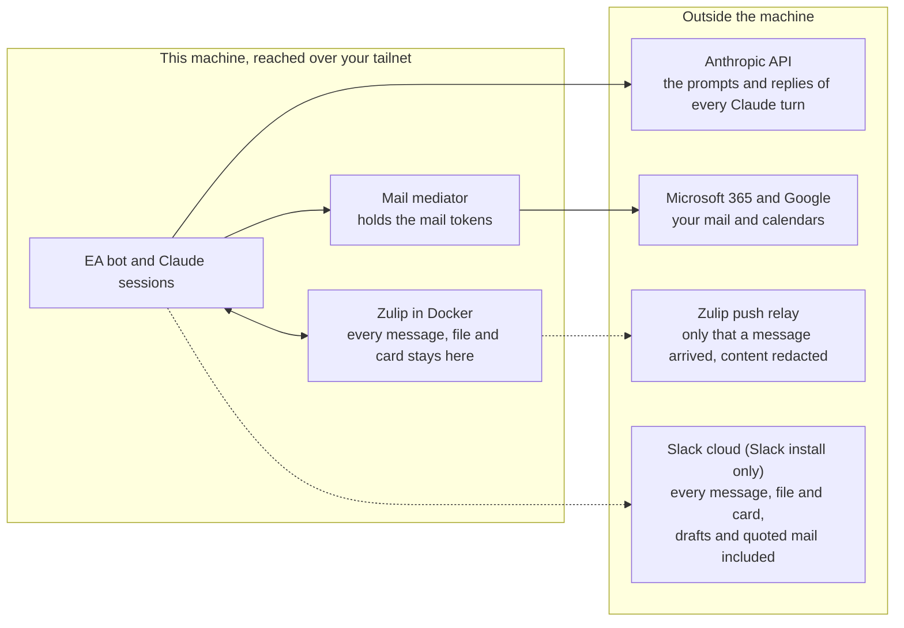

# Security Model

The EA bot can read your email, calendar, and Slack on your behalf. It
can draft emails and create calendar holds. But it **cannot send email,
create calendar invites, delete messages or events, or take any action
visible to others** without your explicit approval via a Slack button.
That send-block is not merely a policy the LLM is asked to follow: the
`ea-bot` user that runs the LLM cannot read the mail tokens at all, so it
holds no send-capable credential to misuse (see Defense Layer 5).

This document covers the threat model, autonomy tiers, code-enforced
gates, and what prompt injection cannot do. For the technical
implementation (data flow, prompt construction, tool whitelists), see
[ARCHITECTURE.md](ARCHITECTURE.md).

---

## Autonomy Tiers

Every action the EA can take falls into one of four tiers, configured
in `~/.ea/config/autonomy-tiers.json`:

| Tier | Approval | Example |
|------|----------|---------|
| **button-required** | Click Send/Create button in Slack (code-enforced) | Send email, calendar invite, delete email/event |
| **ask-first** | Post to Slack, wait for user approval | Draft email, scheduling response |
| **do-and-tell** | Do it, then notify on Slack | Archive email, calendar hold, LoR upload |
| **fire-and-forget** | Silent, included in next briefing | Update ledger, post summaries |

Button-required actions **cannot be promoted**. They are permanently
gated at the code level regardless of any prompt or configuration
change. The user can promote other tiers (e.g., promote scheduling
from ask-first to do-and-tell for a specific contact) by saying so in
Slack.

---

## Confirmation Gate (Code-Enforced)

Actions that interact with other people or are destructive require you
to click a Send/Create button in Slack. This is enforced at the code
level, not by prompt instructions, so it cannot be bypassed by prompt
injection. The LLM has no mechanism to click Slack buttons.

### Gated actions

| Action | Tier | Why |
|--------|------|-----|
| Send email | button-required | Sends as you to recipients |
| Calendar event creation (any) | button-required | Anything on your calendar goes through a Slack button, including personal holds with no attendees |
| Reschedule calendar event | button-required | May send updated invites |
| Delete calendar event | button-required | Removes from calendar, may notify |
| Schedule deferred send | button-required | Will send email at a future time |
| Delete email | button-required | Permanent, irreversible |
| Publish a site, push to Overleaf | button-required | Puts the EA's work in front of the public, partners or co-authors ("Public publishing" under Layer 3) |

### Ungated actions (safe to call directly)

| Action | Tier | Why safe |
|--------|------|----------|
| Create/edit/delete drafts | ungated | No external effect (drafts are disposable) |
| "Sent myself" (close obligation) | ungated | User confirms they already sent from Outlook; closes ledger item only |
| Archive email | do-and-tell | Moves to archive (reversible, not deletion) |
| Read/search email and calendar | ungated | Read-only |
| Read Teams DMs | ungated | Read-only. A SAFE verb of the teams-dms owner plugin (`graph_actions.py get-teams-dms`), run by the mediator from the owner's lock; not Graph |
| Create/move/delete an attendee-less hold on the EA-Managed calendar | ungated | The assistant's own rule store. Nothing on it has attendees, so nothing there mails anyone, and `calendar_reconciler.py` rewrites it every 30 minutes anyway. Enforced on both sides of the mediation boundary; every other calendar write stays button-required. Which calendar that is comes from the owner-private `calendars.json` (`owner_trust.py seed --calendar`), never from the resident's own `scheduling-preferences.json`; with no such file, no calendar write is ungated and the reconciler writes nothing. Only a process known to be the resident (its user, or a test's scratch tree) reads the config's id, as a hint; every other process, including an owner process the owner checks misclassify, reads the private file only (`mail_mediation.owner_side`). A move or delete there also needs the event to have no attendees and EA-Managed as its organizer. |

### How the gate works

When the LLM creates an email draft or prepares a calendar action, the
bot detects the new draft and posts a standardized confirmation block
in Slack:

> :lock: **Confirm send**
> **To:** recipient@example.com
> **Subject:** RE: Meeting next week
>
> [Full email body displayed here]
>
> [ :outbox_tray: Send ] [ Cancel ]

Clicking **Send** sends an interaction payload to the bot. The bot runs
Slack in Socket Mode, so the payload arrives on the websocket the bot
opened itself with its app-level token (`SLACK_APP_TOKEN`). The bot
checks no request signature (`SLACK_SIGNING_SECRET` is not used
anywhere); it trusts the payload because of the connection it came on.
It then checks that the clicker's user id equals `EA_SLACK_OWNER_ID`,
issues a one-time cryptographic token (30-minute TTL, consumed on use),
and executes the action.

**A send approval is bound to the content, not only to the draft id.**
`update-draft`, `attach-file`, `remove-attachment` and `create-reply`
(which revises the EA's existing draft in a thread) stay un-gated SAFE
verbs, so the LLM can change a draft after its card is up. Each Send and
Schedule card therefore carries a content fingerprint
(`preprocessor/draft_fingerprint.py`): a SHA-256 over a canonical form of
To, Cc, Bcc, From and Reply-To (addresses and display names, and a hash of
each raw header value, so two different malformed headers that parse
alike still differ), Subject, every body part, and the attachment list
(name, type, size and a SHA-256 of the bytes, or the attachment id where
the API gives no bytes). One module computes it for Outlook and Gmail.

- **Card post.** The bot computes the fingerprint owner-side from its own
  read of the draft (`graph_actions.py draft-snapshot`, or
  `get-gmail-draft --with-fingerprint`), the same read the card renders,
  and stores it in the owner-private registry (`draft-confirmations.json`)
  beside the card's message id. Nothing ea-bot writes feeds it. The card
  shows Bcc and Reply-To when there is one.
- **The card shows all of it, or offers no Send.** The fingerprint covers
  the whole body, so the card carries the whole body text: the authored
  part first, in full, then the rest of the body, collapsed in a Zulip
  spoiler block or split across Slack sections. The quote boundary is text
  the model can write, so the collapsed part is only text that ends an
  earlier sent or received message of the thread, as the owner-side read
  finds it (`mail_links.verified_quote_start`, run by `draft-snapshot` and
  `get_draft`); with no such match, or no thread to read, nothing is
  collapsed. Its label says only that it matches an earlier message. A Gmail draft with more than one plain or HTML text part shows
  every part. When the whole text cannot fit in one card (on Zulip the
  server's message limit, `max_message_length` from the register, less a
  margin; on Slack 50 blocks), the body is cut as before, and the card
  says so plainly and has no Send or Schedule button: the owner opens the
  draft in Outlook or Gmail and sends it from there. A click on an older
  card for such a draft, and the Send-all card, send nothing. A field
  value longer than a card shows (`card_text.field_limit`) is cut with a
  marker, and that card has no Send or Schedule button either. A Gmail
  card shows the From line, which the fingerprint covers.
  The text extract drops tag attributes, so the card adds a warning line
  with each remote resource the HTML loads when it is opened (image
  `src`/`srcset`, `background`, `<link href>`, CSS `url()` and `@import`;
  `cid:` and `data:` parts are inside the message and are not listed).
- **Click.** The bot reads the draft again and recomputes. On a mismatch,
  or when the registry row has no fingerprint or belongs to another card
  of the same draft, nothing is sent: the clicked card is replaced with a
  status line and a new card shows the current content.
- **Token.** `request-confirm --action send` refuses to mint without
  `--fingerprint`, and the one-time token stores it. `send-draft` and
  `send-gmail-draft` refuse a send token without one, and pass it to the
  library, whose process-local approval is bound to
  `(action, draft id, fingerprint)`.
- **Send.** `graph_client.send_draft` and `gmail_client.send_draft` read
  the draft once more right before the send and answer `"changed"`
  (nothing sent) when the fingerprint differs. A send with no fingerprint
  is blocked at both layers.
- **No edit between the check and the send.** The check and the send are
  two requests, and the mail mediator runs the resident's SAFE verbs at
  any time. One owner-side lock per draft (`preprocessor/draft_lock.py`,
  files in the owner-private directory) closes that window: the send path
  holds the draft's lock from its last read to the send, and the mediator
  holds it around every draft-changing verb (`DRAFT_EDIT_VERBS` in
  `mail_mediation.py`; `create-reply`, which finds its draft itself, holds
  the whole mailbox). An owner process that runs such a verb itself (the
  bot, the remote briefing, the scheduling pipeline) takes the same lock
  in the `graph_actions.py` or `gmail_client.py` it starts
  (`mail_mediation.hold_owner_draft_lock`); a child the mediator started
  leaves it to the mediator. An edit that arrives during a send waits, and after
  30 seconds is refused with nothing changed; a send that cannot get the
  lock sends nothing. Gmail's `drafts.send` names the draft by id. The
  installed discovery document describes the Draft `message` field only
  as the draft's content, not as what a send with it sends, so the send
  does not rely on it, and the lock carries the guarantee.
- **Card text is inert.** A subject, a display name, a location, a plugin
  item's fields, a commit subject and the body come from the model or from
  mail, and a frontend renders card text as markup. `botcore/botcore/chat/card_text.py`
  is the one place that makes such text inert: every field value renders on
  one line as literal text (a Zulip code span; on Slack with `&`, `<` and
  `>` escaped), invisible and reordering characters (bidi controls,
  zero-width and other format or control characters) show as `[U+202E]`
  marks, and a builder wraps each model or mail value it writes into card
  text in `card_text.inert`. On Zulip the title, fields and lines come
  first, then a rule, the action legend, a second rule, and the body last,
  as a quote in which Zulip's own link, mention and widget syntax is
  broken; no body can push the recipients or the legend out of view, close
  its quote or open a block that hides what follows, and a status line
  keeps the header before the card's own first rule. A labelled link in
  card text shows its target, and on Slack a special token (`<!channel>`,
  `<@U1>`, `<#C1>`) outside a span shows as typed. A plugin template
  fills each value as a span; a precision spec (`{x:.20}`) cuts the value
  before it is wrapped, with the visible marker, and that card has no
  approve button. On Slack the buttons are real elements, so
  the body cannot imitate them.
- **Send all.** The Send-all card lists each draft's recipients and
  subject, from the same read as that draft's own card, and binds the
  fingerprint each draft had when it was listed: a draft changed since is
  not sent by it and gets a new card. It lists at most ten drafts; a
  larger run gets no Send-all card, and a Schedule card's draft is never
  on one.
- **Card refresh.** A revised draft gets a new card when the
  draft-events journal (`~/.ea/state/draft-events.jsonl`) records the
  change. That journal is ea-bot-writable, so it only keeps the cards
  current; it is not the guard. A draft changed with no journal record,
  or with a forged one, still fails the fingerprint check at click time.

The same pattern applies for calendar invites (Create/Cancel),
rescheduling (Reschedule/Cancel), and deletion (Delete/Cancel): the click
does what the card showed, and the card shows everything that reaches
other people.

- **Create.** The card shows every attendee and optional attendee, and
  the whole event text as the calendar gets it, the join block an online
  invite adds included. The payload behind the button is in the
  owner-private store (`button-payloads.json`), so nothing ea-bot writes
  after the card is up changes what the click creates. When the payload
  could not be stored and the inline button value had to drop the text,
  the card has no Create button.
- **Reschedule and Delete.** The bot reads the event itself
  (`graph_actions.py get-event`, or `google_calendar_client.py get-event`,
  a verb ea-bot cannot call) and builds the card from that read, never
  from the staged labels: the title, the time, the organizer, whether the
  owner organizes it (so a delete mails a cancellation, which the card
  says), the series, and every attendee. The staged change shows as a
  difference: the new time, the attendees added and removed, and a staged
  `subject` that differs from the event's title as a rename. The payload
  keeps a fingerprint of the read (every field the card shows, the event
  text by hash; attendee responses left out). At the click the bot reads
  the event again; when the read fails, the payload has no fingerprint,
  or the fingerprint differs, nothing is changed, the card is replaced
  with a status line and a new card shows the event as it is now.
- **Shown in full, or no button.** Link markup (`<url|label>`,
  `[label](url)`) shows its target. A card that cannot show all of it in
  one message (Zulip's message limit, or Slack's 50 blocks and section and
  field sizes) is posted short, says so, and has only Cancel or Keep. So
  is a card with a field value longer than the frontends show
  (`card_text.field_limit`, the limit they cut at): a cut Subject,
  Location, Repeats, Rename or Organizer withholds the button. Each
  attendee and each name on a card line is an inert span, so a newline
  or markup in a name cannot start a line that reads as a field.
- **The time shown is the time sent.** A staged time with an offset is
  converted once, owner-side, to the user's zone and kept with no offset
  (`_event_time_local`); the card shows that local time and the payload
  holds it. The gated verbs send it with the user's zone beside it, and
  `graph_client` converts any time that still carries an offset the same
  way, since Graph reads `dateTime` in the `timeZone` sent with it.

**On Zulip** there are no buttons. The confirmation card posts in the
owner's private `ea-dm` stream, under a topic of its own, with a
one-time code and one reaction chip per action, which the bot adds
itself. The owner confirms by tapping a chip (the bot's own reactions
never count) or by replying with the code in the card's own topic (a bare code picks the
primary action; any other action needs its word first, for example
`cancel <code>`). A code typed anywhere else, another card's topic
included, is an ordinary message. The
reaction or code reaches the bot through the bot's own event queue,
which it registered with its API key (`ZULIP_API_KEY`). The bot drops
every message and reaction that is not the owner's
(`chat.zulip.owner_user_id`) before it looks up a code, and it never
counts its own messages or reactions. It refuses to start when the owner
id is its own user id (on Slack, `EA_SLACK_OWNER_ID` equal to the bot's),
and a card action by the bot's own id is refused whatever the setting. A code works once, and the same
48-hour stale-card guard as on Slack refuses an old card. After that
the flow is identical: one-time token, gated verb, status line.

**What leaves the machine.** The gate is the same on both platforms;
the custody of the conversation is not. On Zulip the server runs in
Docker on the EA's machine and is reached over the owner's tailnet, so
every message, file and card body (draft email text, quoted mail) stays
on that machine, and the only chat traffic that leaves is the push
relay's "a message arrived" notice with the content redacted. On Slack
all of it is stored by Slack. That is why Zulip is the recommended
platform and Slack is the alternative for an owner who would rather not
run a server and accepts that custody.



---

## Defense-in-Depth Layers

Security is enforced through five independent layers. Bypassing one
does not compromise the others.

### Layer 1: Process isolation (OS-enforced)

The LLM subprocess runs as a dedicated `ea-bot` Unix user, not as
your account. Standard filesystem permissions prevent it from
modifying source code or tampering with config files. The bot process
runs as you and retains full access.

| Path | ea-bot access |
|------|--------------|
| Owner services' code (`/opt/ea-system`) | Read only (root-owned parent) |
| Lanes' code copy (`/home/ea-bot/ea-system`) | Read only files, but in ea-bot's home (see below) |
| Config (`~/.ea/config/`) | Read + write (ea-bot-owned) |
| State/ledger (`~/.ea/state/`) | Read + write (shared group) |
| Auth tokens (`~/.ea/auth/`) | No access -- owner-owned, `0600` or `0660` in the owner's own group (see Layer 5); on Linux a mount point (bound onto itself), which it cannot rename ("The auth directory is pinned") |
| Owner-private dir (`~/.ea-private`: secrets, chat settings, card stores, owner logs) | No access (owner home, `0700`) |
| Owner's home (`/home/<you>/`) | No access (private) |

Everything under `/home/ea-bot`, `~/.ea` included, is **ea-bot space**:
ea-bot owns the directories above every path there, so a path there is
not trustworthy to an owner process even when the file itself is
owner-owned. The rules owner processes follow for it are in "Owner trust
rules" below.

**Mandatory, code-enforced.** `ea-chat-bot.py` and `run-agent.sh`
refuse to start unless the `ea-bot` Unix user exists. There is no
opt-out env var, no "skip on macOS" fallback, no dev mode that
disables isolation. Any fail-open path would invalidate every
guarantee in the "What prompt injection cannot do" section below, so
the architecture does not include one. If you see a startup log line
that is *not* `isolation: ENFORCED ...`, the bot is not actually
running and needs the ea-bot user created.

Setup:
- Linux: `sudo bash scripts/install/setup-ea-user.sh`
- macOS: `sudo bash scripts/install/setup-ea-user-macos.sh`

See [SETUP.md](SETUP.md#the-service-account). macOS user management uses
`dscl` instead of `useradd`, but the resulting permission model is
identical — isolation works the same way on both platforms.

### Layer 2: Tool restriction

The LLM can only call whitelisted Python scripts via `--allowedTools`:
`graph_actions.py`, `gmail_client.py`, `google_calendar_client.py`,
`scheduling_engine.py`, `fetch_url.py`, `email_to_pdf.py`,
`doc_text.py` (reads only files under the EA's document folders),
`doc_write.py` (writes only .docx and .xlsx files under them; a sheet
value starting with `=` is written as text, never as a formula),
`poll_filler.py`, `compile_letter.py`, `ledger.py`, `project_store.py`,
and `style_profiles.py`, plus the scripts of an enabled plugin, one rule per
entry point (docs/plugins.md). Every lane builds those rules from
`plugin_registry.py`: a v2 plugin's accepted templates over the files the
owner's lock hashed, and only while the files match it; a v1 plugin's files
on disk. A permission rule's `*` crosses `/`, and the lanes may write a
plugin's `state/` dir, which the integrity hash and the persistence digest
skip, so no rule is a glob on a plugin directory and none names a file
under a state dir. It cannot run
arbitrary Python, import libraries directly, or execute unwhitelisted
commands.

**The allow list is a boundary because every headless lane runs in
`dontAsk` mode.** ea-bot's Claude settings set `"defaultMode": "auto"`,
where a tool outside `--allowedTools` goes to the auto-mode classifier
and can be approved. Every `claude -p` command line therefore passes
`--permission-mode dontAsk`, under which the CLI refuses any tool the
allow list does not name. The Python lanes (the chat, room and DM lanes,
the remote arm, the context export, the owner tools and the arm backtest)
take it from `claude_cli.apply`, which raises on a command that asks for
another mode or for bypass; run-agent.sh and run-plugin.sh write it into
their own command line. `dontAsk` still honors the allow rules and runs
the hooks in ea-bot's `~/.claude/settings.json`, so the boundary audit
warns when that file sets hooks, allow rules or a bypassPermissions
default. The interactive resident pane and the ea-bot shell run in
bypass on purpose (below).

**Connectors load only where a lane grants one.** The account's claude.ai
connectors (task trackers, docs, design, CRM, as well as Gmail, Calendar and
Drive) load into any run that does not pass `--strict-mcp-config`. A lane
that grants no connector tool passes it, and its environment sets
`ENABLE_CLAUDEAI_MCP_SERVERS=false` as well (`claude_cli.no_connector_env`):
the chat lanes when `_needs_mcp` says no, the remote arm, the context
export, the plugin runs whose manifest grants no connector verb, the
cron audit's tool-less verdict and the owner tools. A lane that keeps the
connectors (the chat lanes with MCP on, the cron agents) reaches only the
read verbs its allow list names, since `dontAsk` refuses the rest. For the
bypass lanes the shared deny list names every connector no lane uses by
server, and the write verbs of any connector by glob
(`mcp__claude_ai_*__*_create*` and the like).

**MCP grants are enumerated, never wildcarded.** Until 2026-08,
`run-agent.sh` granted `mcp__claude_ai_Gmail__*` and
`mcp__claude_ai_Google_Calendar__*`. Those globs also matched
`send_message`, `reply`, `forward`, `trash_message`, `trash_thread`,
`create_event`, `update_event`, `delete_event` and `respond_to_event` —
none of which is covered by the confirm-token gate (it guards CLI verbs)
or by mail mediation (it only sees Bash shell-outs). Every cron agent
could therefore send or delete mail and cancel meetings with no `:lock:`
button. Each grant is now spelled out: 5 Gmail read/draft verbs, 4
Google Calendar read verbs (`run-agent.sh` only), 3 Slack read verbs.
The same list appears in `run-agent.sh` (`MCP_GMAIL` / `MCP_GCAL` /
`MCP_SLACK`) and `ea-chat-bot.py` (`_MCP_TOOLS`); the resident pane
(`scripts/ea-resident-inner.sh`) runs in bypass mode with no allow list,
so for it the deny list below is the only tool-level layer.

The `--allowedTools` glob for `graph_actions.py` is coarse
(`Bash(python3 .../graph_actions.py *)`) because it has to cover dozens
of legitimate subcommands. A complementary `--disallowedTools` list
denies the dangerous subset by name regardless of how the LLM
constructs the command:

- `send-draft`, `send-gmail-draft`
- `create-event`, `update-event`, `delete-event`
- `schedule-send`
- `request-confirm` (denied because it would otherwise let the LLM
  mint its own confirmation token and chain into `send-draft`)
- `gmail_client.py send-draft` (Gmail's own send path)
- `scheduled_sends.py add` (a send lever wearing a delay: it parks a
  draft the `*/5` cron later sends. The approved path is
  `graph_actions.py schedule-send` behind its confirm token.)
- `python3 -c *graph_client*` and the same for `graph_actions`,
  `gmail_client`, `google_calendar_client` — a verb denial matches a
  command line, but importing the module and calling its function does
  not, so the import route is denied structurally
- every Gmail MCP send/delete verb and every Google Calendar MCP write
  verb, plus the three Slack MCP posting verbs
- `site_tools.py publish` and `overleaf_tools.py push`, which run only
  from the bot after the owner's click ("Public publishing" under Layer
  3), and raw `git push` in its plain form, behind a global option (`-c`,
  `-C`, `--git-dir`, `--work-tree`, any `--option`), as `send-pack` or the
  `git-remote-https` helper, as `subtree push`, and through an alias set
  for the call or in config. These rules match a spelling, so they are a
  backstop, not a boundary: a shell spells a push in more ways than a list
  holds. The boundary is that no lane grants raw git and the git tools
  push only from the bot after the owner's click

**The cron lanes have no web tools of the model's own.** `run-agent.sh`
leaves `WebFetch` and `WebSearch` out of its allowlist and adds both to
its `--disallowedTools`, and `run-plugin.sh` denies them too (no manifest
can grant them). The denial is a second layer under the lanes' `dontAsk`
mode, kept because a deny rule holds whatever the mode, and it reaches
subagents. A scheduled run reads untrusted mail with no one
watching; the page reads it needs go through `fetch_url.py`, which logs
every request. The chat and room lanes keep both tools; the bot records
each call (below, "Not claimed").

`google_calendar_client.py create-event` is deliberately NOT denied
(user decision, 2026-08-22): it is the EA-Managed auto-hold carve-out
described under Layer 5. Both the shim and the owner-side mediator enforce
`--calendar-id == EA-Managed` and no attendees, and the verb structurally
cannot invite anyone — `create_event()` takes no attendee parameter
(pinned by `tests/test_gcal_ea_managed_writes.py`). Every other Google
calendar stays GATED for the resident, and owner-side the client itself
requires a one-time `create_google_event`, `update_google_event` or
`delete_google_event` token for it, which only the Create, Reschedule or
Delete button mints. The carve-out refuses any request that carries
`--confirm-token`. The library functions check again on their own
(`create_event`, `_patch_event`, `_remove_event`): a write to any calendar
but EA-Managed needs a process-local approval the CLI mints after it has
consumed the button token, bound to the account, calendar and title or
event id and spent on first use. An un-gated move or delete on EA-Managed
reads the event first and goes ahead only when it has no attendees and
EA-Managed organizes it (`ea_managed_event_refusal`), so a meeting someone
invited that calendar to is not the EA's to change. On Outlook,
`clear-hold` likewise counts an event without `isOrganizer: true` as not
the user's.

The deny list lives in `scripts/disallowed-tools.txt` and is loaded by
every Claude invocation path: the Slack bot, `run-agent.sh` (cron-driven
agents), `run-plugin.sh` (plugin runs), `scripts/ea-bot-shell.sh`
(interactive shells for the operator), and
`scripts/ea-resident-inner.sh`. Both `python3 *graph_actions.py <cmd>`
and bare `*graph_actions.py <cmd>` patterns are denied to cover
invocations with or without an explicit interpreter prefix.

This list is the ONLY enforcement layer for the resident lane, which
runs Claude with `--dangerously-skip-permissions`: there the allowlist
is moot and only `--disallowed-tools` still bites. Anything omitted from
the file is reachable from that lane.

The chat and cron lanes grant `Write` and `Edit` only as `Edit(path)`
rules on the paths the EA writes (`preprocessor/resident_write_paths.py`:
state, docs, letters, research, receipts, exports, plugin state, the tier
file, the deck, site, doc-review and Overleaf clones, `/tmp`). The shared
deny list refuses the file tools on ea-bot's Claude settings, CLAUDE.md
files, user skills, agents, commands and plugins, its systemd user units
and its shell rc files, in every lane, the resident pane included. It also
refuses them on the other files a later session loads
(`resident_write_paths.STEERING_RULES`): `~/.claude.json`, auto-memory,
rules and output styles, a project's `.claude/settings*.json` or
`.mcp.json` in any directory, the CLAUDE.md and CLAUDE.local.md files in
the docs and research folders, and the lane directories. It also
refuses them on every `.git` directory and `.gitattributes` file
(`resident_write_paths.DENIED_RULES`), since the clones sit inside the
write paths. On source files the file tools also fail at the OS level,
because `ea-bot` lacks write permission.

MCP tools are conditionally enabled per-message on the per-thread lane
-- when the task can be handled via Bash tools alone (scheduling, polls,
drafts, ledger ops), MCP servers are not started, reducing attack
surface.

**`fetch_url.py` polices its own network access.** It is the EA's only
general-purpose outbound-network primitive and the URLs it receives come
out of untrusted email, so it enforces an SSRF policy in code (B8-01):

- only `http` and `https` schemes;
- the host must resolve to a globally routable address. Loopback,
  RFC1918, link-local (including `169.254.169.254` and `fd00:ec2::254`),
  CGNAT/Tailscale `100.64/10`, multicast, reserved, unique-local IPv6,
  and the IPv4-mapped / 6to4 / Teredo forms of any of those are refused
  by `_classify_address()`;
- redirects are walked ONE HOP AT A TIME with `allow_redirects=False`,
  and every hop is re-validated, so a public URL cannot bounce the
  fetcher into an internal service (max 5 hops);
- DNS is PINNED to the validated addresses for the life of the request
  (`pinned_dns()`), so a rebind between check and connect cannot land
  somewhere else;
- the Playwright JS-rendering path installs a route guard that
  re-validates every sub-request the page makes and aborts the ones that
  fail;
- raw HTML is capped at 2 MB;
- `--save-image` is the one mode that writes: the same policy and log,
  then only a PNG, JPEG, GIF or WebP by its first bytes (never SVG, which
  can carry script; never a page or an archive), at most 15 MB, into a
  NEW file (`O_EXCL | O_NOFOLLOW`, mode 0644, a plain file name) in a
  folder that resolves under the decks' workspace or `~/.ea/state`. A
  GET with a URL was already possible, so saving the body opens no new
  way out; the log records its size, type, SHA-256 and destination;
- every fetch, block and error is appended as one JSONL record (URL,
  resolved IP, method, outcome) to `~/.ea/logs/fetch-url.log`.

The other modules that reach the network log there too
(`preprocessor/outbound_log.py`): `booking_link.py`'s cal.com and Calendly reads,
`list_digest.py`'s redirect walk (each HEAD hop), and `poll_filler.py`'s
reads and submissions (host, poll id, the fields sent and their sizes). An
owner process writes the same records to the owner-private
`outbound-owner.jsonl` instead. `poll_filler.py fill-poll` puts only the
user's configured display name on a poll and refuses any other `--name`.
`email_to_pdf.py` renders with scripts off, the browser context offline and
every request the mail's HTML makes aborted, so a receipt PDF fetches no
image or tracking pixel; the count it refused goes on the log.

### Layer 3: Token-gated commands (defense-in-depth)

`send-draft`, `create-event` (always — including personal holds with
no attendees), `update-event`, `delete-event`, and `schedule-send`
require a one-time cryptographic token. Tokens are:

- Generated only by the bot's Python code when the user clicks a
  Slack button
- Stored in `~/.ea/state/pending-confirmations.json` with file locking
- Valid for 30 minutes, consumed on use (one-time)
- Validated at the CLI layer (`graph_actions.py`), which then mints a
  process-local approval for the library layer (`graph_client.py`)
- For a send, bound to the content fingerprint of the draft the owner
  reviewed; the send verb re-reads the draft and refuses changed content
  (see "A send approval is bound to the content" above)

The LLM never sees or generates tokens. The `request-confirm`
subcommand that mints tokens is denied to the LLM at Layer 2 above, so
the LLM cannot mint its own token.

**The state directory is not a trust anchor.** `~/.ea/state` is owned
by `ea-bot` and group-writable (setgid `ea`), so the LLM user can read,
rename or replace any file in it, `pending-confirmations.json`
included. What stops misuse is that a gated verb runs only with a live
token the bot's Python mints after an owner action, that the CLI and the
library each validate it, and that the mail tokens sit with the owner-side
mediator (Layer 5). A file ea-bot writes in the state directory can
make a token lookup fail; it cannot make a send happen.

The bot's own confirmation bookkeeping lives out of ea-bot's reach, in
the private directory `/home/<you>/.ea-private/` (`EA_PRIVATE_DIR`,
owner-only `0700`; `/home/<you>` itself is closed to ea-bot). It holds the
card registry (`chat-cards.json`: each live card, its code and its
action values), the Zulip event-queue position (`zulip-queue.json`),
the two button stores (`button-payloads.json`, `draft-confirmations.json`)
and the Slack webhook file. A reader of either button store falls back
once to the old path under `~/.ea/state` and migrates the file.

**The two layers really are independent now.** The CLI used to hand the
library the literal string `"pre-approved:<token>"`, which
`_validate_library_token` accepted on the prefix alone — so the second
gate was satisfiable by any string from any caller, including one read
out of an ea-bot-writable file (audit B1-01 / B2-02 / B2-05). The CLI
now calls `graph_client.issue_inprocess_approval(action, identifier)`
after it has validated and consumed the real token. That mints a random
value bound to `(action, identifier)`, held only in that process's
memory and invalidated by its first use, so nothing on disk can satisfy
the library gate.

> **Known open exception (audit B2-05).** `graph_client.update_event()`
> consults the gate only when `attendees is not None`. A direct library
> call that changes a time but not the attendee list is not blocked at
> the library layer. The CLI layer still refuses `update-event` without
> a token, and `Bash(*graph_actions.py update-event *)` plus
> `Bash(python3 -c *graph_client*)` are both on the deny list, so the
> LLM has no route to it — but the "independently at both layers"
> property does not hold for that one call. Open item.

**Deferred sends carry a second, longer-lived credential.** A one-time
token expires in 30 minutes; a scheduled send may fire days later, and
the queue file (`~/.ea/state/scheduled-sends.json`) sits in an
ea-bot-writable directory, so the file proves nothing. `schedule-send`
therefore signs the entry with an HMAC-SHA256 over
`(draft_id, send_after, fingerprint)` (payload version 2), keyed by
`~/.ea/auth/scheduled-send-hmac.key` (owner-only `0600`, minimum 32
bytes). The fingerprint is the content the owner reviewed on the
Schedule card; `schedule-send` takes it from the one-time token, checks
that the draft still has it, and the queue entry stores it beside the
signature. The `*/5` cron re-verifies that signature before it touches
the Graph token, then reads the draft again and sends only when its
content still has the signed fingerprint; `send_draft` checks once more
right before the send. A draft changed after the click is dropped with an
alarm and nothing is sent. Verification is **fail-closed**: a missing
key, an unreadable key, or a short key means nothing sends. An entry
ea-bot writes, edits, re-times, copies onto a different draft, or
re-points at other content fails verification and is dropped with a
Slack alarm; the legacy bare `pre-approved:` marker fails too. A
version 1 entry (`pre-approved:v1:`, signed before content binding) binds
no content, so the cron drops it with an alarm that says to schedule it
again, even when its MAC is valid. Both checks that can fail without user
involvement (ISO parse, key readable) run BEFORE the one-time token is
consumed, so an operational fault never burns an approval.

> **Known open item, found 2026-08-22 while reconciling these docs.** The
> HMAC guarantee assumes `ea-bot` cannot substitute the key. On the
> current install it can. `scripts/install/setup-ea-user.sh` leaves `~/.ea/auth` as
> `ea-bot:ea 750`, and Unix write permission lives on the DIRECTORY, not
> the file. So `ea-bot` cannot *read* an owner-only `0600` key sitting there,
> but it can unlink that key and create its own — and then mint
> signatures the owner's cron accepts. Deleting the key is harmless (it
> fails closed and the send is held); replacing it defeats the control.
> The same reasoning applies to every other owner-owned file in that
> directory. Closing this means making the auth directory
> non-`ea-bot`-writable, which is a change to `scripts/install/setup-ea-user.sh`.

**Public publishing.** `site_tools.py publish` (a GitHub Pages site, or a
private status site that partners read) and `overleaf_tools.py push` put
the EA's work in front of other people, so they are button-required too
(`preprocessor/publish_gate.py`). The EA commits in its clone and stages
`~/.ea/state/pending-publish.json` naming the target and one commit. The
bot claims the file, runs the tool's read-only `preview` as ea-bot (from
the bot's own deployed tree, with a clean environment), and posts a card
with the files the commit changes, the remote head it lands on, the first
added lines of each file (with counts of the rest), and a scan of the
added lines for email headers, email addresses, phone numbers and
message-id-like strings; the scan runs owner side on the diff text. For a
site, the card names the repository; its reach comes from GitHub's
anonymous answer for that repository, and its title and address from an
owner-private `~/.ea-private/sites.json` when the owner keeps one
(github.json is ea-bot space, so the card says when they come from there,
and a sites.json that names another repository stops the card). The click
mints a one-time token bound to {target, commit, base}, plus the
repository for a site and the project id for an Overleaf push, and the
bot runs the gated verb as ea-bot
with the token in `EA_CARD_TOKEN`. The verb refuses unless the remote head
still equals the base the card showed, the clone still names the project
the card showed, and the token takes, then pushes exactly that commit
(never a force). A refusal before the push leaves the token unspent; a
token works once.

The clones are ea-bot space, so every git call of `site_tools.py`,
`doc_review.py` and `overleaf_tools.py` goes through one runner,
`preprocessor/safe_git.py`. It clears `GIT_*`, turns system and global
config off, reads attributes from the empty tree (no `.gitattributes`
applies), overrides the single keys that name a program or a diff prefix
(hooks, fsmonitor, pager, editor, ssh command, credential helper, gpg
programs, diff prefixes), and refuses a clone whose `.git` is not a plain
directory, whose `.git/config` holds a key outside a short allowlist
(no filters, diff or merge drivers, includes, URL rewrites, push URLs,
proxies or aliases), or whose `.git/info` holds an attributes or grafts
file. Fetch and push go to a URL built from owner-trusted config
(`github.json` for a site and the review repo, the bound project id for
Overleaf), never the clone's remote. The preview diff the card shows and
scans runs with `--no-textconv --no-ext-diff --text --src-prefix=a/
--dst-prefix=b/`, so no attribute hides a change as binary.
The tokens use plugin_cards' store under a card id no plugin manifest can
declare: on a mediated install the bot mints into the owner-private
directory and the verb's check goes through the mediator's `plugin_cards
consume-token`, so no file ea-bot writes passes it. The limit: the GitHub
and Overleaf credentials sit in ea-bot space, so the gate binds the EA's
tools, not the credentials. A lane with raw git or a raw HTTP client and
the token could push without it; the lanes grant neither, the deny list
names `git push`, and the resident pane (bypass mode) is bounded by that
list alone. `doc_review.py` (the private review repo) stays un-gated.

### Layer 4: Interactive confirmation (owner action on the bot's own connection)

On Slack, the bot runs Socket Mode. Interaction payloads arrive on the
websocket the bot opened with its app-level token, and the bot verifies
no signature (`SLACK_SIGNING_SECRET` is unused). The payload names the
Slack user who clicked; the bot checks that id against
`EA_SLACK_OWNER_ID` before it does anything else. The anchor is
therefore the connection plus the owner check: only Slack can put a
payload on that socket, only a user in the workspace can click, and
only the owner's click passes. The LLM cannot reach the socket, because
it cannot read `SLACK_APP_TOKEN` (`~/.ea-private/secrets.env`, owner `0600`).

On Zulip, the anchor is the bot's event queue, registered with the
bot's API key, plus the same owner check on the sender of each reaction
or code, and a reaction or code by the bot's own id never counts. Codes
are single-use, count only in the card's own topic, and the 48-hour guard
bounds a card's life. The LLM cannot read `ZULIP_API_KEY`, cannot post as the owner, and
its own messages (which the bot posts for it) are dropped before the
code lookup.

The real barrier under both is Layer 1: the LLM runs as `ea-bot`, holds
no chat credential, cannot mint confirmation tokens and cannot run the
gated verbs.

### Layer 5: Token custody (mail mediation)

Layers 1-4 keep the LLM from *invoking* a send. Layer 5 removes the
*capability* underneath it. The Microsoft Graph and Google OAuth tokens in
`~/.ea/auth/` are the owner's: `0600`, or `0660` in the owner's own
group, which the owner checks accept only while that group holds no other
user. So the `ea-bot` user that runs the LLM cannot read them and cannot mint a Graph/Gmail access token at all. A
send therefore has no credential to use, independent of any prompt or verb
gate.

The resident still needs to read mail and create drafts, which need those
tokens. So the SAFE verbs (search, read, draft, reversible inbox ops) are
transparently forwarded to a owner-side systemd service, `ea-mail-mediator`,
which holds the tokens and executes them on ea-bot's behalf via a request
queue in `~/.ea/state/mail-queue`. GATED verbs (send, send-gmail-draft,
schedule-send, calendar create/update/delete) are refused -- and refused
**twice**: at the ea-bot shim (`preprocessor/mail_mediation.py`) and again,
server-side, at the mediator (`preprocessor/mail_mediator.py`), which
re-validates every request against a default-deny allowlist. So even a
resident that bypasses its own shim and writes a raw `send-draft` request
straight into the queue is refused by the service that actually holds the
tokens.

**Path confinement.** Every file-path flag (`--output`, `--body-file`,
`--path`, `--file`, `--screenshot`, `--attachment`, `--out`, `--dest`,
`--input`) must resolve inside `~/.ea/uploads`, `~/.ea/receipts`,
`~/.ea/state` or `/tmp`, and a symlink whose real target leaves those
roots is rejected. `_file_args()` parses BOTH argv spellings argparse
accepts — `--body-file /path` and `--body-file=/path`. Matching only the
bare token (the behaviour before 2026-08-22) let the `=` form skip
confinement completely on BOTH sides of the boundary, since the owner-side
mediator re-runs the same function; an attached `=` value was executed as
the owner with no path check at all (audit B2-01, fixed). The mediator also
forwards a length-capped, charset-restricted `EA_RUN_ID` into the child
environment so mediated draft mutations are attributed to the dispatch
that caused them.

**Option spellings.** Path confinement matches a file flag by its exact
spelling, so no other spelling may reach a file option. Every mediated
parser and subparser sets `allow_abbrev=False`: `--body-f /path` is an
unrecognized argument, not `--body-file`. Both halves of the boundary also
refuse a request that carries any option token that is not an exact option
of that verb's parser, with or without `=value`, and a short or alias
spelling of a file option (`mail_mediation.option_error`, run first in
`sanitize()`). The option set comes from the source of the tool the
mediator executes, so it cannot drift from the parser, and
`tests/test_mail_mediation.py` checks it against the parser argparse
builds. An owner plugin's parser is not readable there, so for a plugin
verb a strict prefix of a file flag is refused. A request that gives an
option twice is refused too, unless that verb's parser appends it
(`action="append"`, `extend` or `count`, read from the same source):
argparse acts on the last use, and a check that read another use could
approve one `--calendar-id` while the child wrote another.
`tests/test_mediator_argv_tripwire.py` sets every single-value option of
every mediated verb twice.

**The verb that runs is the verb that was checked.** The allowlist reads
the request's verb field and argparse takes the subcommand from argv, so
`argv[0]` must equal that verb; nothing then comes before the subcommand,
so no top-level option can be set. The mediator also passes the checked
verb to the child (`EA_MEDIATED_VERB`), and each mediated tool's own parser
exits 2 unless it resolved that verb with every top-level option at its
default (`mail_mediation.check_child_parse`). `gmail_client.py send-draft`
consumes the same one-time Send token as `graph_actions.py
send-gmail-draft`, and `recolor-tokens` writes the EA-Managed calendar
only, so no Gmail send or calendar write rests on the verb check alone.
`tests/test_mediator_argv_tripwire.py` checks the outcome with each tool's
`build_parser()`.

**The mediator's sandbox.** `ea-mail-mediator.service` runs with
`ProtectSystem=strict` and `ProtectHome=read-only`. It writes only to
ea-bot's home (the queue, the token files and the allowed roots), `/tmp`,
the owner-private directory and its staging root; the owner's `~/.ssh` and
`~/.gnupg` are hidden. `NoNewPrivileges=` and the options that imply it stay
off, because the resident-side file copies run through `sudo -u ea-bot`.
`deploy/mediator-sandbox.sh` holds the lines; `enable-mail-mediation.sh`
writes them into the unit and `harden-permissions.sh` into its drop-in.

**File transfer with the resident's own access (audit B2-03, closed).**
The mediator stages every file argument through an owner-private
directory, so the child only ever opens private copies. The bytes of a
resident-named source are read, and the bytes for a resident-named
destination are written, by an isolated child running as ea-bot
(`python3 -I ... --confined-io`), so no path reaches beyond what ea-bot
could read or write itself. Whether that child can run is decided once
per process from the sudoers policy (`sudo -n -l`), which ea-bot cannot
influence. When it can run, any outcome other than a framed success
refuses that file (fail closed). Only a host whose sudoers does not allow
the child falls back to the in-process path (O_NOFOLLOW confinement as the
owner), and the audit log records `RESIDENT-IO-FALLBACK`. The chat outbox
follows the same rule: the bot reads a staged file as ea-bot into a
private copy and uploads the copy. So does a file a reply names
(`reply_files.py`): the bot reads it as ea-bot, with the turn-start and
size checks made on the descriptor it reads, and with no owner fallback.
A reply can bring the owner only a file ea-bot could post itself with
`chat_upload.py`.

Mail mediation is installed by the mandatory hardening (`scripts/install/setup-ea-user.sh`
runs `deploy/enable-mail-mediation.sh`); that same enabler is the ops tool
(`--status`, `--rollback`). The enabler locks the tokens first and no
failure, check or rollback gives one back to ea-bot: a broken forward path
or a rollback leaves the resident with no mail, never with a token. The
setup scripts treat the auth directory the same way on every run
(`deploy/tree-custody.sh`): it and everything in it go to the owner before
any other step, and are never ea-bot's, not for a moment, so a re-run is
safe on a mediated install. Root adopts nothing there. An auth directory
that neither the owner nor root owns stops the run with the recovery steps
(move it aside, make a new one as the owner, put tokens back only from the
owner's own backup or sign in again, make a new scheduled-send key). An
entry the owner does not own, or a file with more than one link, moves
into an owner-only `auth/.quarantine-*` directory with a note, never
chowned: the owner checks accept any file the owner owns, so a chown
would turn a key ea-bot knows into a trust anchor. The first move of a
fresh install is no exception, since its auth/ comes from the owner's
home.

**The auth directory is pinned.** `~ea-bot/.ea` is the resident's own
directory, and the owner of a directory may rename any entry in it, so
without more the resident could move `auth/` (or `.ea` itself) aside and
leave an empty one: the owner checks refuse that directory, so the result
is no mail, not a planted token. On Linux `deploy/pin-auth-dir.sh` (root;
`--status`, `--rollback`, `--print`) removes even that: `~ea-bot/.ea` and `~ea-bot/.ea/auth` are each
bind-mounted onto themselves. The kernel refuses to rename or remove a mount
point and `/home` is root's, so nothing from `/home` down to the token
files can be moved by the resident. Nothing moves and every path stays as it
was, so no code, plugin or unit changes. The script checks the result by trying both
renames as ea-bot, and the daily audit warns when either mount is missing
(`check_auth_pinned`). macOS has no such mount here, and keeps the
no-mail residual. Design and rollout:
[mail-mediation-spec.md](mail-mediation-spec.md).

**Deck hosting rides the same boundary.** A deck plugin builds slide
decks in the EA's own workspace (`/home/ea-bot/presentations/`) and the
core serves them on the owner's tailnet. The owner's presentations tree is
a read-only bind mount at `/srv/ea/presentations` (under a `root:ea 0750`
directory, so only the `ea` group can traverse it); `/home/<you>` itself
stays closed. The static file server runs as ea-bot on a loopback port in
the EA's own range (3050-3069). The one step with reach beyond the host,
the `tailscale serve` route, is a tailscaled write that only the operator
user (the owner) may make, so it is a mediated tool: `preprocessor/deck_serve.py`
forwards through `mail_mediation` and the mediator re-runs it as the owner, where
it re-validates (plain slug; EA port range; the target port's LISTEN socket
must be owned by ea-bot, read from `/proc/net/tcp`; a path already served
by another user is never taken over; no Funnel may be enabled on the node)
and only then calls `tailscale serve --set-path=/<slug>`. There is no
funnel verb on either side, `scripts/disallowed-tools.txt` denies
`tailscale funnel` and `serve reset` for every lane, and the owner's
`build-deck.sh` reaches tailscale only through the PATH shim
`scripts/deck-bin/tailscale`, which maps its two writes onto those verbs
and refuses the rest. Its closing check (`curl https://<node>/<slug>/`)
goes through `scripts/deck-bin/curl`, since the resident's network policy
refuses it tailscale serve: the shim asks the mediated `deck_serve.py
status` whether the route is the resident's and then fetches the deck's
loopback port. A deck the EA stages is therefore reachable from the
owner's tailscale devices and nowhere else; the PDF is how one leaves the
tailnet. Installed by `deploy/enable-deck-builder.sh` (root: mounts,
linger for ea-bot so servers outlive a bot restart, mediator restart).

**Verified (2026-07-13 red-team, as ea-bot):** all six token files
unreadable; `import graph_client` blocked at the token read; send-draft
refused at the shim and via raw queue injection; `--body-file` path escapes
and a symlink to `/etc/passwd` rejected; SAFE reads/drafts still work
through the mediator.

---

## Resident Pane: Bypass Permissions Rationale (2026-06-10)

The resident orchestrator (tmux `ea-resident`, an interactive Claude
Code session running as ea-bot) runs with
`--dangerously-skip-permissions`. This is a deliberate decision, not a
relaxation of the security model:

**Why**: an interactive permission prompt has nobody at the keyboard.
On 2026-06-10 a `Bash(date)` call (not on the allowlist) raised a
prompt that froze the entire dispatch lane for 7 minutes until the
bridge timed out. In a headless-driven interactive session, prompts
are a denial-of-service against ourselves.

**Why it is safe — the layers that still apply**:

| Layer | Status under bypass |
|---|---|
| ea-bot Unix user isolation (OS) | UNCHANGED — this is the sandbox. Source read-only, owner home unreachable, secrets unreadable. The user separation exists precisely so tool-level permission prompts are not the boundary. |
| `--disallowed-tools` deny list | STILL ENFORCED — deny rules apply in bypass mode. send-draft / create-event / update-event / delete-event / schedule-send / request-confirm remain blocked at the CLI layer. |
| Confirm-token gate (code) | UNCHANGED — gated graph_actions verbs refuse to run without a one-time token only the bot's Python can mint after a Slack button click. |
| Mail mediation / token custody | UNCHANGED: ea-bot cannot read the mail tokens (owner-only); SAFE ops run via the owner-side mediator, send/mutate refused there too. Bypassing the per-tool prompt grants no token access. |
| Owner confirmation on the bot's own chat connection | UNCHANGED |

What bypass actually removes: the per-tool ASK. The ea-bot user could
already run any binary it can execute via an allowlisted Bash glob
escape; the prompt layer was friction, not a boundary. (Owner's
framing: "it should always be able to do anything as the ea-bot user
that such a user has access to — that was the purpose of unix user
separation.")

One-time setup: bypass mode requires a per-user acceptance dialog;
`scripts/ea-resident-pane.sh ensure` pre-seeds it for ea-bot. If the
dialog ever appears in the pane, select "Yes, I accept".

---

## Threat Model: What Prompt Injection Cannot Do

Even if a malicious email convinces the LLM to act:

- **Cannot send email**: the `ea-bot` user holds no mail token (they are
  the owner's, `0600` or `0660` in a group of the owner alone), so there is no send-capable credential; the send verb
  is *additionally* token-gated, issued only on a Slack button click
- **Cannot read the OAuth tokens**: `~/.ea/auth/*` is the owner's (`0600`,
  or `0660` in a group that holds only the owner);
  ea-bot reads and drafts only through the mediator, which refuses send and
  every other externally-visible verb
- **Cannot click the Send button**: button payloads reach the bot only
  on the Socket Mode websocket it opened with `SLACK_APP_TOKEN`, which
  ea-bot cannot read, and the bot accepts only the owner's user id
- **Cannot confirm a Zulip card by code or reaction**: it cannot post or
  react as the owner, and the bot drops its own messages before the code
  lookup
- **Cannot read or replace `ZULIP_API_KEY`**: it lives in the
  owner-private `~/.ea-private/secrets.env`; the legacy
  `~/.ea/.env.secrets` counts only while it passes the ownership checks
  in "Owner trust rules"
- **Cannot delete email or events**: delete operations are
  button-required and token-gated
- **Cannot modify source code**: OS permission denied (`ea-bot` user
  has read-only access)
- **Cannot import libraries directly**: `python3 -c *graph_client*` and
  the equivalents for `graph_actions`, `gmail_client` and
  `google_calendar_client` are on the deny list, so the import route
  around the CLI verb gates is closed structurally
- **Cannot schedule a deferred send**: `schedule-send` and
  `scheduled_sends.py add` are both denied, and the queue entry the cron
  acts on must carry an HMAC signed with a key `ea-bot` cannot read. A
  queue entry it writes by hand — or edits to fire earlier, or copies
  onto a different draft — fails verification and is dropped. Verification
  is fail-closed: no readable key means nothing sends.
- **Cannot change what an approved send says**: a click or a queued send
  is bound to the content fingerprint of the draft the owner reviewed.
  An `update-draft`, `attach-file`, `remove-attachment` or `create-reply`
  after the card makes the click post a new card and makes the cron drop
  the send; `tests/test_send_content_binding.py` runs every SAFE verb
  that can change a draft against both
- **Cannot reach internal network services through `fetch_url.py`**:
  scheme and public-address policy, per-hop redirect re-validation,
  pinned DNS, and a Playwright route guard (Layer 2)
- **Cannot connect to this host or to local networks at all**, once
  `deploy/enable-resident-netpolicy.sh` is installed: an nftables table
  matches ea-bot's sockets (`meta skuid`) and refuses every address of
  this host, loopback, the private, link-local, CGNAT and tailnet ranges,
  multicast, the on-link prefixes and their NAT64 and 6to4 forms, on IPv4
  and IPv6. The allowlist is the resolver in `/etc/resolv.conf`, the EA's
  own deck servers (127.0.0.1:3050-3069) and the tool gateway's loopback
  port. tcp 443 on the tailnet addresses stays shut: it fronts every
  `tailscale serve` route, the owner's own too, so build-deck.sh's closing
  check runs through `scripts/deck-bin/curl`, which asks the mediated
  `deck_serve.py status` for the route and fetches the deck's loopback
  port. A listener of ea-bot answers loopback clients only. Unix sockets (the
  mediator queue, tailscaled's LocalAPI, D-Bus) are outside it. The
  internet stays open, so this is not an egress control either. The daily
  boundary audit probes it as ea-bot (`preprocessor/resident_netpolicy.py`)
- **Cannot switch off a gate by editing config**: the send, calendar and
  deferred-send gates are token-checked in code, the deny list lives in
  the repo, and the mediation off-switch counts only when the owner or root
  owns it. The chat settings the bot trusts (server, bot account, owner
  id) come from the owner-private `chat.json`, not from ea-config.json.
  Note that `~/.ea/config/` itself is ea-bot-owned (preferences,
  autonomy tiers, profile, VIP list): an injection can change those
  preferences, and so the EA's later behaviour, but not a gate. The
  daily persistence digest (`scripts/persistence-digest.py`) posts every
  change to those files, and to the other ea-bot stores that steer later
  sessions, to the health channel
- **Cannot turn its own reply into an instruction**: the bot never
  dispatches a message it posted, live or in the restart catch-up, so a
  reply an email steered cannot come back as the owner's request
- **Cannot reach beyond the review repo through GitHub**: the EA's GitHub account's
  fine-grained token covers one private repo (Contents and Pull requests).
  It cannot create, delete or reconfigure a repo, add a collaborator,
  reach any other private repo, or run Actions (off for the org). It can
  write that repo's branches, including `main` (no branch protection on
  the Free plan)

- **Cannot publish a site or push to Overleaf through its tools**: both
  verbs are denied to the lanes and refuse without a one-time token the
  bot mints on the owner's click, bound to the exact commit the card
  showed ("Public publishing" under Layer 3; the credentials themselves
  sit in ea-bot space, which is the stated limit there)

**Not claimed:** general data exfiltration. `WebFetch` and `WebSearch`
(chat and room lanes; the cron lanes deny both), `fetch_url.py` and the
modules above all reach the public internet by design. `WebFetch` fetches
from this host, as ea-bot, with none of `fetch_url.py`'s address policy;
`WebSearch`'s query travels in the model request. `fetch_url.py`'s policy
is an SSRF control, not an egress control. It stops the fetcher from
reaching *inward*; it does not stop a convinced model from putting text in
a URL it is allowed to fetch. The detection surface is three logs,
reviewed daily by `scripts/outbound-review.py`:
`~/.ea/logs/fetch-url.log` for the scripted fetcher and the other modules
run by ea-bot; the owner-private `web-tools.jsonl`
(`preprocessor/web_tool_log.py`), where the bot records every `WebFetch`
URL and `WebSearch` query from the stream-json of the chat and room runs
it parses itself, and `log_claude_cost.py` any from a cron pipe; and the
owner-private `outbound-owner.jsonl`, with the owner processes' requests
and, for each brief the `email_writer.py write` verb sends to the remote
endpoint, its size, a hash, its first 200 characters and the size of the
whole request. The review flags an email address on any host, a long or
encoded path segment, query value or DNS label (high entropy, a hex run
of 48 or more, hex runs of 96 in all across a path, or a one-case
base32-like run), many subdomains under one domain, a volume spike or a
count well above a host's recent days, a new host with many requests, a
poll submitted under a name that is not the owner-private `profile.json`
name, and web tools in a cron lane; it lists the hosts first seen that
day and counts the writer's briefs. With no `profile.json` it lists the
poll names, marked unchecked. Each log has its own cursor, a byte offset
with the file's inode and a hash of the bytes before it, in the
owner-private directory, so no time in a record moves any cursor. With
no cursor file there (a first run, or a removed file), or one that is
refused or is not JSON, each log is read from its start (its last 8 MB
at most, the bytes left out named) and the post carries a LOG CHECK line
that says why; a bad file is renamed aside, not overwritten. The copy an
older version kept in ea-bot space never seeds the cursor, and a legacy
time-only cursor with a time in the future is ignored and named. ea-bot
can write `fetch-url.log`, so a record there with a future time, a time
that is not ISO or a time out of order, a line that is not JSON, and a
log that shrank, changed under the cursor (any reviewed byte, a
same-size rewrite included) or was replaced are each named in the post.
ea-bot can still leave a request out of `fetch-url.log` by not calling
the logger (raw sockets from a lane with a shell are not in any log),
and can rewrite or drop its own records after the cursor before the next
review reads them; the review vouches only for bytes it has read, so such
a record is the same as one never written. Identity and link-wrapper
hosts that only their provider runs (the Microsoft and Google sign-in
hosts, Safe Links, URL Defense) skip the length and encoding checks, not
the email check. A tenant's host (a SharePoint site, a Zoom or Box
vanity name) is anyone's who buys a tenant, so it is exempt only when the
owner lists that exact host in the owner-private `outbound-hosts.json`
(`token_hosts`, `id_path_hosts`); `own_addresses` there names the
mailboxes a Safe Links `data=` value may carry. The session
transcripts under ea-bot's home hold the same calls, but ea-bot can
rewrite them, so the review reads only the owner-side copy. The resident
pane's own calls appear only in its transcripts and are not in the
review. Detection, not prevention.

### Owner services off the ea-bot tree

The EA runs its subprocesses as `ea-bot`, but the bot and the mail mediator
run as the owner. Three places once had an owner process trusting something
ea-bot controls; each matters only with a foothold as ea-bot, which a
prompt-injected resident has:
- **Env file (fixed):** the bot unit loaded an environment file in ea-bot's
  tree. `deploy/harden-permissions.sh` loads `EA_MODEL` from an owner-owned
  `~/.ea-private/bot.env` instead, and the secrets from
  `~/.ea-private/secrets.env` (see "Owner trust rules").
- **Code dir (fixed):** the services ran code and the mediator its
  interpreter from ea-bot's `~/ea-system`, whose parent ea-bot owns. They
  now run from `/opt/ea-system` (parent root-owned) with the interpreter
  from the owner's private home. The deploy hook keeps `/opt/ea-system` in
  step; the harden script seeds it.
- **State writes (fixed):** owner processes wrote state with predictable
  temp names in a group-writable directory, so an ea-bot symlink could
  redirect the write. `atomic_io` writes through a random `mkstemp` name and
  `os.replace`, which a symlink cannot capture.

`deploy/harden-permissions.sh` (owner-agnostic, idempotent, reversible)
applies the first two; it is a required install step (SETUP.md "Hardening"), and
`ea-doctor` warns until it is run ("hardening: services off the ea-bot
tree"). `atomic_io` is always on.

**Cron-log appends (fixed):** owner processes appended logs into the
ea-bot-shared logs directory, where an ea-bot symlink at a log name could
steer the append. Hardening that directory in place is unsafe (mixed
ownership; making it world-writable to arm `protected_symlinks` tripped
`protected_regular` and blocked the owner from its own logs). Instead, every
log written only by an owner process moves to `log_paths.owner_log_dir()`
(`~/.ea-private/logs`, mode 700, ea-bot cannot traverse): the cron redirect
sinks (`crontab.master`), the owner-only direct writers (sentinel's
ledger-sync and sentinel logs, owner plugins' cron jobs, the mail mediator's audit),
the per-run agent and plugin logs (`run-agent.sh`, `run-plugin.sh`) and the
cost log (`log_claude_cost.py`); sentinel scans the owner dir for the agent
logs. A log an ea-bot process writes stays in the shared `~/.ea/logs`
(`missed-closures.log`, `fetch-url.log`), where ea-bot can reach it and
where the owner does not create-append across users. Activated by
`crontab ~/crontab.master`.

### Owner trust rules

Owner processes (the bot, the mediator, the crons, the deploy hook) hold
the tokens and must not take anything from ea-bot space on trust. The
rules, and where each is enforced:

- **Env files are data.** No owner script sources, evals or executes a
  file from ea-bot space. `scripts/owner-io.sh env` (shell) and
  `preprocessor/owner_trust.py` (Python) parse `KEY=VALUE` lines against
  allowlists. `~/.ea/.env` supplies only non-secret settings, never a
  path, interpreter or loader variable. Secrets come from the environment,
  then `~/.ea-private/secrets.env`, then the legacy `~/.ea/.env.secrets`
  only if it is a regular file, not a symlink, owned by this user and
  writable by no one else.
- **Units load owner-private env files only.** After
  `deploy/harden-permissions.sh`, both services' `EnvironmentFile`s are
  in `~/.ea-private`; the script refuses to finish if a unit still loads a
  file in ea-bot space.
- **Trust anchors are checked where they are used.** The scheduled-send
  HMAC key, the token files and the auth directory must be owned by this
  user, not symlinks, and not writable by any other user, and a file must
  have one link; the checks run on open descriptors, and the HMAC key
  fails closed. The checks see who owns a file now, not who wrote it: a
  file the resident wrote and root then chowned to the owner passes them.
  So no root step adopts an entry in auth/ (`deploy/tree-custody.sh`
  quarantines it), and no fix line in the doctor or the audit says to
  chown a trust anchor; they say to make a new key and sign in again. A
  ctime fingerprint does not close this gap: the owner's token writers
  replace the token files many times a day and a mode change moves the
  ctime too, so every writer would have to keep the fingerprint. The link
  count matters most on macOS, which has no `fs.protected_hardlinks`:
  there the resident can give any file it can reach a second name. A harvested token
  file is `0600` when mail mediation is on (`owner_trust.token_file_mode`,
  `owner_trust.py token-modes`). Graph sign-in accepts an authority
  only on Microsoft's login host and a redirect only on the loopback
  interface.
- **The EA-Managed calendar comes from the owner.** The mediator, its
  children, the calendar reconciler and every other process not known to
  be the resident take the EA-Managed calendar id (and the account that
  holds it) from `~/.ea-private/calendars.json` only, and write no
  calendar without it. scheduling-preferences.json keeps a copy for the
  lanes' wording.
- **Ids from resident state are checked before use.** An owner process
  that builds a Graph path from an id it read in ea-bot space (the
  snoozed-messages records `wake-snoozed` acts on) checks it with the
  mediator's plain-id test first (`mail_mediation.is_plain_id`); a record
  that fails is escalated and kept, and nothing is sent. The same test
  holds at every other entry: graph_actions, gmail_client and
  google_calendar_client refuse a non-plain id option whoever runs them
  (`refuse_unplain_ids`); graph_client checks every id it puts into a
  request path (`_id`), since its whole-path check cannot see a slash
  inside an id; the draft journal drops a record whose draft id fails; the
  bot refuses a staged event id or deferred-send draft id that fails; and
  ledger_sync and the dashboard skip a ledger row whose mail id fails. A
  run's short id handles (`id_handles`) resolve only in a process whose
  effective user is the resident, never in an owner process, whatever its
  environment says.
- **Chat settings come from the owner.** Owner processes read the chat
  block from `~/.ea-private/chat.json`; ea-config.json keeps a copy for
  the lanes' wording. On Slack the owner id is `slack.owner_user_id` there:
  the bot never takes EA_SLACK_OWNER_ID from `~/.ea/.env`, which ea-bot
  can rewrite, and refuses to start without it. Without chat.json an owner process refuses to run a
  chat frontend, with an error naming the seed step, and `ea-doctor`
  reports it. The seed (`owner_trust.py seed`) copies chat.json and
  calendars.json from ea-bot's files once: it shows every value and writes
  the file only after the operator types back each trusted one (frontend,
  site, bot email, owner id; on Zulip every stream the bot posts to:
  `stream`, `sched_stream`, `dm_stream` and each `notify.<key>.stream`;
  on the web chat, alone or as the shadow, `web.public_url`, `web.port`,
  `web.tailscale_login` and `web.pair_token_file`; the EA-Managed
  calendar id) or passes it with its flag (`--chat-site`,
  `--chat-owner-id`, `--chat-dm-stream`, `--chat-notify KEY=STREAM`,
  `--chat-public-url`, `--chat-tailscale-login`, `--calendar-id`, ...).
  It refuses a web `store_path` or `pair_token_file` that is relative or
  lies in ea-bot's tree, the rule the bot itself serves by. profile.json (the one name the EA may put on an
  outside poll) is written the same way (`--profile-name`).
  Slack webhooks are read from `~/.ea-private/slack_webhooks.json` only.
- **Where the bot posts is the owner's choice.** A staged file, a thread
  key and the room registry (`ea-channels.json`) are ea-bot space, so each
  only asks. The bot posts a staged action, or a background delivery, only
  in the EA channel, the scheduling channel, the owner's DM, or a
  registered room; anything else falls back to the EA channel. It serves a
  registered room only when the owner-private record
  `~/.ea-private/owner-rooms.json` names it as a room the bot created for
  the owner, it is not one of the bot's own streams (EA, scheduling, DM,
  a notify target), it is private, and the chat API lists no member but
  the owner and the bot (checked owner side, again after five minutes).
  The same check gates every room path: the opening and reopening pack,
  the back-link, and room hygiene's archive and unarchive (an unarchive
  only of a room the pass itself archived, by the owner record). The
  first start with no record takes over each registered room whose
  members are exactly the owner and the bot, once, and logs every row it
  leaves out. A confirmation card goes only to the owner's DM; with no
  DM, one line in the thread names the setting. In every channel, a message
  is an instruction only when its user id is the owner's (live and in the
  restart catch-up); a sender's address or bot flag proves nothing. A
  Zulip topic move re-keys the thread's session, cards and replies only
  when the owner or the bot made it.
- **Owner code never comes from ea-bot's tree.** `scripts/ea-bot-shell.sh`
  refuses to run from a tree under ea-bot's home (run
  `/opt/ea-system/scripts/ea-bot-shell.sh`). `install_overlay.py install`
  reads the rendered overlay with the resident's access, a link refused,
  and writes `CLAUDE.local.md` only into a tree in resident space, never
  the owner's own checkout. `ea-plugin.py test` runs a plugin's suite only
  when its files match the owner's lock, and an agent-zone suite as ea-bot.
- **Writes into ea-bot space happen as ea-bot, or by replacement.** Owner
  shell writes and reads that cross into ea-bot space go through
  `scripts/owner-io.sh` (as ea-bot). Owner Python state writes use
  `atomic_io` (random temp name, then replace), so a link at the name is
  replaced, never followed.
- **The deploy trusts only the committer's repo.** `/opt/ea-system` is
  built from `git archive` of the committed HEAD. git runs in the lanes'
  copy only after a pinned check that it is a real, committer-owned tree,
  with every `GIT_*` variable cleared. Only a commit in the main checkout
  on `main` deploys. Tests never inherit `GIT_*` variables
  (`tests/conftest.py`, `tests/run_wall.py`), so a fixture repo cannot act
  on the real one. The hook's test wall is switched off only by the owner
  (`EA_POSTCOMMIT_TESTS`, or `eval_postcommit_enabled` in the private
  `evals.json`), never by ea-config.json.
- **An owner-run model with tools reads only repository content.** The
  nightly full-mode evals and the weekly release tests' briefing lane run
  `claude -p` with tools as the owner (`tests/evals/provider.py`). The run
  starts in a scratch directory outside any checkout and outside the
  system temp dir, made in an owner-only (0700) directory
  (`~/.ea-eval-scratch`, or `EA_EVAL_SCRATCH`) that no other user can
  write above, and refuses to start when any memory file sits on its path
  but the repository CLAUDE.md it copied in. It takes its config from
  repository fixtures, loads no settings file and no MCP server, offers
  only the listed tools in `dontAsk` mode under the shared deny list
  (Bash only for the ledger's read verbs and add, update and propose on
  the run's own ledger: no close, which archives mail, and no verb that
  takes a database path), and confines its file tools to the scratch
  directory. The Codex
  harness is refused where the owner can read the resident's home. The
  run gates are the owner's (`~/.ea-private/evals.json`,
  `~/.ea-private/evals/last-full-commit`). Tool-less owner turns (the
  release judge) keep `--tools ""` with a strict empty MCP config.

The owner's crons run the deployed tree `/opt/ea-system` too, so an edit
saved in the checkout but not committed never runs in production.

`scripts/ea-doctor.py` (`check_owner_trust`) reports each of these on the
live install from metadata only, and `scripts/boundary-audit.py` checks them
daily from cron, posting to the health channel only when a result changes.
Sentinel's alerts, the daily outbound-web, preference-rule and persistence
reviews, and plugin integrity failures post there too: the chat key `health` (the `ea-health` stream on Zulip), with the
main EA channel as the fallback when no health channel is configured.

sshd refuses logins for the resident, which controls its own
`authorized_keys`: `deploy/ssh-deny-resident.sh` (root; --status,
--rollback) adds a `DenyUsers` drop-in, validated with `sshd -t` before the
reload, and the audit checks it.

**Known limits.** A Python state write by an owner process lands under
its fixed name in whatever directory the state path resolves to; the
name and content are the owner's, not ea-bot's. Content ea-bot writes
(preferences, ledger rows, staged cards) still shapes what the EA does and
shows, by design, but not a gate. Plugin manifests set their plugin's
allowed tools inside the shared deny list.

#### For developers and agents

Code that can run as the owner reaches ea-bot space only through the
approved helpers: `owner_trust` (secrets, env files as data, trust
anchors, the chat block), `resident_io` (reads and writes with the
resident's access), `atomic_io` (a write by replacement),
`ledger.guarded_connect` (the shared SQLite files) and
`scripts/owner-io.sh` (shell). On a path under `~/.ea` or `/home/ea-bot`,
a plain write (`open(..., "w")`, `write_text`, `mkdir`, `rename`), a plain
read of a file that is then written back, a trust anchor or env file read
by path, a `sqlite3.connect`, a `source` or a shell `>` is a bypass; so is
a unit or crontab line that points there.

`scripts/boundary_lint.py` finds these statically, in about two seconds,
and names the helper to use for each hit. The pre-commit hook runs it on
the staged files and blocks a new hit; `tests/test_boundary_lint.py` runs
it on the whole tree. Accepted exceptions are in
`tests/boundary_baseline.json`, each with a reason. The test also fails
when a listed line no longer matches a hit, so the list only shrinks:
when you fix one, remove its line. Fix a new hit with the named helper;
add a baseline line only for an exception a reviewer accepts. The
script's docstring says what it treats as resident space and what it
leaves out (code on the resident side of an owner check, resident-only
tools, and the install and diagnostic steps run at a terminal).

**What it CAN do (by design):**
- Create a draft: drafts sit in Outlook Drafts harmlessly until the
  user clicks Send
- Archive email: reversible, and reported to the user via do-and-tell
- Update the obligations ledger: state files are read-write for
  `ea-bot` by design
- Read email/calendar data: necessary for the EA to function

---

## Approval Flow Diagram

```
  Claude subprocess                Bot (ea-chat-bot.py)           Slack UI
  (runs as ea-bot)                 (runs as the owner)             (user)
  ~~~~~~~~~~~~~~~~~~~~             ~~~~~~~~~~~~~~~~~~~~            ~~~~~~~~

  create-reply --body "..."
       |
  Draft saved in
  Outlook Drafts
  (no external effect)
       |
  subprocess exits -------->  detect new draft
                                   |
                              draft-snapshot (one read):
                              To/CC/BCC/Subject/Body/files
                              + content fingerprint FP
                              FP -> owner-private registry
                                   |
                              :lock: Confirm send  ------>  User reviews
                              [Send] [Cancel]               full email text
                                                                 |
  update-draft / attach-file      handle_approve_send()  <-------+
  (SAFE; may run at any time)     (bot's own Socket Mode       (clicks Send)
                                   socket; owner id checked;
                                   no owner id = refused)
                              verify_button_user()
                                   |
                              execute_send(FP from registry)
                              0. re-read draft; FP changed?
                                 -> no send, new card
                              1. preflight-check
                              2. issue one-time token (binds FP)
                              3. send-draft --confirm-token
                                 (validated at CLI + library;
                                  draft re-read, FP checked
                                  right before the send)
                                   |
                              :white_check_mark: Sent.
```

Calendar events follow the same pattern: Claude writes a pending JSON
file, the bot detects it and posts a confirmation block, the user
clicks to approve, and the bot executes with a one-time token. On Zulip
the column on the right is the `ea-dm` stream, and the click is one tap
on the card's reaction chip or a typed code; every other step is the
same.

---

## Non-gated buttons

There are no Snooze/Close/Reply quick-action buttons after a briefing.
`preprocessor/briefing_actions.py` and the Python fast-path handlers in
`preprocessor/action_handlers.py` that backed them were deleted; the user
drives those actions through natural language in Slack instead ("that's
done", "snooze that until Monday", "reply to Eli"), and snooze
duration is always user-specified.

The buttons the bot does post fall into two groups:

- **Gated** (`approve_send`, `approve_schedule_send`, `approve_event`,
  `approve_event_update`, `approve_event_delete`, `plugin_card_approve`,
  `approve_publish`):
  each mints a one-time token after `_verify_button_user()` confirms the
  clicker is the channel owner. A plugin card's token is for that
  card and that exact item (`plugin_cards.mint_token`, docs/plugins.md);
  a publish card's is for that target, commit and base.
- **Un-gated by nature** — the matching `cancel_*` buttons (they only
  replace the block with a status line), `sent_myself` (closes a ledger
  item the user says they already handled from Outlook), and the App
  Home controls (`home_refresh`, `home_ask*`, `home_item_done`,
  `home_card_menu`, `home_file`). None of these has an external effect
  on anyone but the user.

---

## Web chat

The bot's own web chat (docs/webchat.md) holds the owner's DM, every card
with its Send button, and the recent history. The bot serves it over
HTTP on loopback; `tailscale serve` publishes it on the tailnet. These
rules are in code (`botcore/botcore/chat/web_frontend.py`, its tests in
`tests/test_web_hardening.py`).

**What makes a request the owner's.** One of two credentials:

1. The `Tailscale-User-Login` header equal to `web.tailscale_login`, on a
   connection that tailscaled itself opened. tailscaled sets the header
   and strips one a client sent, but any other local process can send
   it to the loopback port. So the bot finds the client end of the TCP
   connection in `/proc/net/tcp` and `/proc/net/tcp6` and requires the
   uid of the `tailscaled` process (its `/proc/<pid>/status`, else the
   owner of its control socket; kept, and looked up again on a
   mismatch). Off Linux this path is off. `web.trust_tailscale_header:
   false` turns it off.
2. The `ea_web` cookie equal to the pairing token in `pair_token_file`
   (HttpOnly, SameSite=Strict, Secure on https). A token file shorter
   than 16 characters is refused with a log line. Pairing attempts run
   one at a time under one lock, with a pause after a wrong token, and
   the pairing route reads at most 1 KiB.

**The loopback rule.** The server binds loopback, and loopback is not
trust: every local user reaches the port, and a page can rebind a name
to 127.0.0.1. A loopback peer is the owner only with the cookie, or with
the header on tailscaled's own connection.

**What the bot serves at all.** `WebFrontend.start()` serves only a chat
block from the owner-private `chat.json` (`ea_config.get_chat_source`
says where the block came from; `chat.load_frontend` passes it on), so
the resident cannot choose the bind address, the public URL, the login
or the token file through `ea-config.json`. The store directory must be
the bot user's, mode 0700; the store and the token file mode 0600 with
one link; the token's directory writable by no one else; and none of
them inside the EA tree or the resident's home. Otherwise start()
refuses: standalone it raises, and in shadow mode it logs why and the
bot runs on its primary alone (the composite writes nothing to the web
store and copies no history). A command-line sender's writer-only side
serves nothing and runs only in owner processes.

**The origin rule: one app per origin.** A browser isolates pages by
origin (scheme, host and port). A page on the chat's origin, a deck on
the same host and port for one, could call the API with the owner's
cookie, and `tailscale serve` adds the owner's login to every request on
that host and port. So the chat has an HTTPS port of its own
(`tailscale serve --bg --https=8444 --set-path /chat
http://127.0.0.1:8470/chat`, docs/SETUP.md), and `deck_serve.py` refuses
a deck route on the chat's port (the port in `public_url`, or a route on
443 to the chat's loopback port). In code, before auth, every `/api/`
request:

- names this server in `Host`: exactly `public_url`'s host and port, or
  `127.0.0.1`, `[::1]` or `localhost` with the server's port. Anything
  else is 421: a rebound name arrives with the attacker's host.
- is refused (403) with `Sec-Fetch-Site: cross-site` or `same-site`, a
  GET too. A page on another port of the same host is same-site.
- as a POST, carries an `Origin` equal to `public_url`'s scheme, host and
  port. A missing Origin is refused. A loopback client that sends no
  identity header (the relay client) may send this server's loopback
  origin instead.

Every answer carries `Cross-Origin-Resource-Policy: same-origin`, and
the app's pages a CSP with `script-src 'self'`, `frame-ancestors 'none'`
and `form-action 'none'`.

**Bounds.** At most 64 open connections (one more is closed at once); a
client stalled for 30 seconds is dropped; a chunked body takes chunk
sizes of 1 to 8 hex digits only, and a chunk past the body limit is
refused before it is read; an error answer reads at most 64 KiB of an
unread body first.

**Notifications.** The bot pushes only to exact push-service hosts
(`fcm.googleapis.com`, `updates.push.services.mozilla.com`,
`web.push.apple.com`, `jmt<n>.google.com`, one name under
`notify.windows.com`) and follows no redirect. The store records a hash
of the pairing token: when the token changes, every subscription is
dropped, so replacing the token cuts each device off from notifications
as well as from the API. A subscription the app has not posted again
for 30 days is dropped too. The drawer lists the subscriptions (`GET
/api/push/subscriptions`: the push service's host and the dates, never
the endpoint) with a Revoke button (`POST /api/push/revoke`). A card's
notification shows "Tacitus" and the card's title, never a field, a line
or the body (a recipient address must not show on a locked screen), and
each payload is padded to a multiple of 256 bytes.

**The owner's web messages.** In shadow mode the owner's web message is
posted into the primary as the bot, after a "You (web)" mark. The mark
proves nothing: anything that can post as the bot can write it. The web
front end keeps the primary id of each such message in
`<store dir>/webchat-owner-ids.json` (mode 0600, the newest 5,000), and
the history copy and `chat_read.py` take a bot message as the owner's
only by that list.

**The relay's trust levels** (docs/webchat-relay.md). The relay is a
public service that forwards frames sealed end to end; it is treated as
honest but curious at best and possibly compromised. What a device may
do depends on where its code comes from, recorded at pairing:

| Device | Its code comes from | What it may do |
|---|---|---|
| Own origin (the default on the tailnet) | the bot's tailnet origin, cached by the service worker | everything, card actions included |
| Relay origin, paired with the bundle hash ("Pair through the relay") | the relay's copy of the app, which checks itself against the hash of the bot's signed app bundle that the QR carries; a relay compromised when the phone loads the app can serve code that skips the check and claims it passed | reads only (GET, and the attest) until its code is verified (`bundle_verified`), then everything; no `chat.json` opt-in |
| Relay origin without a hash (`webchat-relay.py pair --relay-origin` on a build that signs no bundle) | the relay's copy, unchecked, which a compromised relay can change (read what the phone shows, type as the owner) | nothing unless the owner-private `chat.json` sets `relay_origin_access`: `"read"` (GET only), `"chat"` (everything but the card actions) or `"all"`; the default is `"off"` |
| Waiting for approval | either | nothing: every request is a 403 and no event stream opens |

A pairing link is a bearer credential for ten minutes: whoever spends it
first registers a device. So every new device waits until the owner
approves it in the web chat (on the tailnet or the bot's machine), where
the owner compares a six-digit code from the handshake's transcript hash
(the phone shows it; "Pair a phone" and `webchat-relay.py show` list
it), and the bot posts a notice of each new device in the owner's DM. On
the bot's own origin the app takes only the pairing secret from a link
and the relay, install and keys from `/api/relay/status` on the tailnet,
so a crafted link cannot replace a pairing. A relay that serves the app
runs the bot's release: a copy of another release fails its check
against the bundle hash and stops. Never send a pairing link through
chat or mail. Removing a device ends its sessions and its open event
streams at once and drops the push subscriptions made through it or
naming it.

The relay client marks each request `X-Tacitus-Relay-Cards: allow` or
`deny`, and the web front end itself refuses a card action, a push
subscription and a revoke on `deny` (403). The relay client never
forwards `/api/pair...`, `/api/relay/...` or a plain request for the
event stream, nor any header of the phone's but `content-type`, `accept`
and `last-event-id` (printable ASCII). It must sign in with the pairing
cookie (the login header from the bot's own process is not tailscaled's)
and post with this server's loopback origin. It follows no redirect from
the relay or the loopback server, takes at most 64 frames from an
answer, bounds the work waiting for its workers, never reads or logs the
relay's error text, and pauses after an early empty answer. The key file
must be a regular file of the bot's uid, mode 0600, in a directory no
other user may write, outside the resident's tree.

**The shared-origin rule for the relay.** The rule above holds for the
relay too: a browser gives a paired phone's key to every page of the
origin that holds it. A relay that serves the app (`--static`) gets a
hostname of its own. On a host with other pages, the relay runs without
`--static` (`relay/install.sh` does so unless `--with-app`), so only
own-origin devices exist, and the nginx block takes `/relay/` with `^~`,
ignores the relay's `X-Accel-*` headers, hides its `Set-Cookie` and
`Service-Worker-Allowed`, and answers `/relay/healthz` with 404 (the
counts there are for a monitor on the relay host). The relay host stays
off the tailnet, or the tailnet's ACL keeps it from the bot host.

---

## Multi-User Isolation

Each user creates their own free Slack workspace and runs their own EA
instance on their own machine. This provides complete isolation at the
OAuth layer with zero risk of cross-user data leakage. See
[SETUP.md](SETUP.md#slack) for workspace setup.

### Code-Level Hardening (applies to all deployments)

**Secrets isolation:** the chat credential and API secrets
(`ZULIP_API_KEY`, `SLACK_BOT_TOKEN`, `SLACK_APP_TOKEN`,
`GRAPH_CLIENT_SECRET`) are stored in `~/.ea-private/secrets.env`
(`chmod 600`, in the owner's `0700` private directory). The `ea-bot`
subprocess user cannot reach it. Non-sensitive config (channel ID, model,
Graph client ID) stays in `~/.ea/.env`, which owner processes read as
data for an allowlist of keys and never for a secret.

**Secrets on Zulip:** the Zulip frontend's only secret, `ZULIP_API_KEY`,
sits in the same `~/.ea-private/secrets.env`. The bot and the owner-side
jobs (cron agents, `run-plugin.sh`) read it from there; nothing passes it
to the Claude subprocess.

**Notifier webhooks:** the Slack incoming-webhook file
(`slack_webhooks.json`) used to sit in `~/.ea/config`, readable by
ea-bot, so the LLM could post plain channel messages with it (never
thread replies and never confirmation cards). It now lives in the
private directory, owner-only, and an owner process reads only that copy
(with the owner checks); a process that is not the owner's falls back to
the config copy.
On Zulip the notifier posts with the owner-only API key, so there is no
equivalent file.

**Dashboard marker:** the phone dashboard's chat bar posts the owner's
text as the bot with a marker, and the bot dispatches that text as if
the owner typed it. The bot accepts the marker only on a message whose
author is the bot's own user id, so a marker typed by anyone else is
plain text.

**Subprocess token restriction:** The Claude subprocess does NOT receive
`SLACK_BOT_TOKEN` in its environment. Only `EA_SLACK_CHANNEL_ID` (a
non-sensitive public identifier) is passed through.

**MCP tool scoping:** The Claude subprocess only has access to
`slack_read_channel`, `slack_read_thread`, and `slack_read_user_profile`.
Broad search tools (`slack_search_public_and_private`,
`slack_search_channels`, `slack_search_users`) are removed from the
allowed tools list.

**Channel privacy validation:** The bot validates on startup that the
EA channel is private. It refuses to start on a public channel. On
Zulip, startup refuses a stream (`ea`, `ea-dm`, and `ea-scheduling` when
configured) that is public, missing, or lacks the bot's subscription, and
one whose subscribers, read from the chat API, include anyone besides the
owner and the bot (the DM stream carries every card with its full draft
body); a public or shared stream stops the bot at once, with no retry. A
registered project or session room is served only when the owner room
record names it, it is private, and its members are the owner and the bot.

**Explicit owner verification:** Button clicks are verified against
`EA_SLACK_OWNER_ID` (set in `.env`). With it unset, the bot logs an
error at startup and refuses every button click; there is no
first-click owner assignment. A refused click also gets a visible reply
in the conversation that holds the card (at most one a minute there),
which names the setting to fix. On Zulip the owner is
`chat.zulip.owner_user_id` in `ea-config.json`, and the frontend refuses
to start without it.

---

## File Reference

| File | Security role |
|------|-------------|
| `scripts/install/setup-ea-user.sh` | Creates `ea-bot` user, `ea` group, file permissions |
| `ea-chat-bot.py` | Button handlers, token issuance, user verification |
| `preprocessor/chat/` | Chat frontends; owner check and code/reaction capture on Zulip; the card registry |
| `botcore/botcore/chat/web_frontend.py` | Web chat: serves only the owner-private block and files; Host, Sec-Fetch-Site and Origin checks; the login header only on tailscaled's connection (Web chat, above) |
| `/home/<you>/.ea-private/` | owner-only `0700`: card registry, Zulip queue position, button stores, Slack webhook file |
| `preprocessor/graph_actions.py` | CLI-level token validation (defense layer 1) |
| `preprocessor/graph_client.py` | Library-level token validation (defense layer 2) |
| `preprocessor/mail_mediation.py` | ea-bot shim: forward SAFE verbs, refuse GATED (Layer 5) |
| `preprocessor/mail_mediator.py` | owner-side service: holds tokens, re-validates, executes SAFE verbs |
| `preprocessor/plugin_cards.py` | plugin card click tokens: minted owner-private on a mediated install; a resident executor's check is the mediated SAFE verb `plugin_cards consume-token`, so no token file the resident writes counts |
| `deploy/enable-mail-mediation.sh` | Installs/arms mediation; `--status` / `--rollback` (the tokens stay owner-only either way) |
| `deploy/pin-auth-dir.sh` | Linux: `~ea-bot/.ea` and `~ea-bot/.ea/auth` each bound onto itself, so the resident cannot rename either; `--status` / `--rollback` / `--print` |
| `deploy/tree-custody.sh` | The root installers' rules for ea-bot space: auth/ goes to the owner before anything else and only when the owner or root owns it already, an entry the owner does not own (or a file with other names) is quarantined, never chowned, mode fixes run as ea-bot, ownership is handed over only in a tree moved in that run |
| `preprocessor/deck_serve.py` | Deck route tool: mediated `serve`/`off`/`status`; owner-side validation (slug, EA port range, ea-bot-owned listener, no takeover, no Funnel) |
| `preprocessor/doc_review.py` | Working docs as GitHub pull requests, run as ea-bot in its own clone with the fine-grained token of the EA's own GitHub account. Not mediated: the token is the boundary (one repo in a private GitHub org of the owner's, Contents and Pull requests read/write; it cannot create, delete or reconfigure a repo, add a collaborator, or reach any other private repo). The org gives members no base access and no repo creation. Branch protection needs a paid plan, so the token can push to `main` or merge; the guide forbids it and the daily `/home` backup keeps the clone. `purge` deletes only a `.md` under `~/.ea/docs` after a matching read-back |
| `deploy/install-overleaf-token.sh`, `preprocessor/overleaf_tools.py` | Overleaf git access, run as ea-bot from its clones through `overleaf_tools.py` (the lane has no raw git) with a token minted on the EA's own Overleaf account (`~/.config/overleaf/token`, read by a `get`-only credential helper beside it). Not mediated: the token is the boundary, and the boundary is the collaborator list in Overleaf, which only the owner edits (Editor to write, Viewer to read; a project the EA is not invited to answers "Authentication failed"). The owner's own account-wide token never enters ea-bot space. Overleaf keeps full history, so a push is reversible by the owner, and git's stock `store` helper is kept away from this host because it erases the credential after any failed login. The tool runs git through `safe_git.py` (system and global config, hooks and attributes off; a clone whose `.git/config` holds anything outside a short allowlist, with no filters, drivers, includes, URL rewrites or proxies, is refused), sends the token only to `git.overleaf.com`, and never forces a push. `push` runs only from the bot after the owner clicks the card (publish_gate.py), with a token bound to the project id as well as the commit and base |
| `scripts/deck-bin/tailscale` | PATH shim for the owner's deck scripts under ea-bot: reads pass through, the two route writes become deck_serve calls, everything else refused |
| `scripts/deck-bin/curl` | PATH shim for the same scripts: the deck check `https://<node>/<slug>/` becomes the deck's loopback port once the mediated `deck_serve.py status` shows the route is the resident's; every other call is the real curl |
| `deploy/enable-deck-builder.sh` | Read-only mounts of the owner's presentations under `/srv/ea`, linger for ea-bot, mediator restart; `--status` / `--rollback` |
| `preprocessor/scheduled_sends.py` | HMAC approval credential for deferred sends (over draft id, time and content fingerprint); fail-closed verification in the `*/5` cron |
| `preprocessor/draft_fingerprint.py` | The content fingerprint a send approval is bound to (recipients, subject, body, attachments), Outlook and Gmail |
| `preprocessor/fetch_url.py` | SSRF policy on the only outbound-network primitive; JSONL audit log |
| `preprocessor/publish_gate.py` | The publish card for `site_tools.py publish` and `overleaf_tools.py push`: the staged request, the diff scan, the token bound to target, commit and base, and the project id for Overleaf (plugin_cards' store), and the resident runs of `preview` and the gated verb |
| `preprocessor/safe_git.py` | The one git runner of `site_tools.py`, `doc_review.py` and `overleaf_tools.py`: no system or global config, attributes from the empty tree, overrides for the keys that name a program or a diff prefix, a clone refused for any `.git/config` key outside the allowlist or an `info/attributes` or `info/grafts` file; the review diff flags |
| `preprocessor/web_tool_log.py` | Owner-private record of the model's `WebFetch` URLs and `WebSearch` queries, written from the stream-json the bot and the cron pipe parse; read by the daily outbound review |
| `deploy/enable-resident-netpolicy.sh` | ea-bot's per-user nftables policy (table `inet ea_resident`, unit `ea-resident-netpolicy.service`): this host and local networks refused, internet open; `--status` / `--rollback` / `--print` |
| `preprocessor/resident_netpolicy.py` | Renders that ruleset with each range and allowlist entry's reason; the probes the boundary audit runs as ea-bot |
| `scripts/disallowed-tools.txt` | The deny list every Claude invocation loads (Layer 2) |
| `~/.ea/state/pending-confirmations.json` | One-time token store (30-min TTL); ea-bot-writable, not a trust anchor (Layer 3) |
| `~/.ea/auth/scheduled-send-hmac.key` | owner-only `0600` signing key for deferred sends |
| `~/.ea/logs/fetch-url.log` | Per-fetch JSONL audit trail (URL, resolved IP, outcome) |
| `~/.ea/config/autonomy-tiers.json` | Per-action autonomy configuration |
