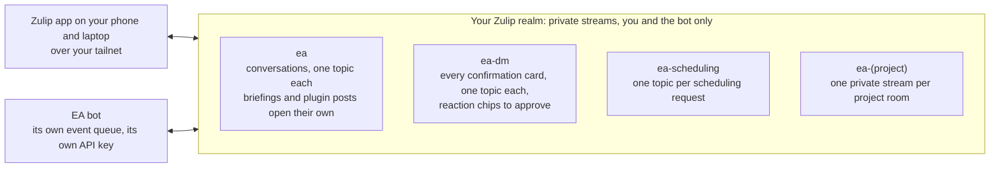

# EA System Reference

Install with `./install.sh`: it installs Claude Code, clones this
repository, installs the Python packages and opens Claude Code on
`/setup`. The `/setup` skill (`.claude/skills/setup/SKILL.md`) asks the
questions, one at a time, and runs every command; it offers the
[setup page in a browser](#setup-in-the-browser) first. This file is what to
read when a step needs background: the appendices below are named, not
numbered, and the skill and the doctor's fix texts point into them by
name.

- [Prerequisites](#prerequisites)
- [Choose a profile](#choose-a-profile)
- [Setup in the browser](#setup-in-the-browser)
- [Microsoft Graph app registration](#microsoft-graph-app-registration)
- [Google OAuth app](#google-oauth-app)
- [Web chat (shadow mode today)](#web-chat-shadow-mode-today)
- [Zulip server](#zulip-server)
- [Slack](#slack)
- [The service account](#the-service-account)
- [Services](#services)
- [Cron schedule](#cron-schedule)
- [Hardening](#hardening)
- [Config files](#config-files)
- [Optional features](#optional-features)
- [Docker](#docker)
- [macOS notes](#macos-notes)
- [Troubleshooting and the doctor's checks](#troubleshooting-and-the-doctors-checks)

## Prerequisites

- **Claude Code** with a Max or Pro subscription. The agents use your
  quota; `ea-bot` (the service account) logs in with its own copy.
- **Python 3.10+** (`python3 --version`); 3.12+ on Ubuntu 24.04 and
  later, where the system Python is PEP 668 managed (see
  [Python packages in three places](#python-packages-in-three-places)).
- **A Microsoft 365 / Outlook account** and an app registration for the
  EA in that tenant ([Microsoft Graph app registration](#microsoft-graph-app-registration)).
- **An always-on machine**: Linux (a server, a NUC) or macOS. WSL2 is
  untested. The cron jobs and, on the `assistant` profile, the chat bot
  run there.
- **For `assistant`**: Docker for the Zulip server (recommended), or a
  Slack workspace where you can install an app.
- **Optional**: one or more Google accounts for calendar merging and the
  EA-Managed rules calendar; a Gmail account the EA may draft from.
- **pip packages**: `pip install -r requirements.txt`. Playwright
  (`pip install playwright && playwright install chromium`) is needed only
  by form-filling plugins; on Ubuntu or Debian Chromium also wants
  `libnspr4 libnss3 libatk1.0-0 libatk-bridge2.0-0 libcups2 libdrm2
  libxkbcommon0 libxcomposite1 libxdamage1 libxfixes3 libxrandr2 libgbm1
  libasound2`.

## Choose a profile

Three install profiles, set as `"profile"` in `~/.ea/config/ea-config.json`
and asked first by `/setup`. Every lane reads it: `scripts/install/setup.sh` installs the
cron lines and services for it, `run-agent.sh` delivers reports where it
says, the launchers add its deny list, and `ea-doctor.py` checks only
what it needs. `python3 preprocessor/ea_config.py features --profile
<name>` prints what a profile turns on.

**Start with `email`.** It needs no chat server and no buttons, and a
first install takes about an hour once IT has given you the Outlook app.
Move to `assistant` later: change `"profile"`, run
`./scripts/install/setup.sh --profile assistant`, then do the chat platform and the
services. Plan half a day for `assistant` from the start, most of it for
the chat server.

| profile | what you get |
|---|---|
| `email` | Outlook triage, the ledger, drafts in your voice, meeting times proposed as text in the report (no holds and no events: the bot that places a staged hold is part of the chat platform), briefings as files in `~/.ea/state/reports/<agent>-latest.md` sent by phone push when one is configured. You work with the EA in the Claude Code shell (`scripts/ea-bot-shell.sh`) and send every draft from Outlook yourself. |
| `review-only` | `email` without drafting: the EA reads, tracks and briefs, and writes nothing to the mailbox. A deny list in every launcher enforces it. |
| `assistant` (default) | everything, plus the chat platform (Zulip, self-hosted, recommended, or Slack): the EA channel, the scheduling channel, the direct message, project and session rooms, the Send and Create buttons, the resident session, plugins. |

Without a chat platform there are no confirmation cards, and the send
verbs need a card's token, so an `email` or `review-only` install cannot
send mail or create a real calendar event by construction.

**The notice.** Before the installer runs, `/setup` shows the "Your
responsibility" paragraph of the README and asks whether you accept it.
On a yes it runs `scripts/install/setup.sh` with `--acknowledged`, which
records the date as `"acknowledged": {"responsibility": "YYYY-MM-DD"}`
in `ea-config.json`, once. `ea-doctor.py` warns while that value is
missing. An install made by hand records it the same way:
`./scripts/install/setup.sh --profile <name> --acknowledged`.

The defaults in the code are the full system's, not the recommended
start: an `ea-config.json` with no `"profile"` (and `scripts/install/setup.sh` with no
`--profile`) means `assistant`, an absent `chat` block means Slack, and
`scripts/install/user_init.py --chat` defaults to the `chat` block's
frontend, else `slack`. The `/setup` skill always
records the profile you choose, and `scripts/zulip_bootstrap.py` prints a
`chat` block with `"frontend": "zulip"`, so neither default applies to an
install it makes.

### Phone push

Optional, for `email` and `review-only`. With no chat channel, a report
is a file in `~/.ea/state/reports/`. To see it on your phone, install the
ntfy app, choose a long random topic name, and write the owner-private
`~/.ea-private/push.json` (mode 600; `scripts/install/user_init.py --phase push` writes
it too):

```json
{"ntfy_url": "https://ntfy.sh", "topic": "<a long random name>"}
```

Each report then sends a push with its name only. Add
`"include_text": true` to send the report text too (it then sits on the
ntfy server), `"click": "<URL>"` to open a page from the push, and
`NTFY_TOKEN=` in `~/.ea-private/secrets.env` for a protected topic.
`python3 preprocessor/push_notify.py test` sends one push. The file is
owner-private on purpose: `ea-config.json` is the EA's own space, and the
EA must not choose where report text goes.

## Setup in the browser

The install questions also come as a page you answer on a phone or a
laptop, the first option `/setup` offers:

```bash
python3 scripts/install/setup_web.py                    # this machine only
python3 scripts/install/setup_web.py --bind "$(tailscale ip -4)"   # your tailnet
```

Open the address it prints, with its `#t=` token (a new one each run).
From a laptop over SSH, `ssh -L 8480:127.0.0.1:8480 <host>` and the
default bind work too. The page asks the profile and the notice, then
every phase of `scripts/install/user_init.py` that writes config, one per
screen, with the same checks and the same files as `user_init.py
--answers`; the definitions are one list, `scripts/install/setup_questions.py`.
It signs in to nothing and runs no root step: its last screen runs the
doctor and lists, word for word, the commands that are left (`setup.sh`,
the sign-ins, the service account, the overlay, the hardening, the cron
lines). Run it before `scripts/install/setup-ea-user.sh`, as you would
the `user_init.py` phases: after that script `~/.ea` belongs to ea-bot.
It binds only a loopback or a Tailscale address, stops on Done or after
an hour without a request, and puts the client secret and the chat
tokens in `~/.ea-private/secrets.env`. [docs/setup-web.md](setup-web.md)
is the design.

## Microsoft Graph app registration

The Graph API gives the EA Outlook mail and calendar. Both auth paths
need an app registration in your Microsoft 365 tenant, and most people
cannot create one themselves: `docs/it-request.md` is the packet to
send your IT group. It asks for the application (client) id, the tenant
id, a client secret, the delegated permissions the EA calls, admin
consent, and says the EA works with public client flows off, as most
university tenants set them. `docs/AUTHENTICATION.md` covers token
lifetimes and failure modes. Without any registration, an owner-side
plugin can supply tokens from another source (`docs/plugins.md`): the
published one is
[outlook-web-auth](https://github.com/arpg/tacitus-plugin-outlook-web-auth),
which saves the token Outlook on the web holds for your own signed-in
session (Option C below).

### Option A: confidential client

The auth-code flow with a client secret. This is what an IT-provisioned
registration supports when "Allow public client flows" is off. The
registration needs a **Web** platform redirect URI equal to
`GRAPH_REDIRECT_URI` below. Non-secret settings go in `~/.ea/.env`, the
secret in `~/.ea-private/secrets.env` (mode 600):

```bash
# ~/.ea/.env
GRAPH_AUTH_METHOD=confidential
GRAPH_CLIENT_ID=<application-client-id>
GRAPH_AUTHORITY=https://login.microsoftonline.com/<tenant-id>
GRAPH_REDIRECT_URI=http://localhost:8400/callback

# ~/.ea-private/secrets.env
GRAPH_CLIENT_SECRET=<client-secret-value>
```

`python3 scripts/install/user_init.py --phase auth` asks for these values, writes both
files and runs the sign-in. By hand: `python3 preprocessor/graph_client.py`
opens a browser and catches the redirect locally. Then align the
requested scopes to what the app grants:

```bash
python3 preprocessor/graph_client.py --align --write
```

The cached refresh token renews silently; no cron and no manual refresh.

### Option B: MSAL public client

When the tenant allows public client flows. Two keys in `~/.ea/.env`:
`GRAPH_CLIENT_ID` and `GRAPH_AUTH_METHOD=device_code` (or `interactive`
for a browser sign-in, which needs a public-client redirect URI on the
registration). `python3 scripts/install/user_init.py --phase auth` writes them and signs
in; by hand, write the two lines and run
`python3 preprocessor/graph_client.py`. A tenant that blocks third-party
apps answers AADSTS1001010 or AADSTS65002; then Option A is the path.

### Option C: no registration (outlook-web-auth)

When IT will not register an app. The owner plugin
[outlook-web-auth](https://github.com/arpg/tacitus-plugin-outlook-web-auth)
opens Outlook on the web in a headless browser with your own signed-in
session every 30 minutes and saves the token Outlook holds, so the EA
reads your mail and calendar with no app registration. It does not get
around sign-in or multi-factor authentication, but it gives the EA access
your IT group did not register an app for: use it only where your
organization's rules allow it, and keep the IT request open as the
lasting path. As the owner, from the checkout:

1. Playwright and Chromium in the Python that runs `ea-plugin.py`: when
   `python3 -c "import playwright"` fails, step 3 of "Python packages in
   three places" (your user site and `playwright install chromium`; on
   Linux also the Chromium libraries under "Prerequisites").
2. `python3 scripts/ea-plugin.py install git:https://github.com/arpg/tacitus-plugin-outlook-web-auth.git@v1.0.0`
   prints the capabilities and stops, since an owner plugin always asks
   for consent; read them, then run it again with `--accept-capabilities`.
3. The first sign-in opens a visible browser on this machine:
   `EA_CORE_DIR="$PWD" python3 ~/.ea-private/plugins/outlook-web-auth/outlook_web.py login`,
   then `... outlook_web.py check` must report a token.
4. The harvest goes in your crontab, beside the lines already there:
   ```bash
   crontab -l 2>/dev/null | grep -qF 'run-owner outlook-web-auth harvest' || \
     { crontab -l 2>/dev/null; python3 scripts/ea-plugin.py cron-lines | grep -F 'run-owner outlook-web-auth harvest'; } | crontab -
   ```

The sign-in cookies last about 90 days; the harvest alerts in the EA
channel a week before, and `outlook_web.py login` renews them. The
plugin's README has the token lifetimes and the recovery steps.

### Test the Graph sign-in

```bash
python3 preprocessor/graph_actions.py calendar-view --days 1
python3 preprocessor/graph_actions.py list-mail --folder inbox --top 1
```

The token cache is `~/.ea/auth/msal_token_cache.json`. A torn file is
recovered on load (the client keeps its first JSON object).

## Google OAuth app

Each install needs its own Google Cloud project; the EA reads your
Google calendars with it and, when a Gmail account is configured, drafts
there.

1. At [console.cloud.google.com](https://console.cloud.google.com/)
   create a project (for example "EA Assistant").
2. **Enable the Google Calendar API** (APIs & Services > Library). If the
   EA will draft in Gmail, enable the Gmail API the same way.
3. **OAuth consent screen**: External, app name "EA Assistant", your
   email as a test user. Then **publish the app** (OAuth consent screen >
   Publish app) so its status is "In production". In "Testing" status
   Google ends every refresh token after 7 days, and the EA loses
   calendar and Gmail access each week. You are the only user, so
   Google's app review does not apply; at sign-in Google shows an
   "unverified app" screen and you continue through "Advanced". A Google
   Workspace account can choose "Internal" instead, which needs no
   publishing.
4. **Credentials > Create Credentials > OAuth client ID**, application
   type **Desktop app**. Download the JSON and save it as
   `~/.ea/auth/google_client_secret.json`, mode 600.
5. Put the accounts to read in `calendars` of
   `~/.ea/config/scheduling-preferences.json` (the setup command reads
   that file, so the config templates must exist first), then sign in
   once per account and test:

   ```bash
   python3 preprocessor/google_calendar_client.py --setup
   python3 preprocessor/google_calendar_client.py --test
   ```

   Each account's token lands in `~/.ea/auth/google_token_<account>.json`.

### The EA-Managed calendar

The scheduler has no config-based working hours: every day and time rule
is a tokened event on a dedicated Google calendar you can see and drag.
Without this calendar and at least one `wh` event, `propose-meeting`
returns an error rather than guessing hours. It is required on
`assistant` (the Create button writes there) and optional on the other
profiles, where the doctor warns instead.

1. In Google Calendar (any authenticated account) create a secondary
   calendar named **EA-Managed**.
2. Copy its id (Settings > "Integrate calendar" > Calendar ID; it ends in
   `@group.calendar.google.com`) into `~/.ea/config/scheduling-preferences.json`:

   ```json
   "ea_managed_calendar": {
     "email": "you@gmail.com",
     "calendar_id": "<calendar-id>@group.calendar.google.com"
   }
   ```

3. Hand the id to the owner side once, as yourself:
   `python3 preprocessor/owner_trust.py seed --calendar`. It writes
   `~/.ea-private/calendars.json` (the calendar id and the account that
   holds it; run it again to add the account to an older file). The
   mediator lets the EA write that
   calendar, and only that one, without a button, and it trusts only this
   owner-private file: the config file above is ea-bot's own, so an owner
   process never takes the id from it. Until the file exists, holds and
   the reconciler's writes are refused, and the doctor says so
   (`EA-Managed calendar (owner copy)`).
4. Seed the standing rules as recurring events on that calendar. The
   leading word of the title is the token; the rest is a label the solver
   echoes back:
   - `wh Working Hours`: recurring weekly, for example Mon-Fri 9:00-17:00.
     Required; slots are proposed only inside `wh` windows.
   - `nm Lunch` (12:00-13:00 daily) or `nm No-meeting Friday` (all-day
     recurring): hard blocks. Optional.
   - `p2 Prefer mornings` (15:00-17:00): a mild penalty. `p1` is a strong
     penalty, `p0` a hard block, `wr` informational. Optional.
5. Colors (optional): green `wh`, red `nm` and `p0`, amber `p1` and
   `p2`, graphite `wr`. After edits in the UI, normalize with
   `python3 preprocessor/google_calendar_client.py recolor-tokens --email you@gmail.com --calendar-id <calendar_id>`.

Two markers complete the vocabulary. An event on any calendar whose title
contains `[note]` is informational: it records when something happens
without blocking scheduling. The calendar protection reconciler (a cron
job) maintains `p0 [auto] <title>` mirrors of standing attendee-less
commitments it finds on the real calendars (a lecture series, a focus
block) so the solver can never offer those slots away. Do not create
`[auto]` events by hand; deleting one is a permanent release, the
intended way to opt a commitment out. To change any rule later, edit the
calendar, never a config file (`docs/SCHEDULING.md`,
`skills/scheduling-rules.md`).

## Web chat (shadow mode today)

Tacitus has its own chat interface, served by the bot process itself:
a phone-first web app and a JSON API on a loopback port, no Zulip, no
Docker. The contract and the API are in [docs/webchat.md](webchat.md);
the off-tailnet relay, designed and not yet wired, is in
[docs/webchat-relay.md](webchat-relay.md). Today it runs in **shadow
mode** beside Zulip: the bot posts to both, and you can read and answer
in either; the web side never blocks the Zulip side.

1. Add a `web` block to the chat block in `~/.ea-private/chat.json`.
   The bot serves the web chat only from that owner-private file (after
   hardening); a block in `ea-config.json`, which the resident can
   change, never serves:

   ```json
   "shadow": "web",
   "web": {
     "bind": "127.0.0.1",
     "port": 8470,
     "base_path": "/chat",
     "public_url": "https://<host>.<tailnet>.ts.net:8444/chat",
     "tailscale_login": "<your Tailscale login, as `tailscale whois` reports it>"
   }
   ```

   `"frontend": "web"` with no `shadow` runs the web chat alone.
2. Publish the port on your tailnet, as the owner, on an HTTPS port of
   its own:
   `tailscale serve --bg --https=8444 --set-path /chat http://127.0.0.1:8470/chat`.
   The chat needs its own origin: one app per origin. A deck or any other
   page on the chat's origin could call the chat as you, so decks stay
   on 443 and `deck_serve.py` refuses a deck on the chat's port. The port
   in `public_url` must be the `--https` port. Tailscale adds your login
   as a request header, which is the sign-in; the bot takes it only on
   tailscaled's own connection (`"trust_tailscale_header": false` turns
   it off, and pairing by token is then the only sign-in).
3. `sudo systemctl restart ea-chat-bot`, then open the `public_url` on
   your phone and add it to the home screen.
4. Without Tailscale on the phone, pairing by token works: the bot
   writes a token to `<private dir>/webchat-pair.token` (the
   `pair_token_file` key moves it; mode 0600, at least 16 characters)
   and you enter it once in the app. Replacing the token signs every
   paired browser out and drops their notification subscriptions.
5. For notifications with the app closed (a new card, a message from the
   bot in your DM, an alert), open the channel drawer and turn on
   **Notifications**. On an iPhone or iPad this works only in the app
   added to the Home Screen. The bot then sends encrypted pushes over
   https to your browser's push service (Google, Apple, Mozilla or
   Microsoft); it needs the `cryptography` package, which the install
   already has. The drawer lists the browsers that get notifications,
   each with a Revoke button.

The store is `<private dir>/webchat.sqlite`; files you upload from the
app sit beside it. Each start copies the last week of Zulip history
into it (`"backfill_days"` in the `web` block; 0 turns the copy off), so
the app opens with your recent threads.

## Zulip server

The `assistant` profile talks to you through a chat platform, and
`chat.frontend` in `ea-config.json` names it (`"zulip"` or `"slack"`; an
install with no `chat` block runs Slack). Zulip, self-hosted, is the
recommendation: it runs on the EA's machine in Docker and is reached over
your tailnet, so every message, file and confirmation card stays on that
machine. The comparison with Slack is the "Choosing a chat platform"
table in [INSTALL.md](INSTALL.md#choosing-a-chat-platform); the switch in either direction is one
config key and a restart ([docs/zulip-switch.md](zulip-switch.md),
`scripts/zulip_switch.sh`).

Three private streams stand in for the Slack channel, the DM and the
scheduling channel, and each project room is a private stream of its own.
Topics are threads, and you never name one: post in a stream's general
chat, and the EA moves the post into a topic of its own and answers
there. Zulip has no buttons, so a confirmation card carries one reaction
chip per action, added by the bot, and a one-time code: tap the thumbs-up
to send, the thumbs-down to cancel, or reply with the code. App Home and
its modals exist only on Slack.



1. **Run the server.** [deploy/zulip/README.md](../deploy/zulip/README.md):
   secrets in `~/.ea-private/zulip.env` (mode 600, outside the checkout),
   `deploy/zulip/compose.sh up -d`, two-factor sign-in on, the realm and owner created headless with
   `manage.py create_realm`, and your owner API key. The stack listens on
   `127.0.0.1:8080` as `http://zulip.localhost:8080`; the README's last
   section moves it onto your tailnet name.
2. **Bootstrap the realm.**
   ```bash
   python3 scripts/zulip_bootstrap.py --site http://zulip.localhost:8080 \
     --owner-email <you> --owner-key "$OWNER_KEY"
   ```
   It creates the generic bot `EA` with the portrait in
   `assets/tacitus-avatar.png` as its avatar, the private streams `ea`,
   `ea-scheduling` and `ea-dm` with you and the bot subscribed, named
   topics and general chat both allowed, and lifts the realm's
   message-edit limit. It prints the `chat` block and the line
   `ZULIP_API_KEY=<bot key>`; it writes no file. `--check` verifies the
   realm without changing it; `--avatar` gives a bot that already exists
   the portrait.
3. **Config.** Paste the `chat` block into `~/.ea/config/ea-config.json`:
   ```json
   "chat": {
     "frontend": "zulip",
     "zulip": {
       "site": "http://zulip.localhost:8080",
       "bot_email": "ea-bot@zulip.localhost",
       "owner_user_id": "<your Zulip user id>",
       "stream": "ea",
       "sched_stream": "ea-scheduling",
       "dm_stream": "ea-dm",
       "notify": {
         "ea-assistant": {"stream": "ea"},
         "scheduling":   {"stream": "ea"},
         "personal":     {"stream": "ea"}
       }
     }
   }
   ```
   `owner_user_id` is the only user whose reactions and codes confirm a
   card; the bot refuses to start without it. Leave `sched_stream` empty
   to run without a scheduling stream. A card settled outside chat (a
   draft sent or deleted in Outlook) moves, with its topic, to a private
   stream the bot makes on first use, `<dm_stream>-done` (`dm_done_stream`
   names another), so a card you never opened leaves your Inbox. To read
   those cards, subscribe to that stream and mute it: a subscriber who
   does not mute it gets the unread ones back.
4. **Secret.** Add the `ZULIP_API_KEY=` line to `~/.ea-private/secrets.env`
   (owner, mode 600, in a 0700 `~/.ea-private`; never `~/.ea/.env`). It is
   the only new secret; nothing goes in `~/.ea/.env` for Zulip.
5. **Python.** `requirements.txt` includes `zulip`; install it in the venv
   the bot runs from.
6. **Restart** the bot (`sudo systemctl restart ea-chat-bot.service`) and
   read `journalctl -u ea-chat-bot -n 40 --no-pager`. Expect
   `frontend=zulip stream=ea (private, subscribed) owner=<id>`. If a
   stream is public, missing or lacks the bot, startup stops with the
   stream's name instead.
7. **Try it.** Post `usage` in `ea` with no topic, and again in `ea-dm`.
   Each moves into a topic of its own, gets the eyes, then the check
   reaction, and a reply in that topic.

**Notifier and plugins.** Cron agents and plugins call
`slack_notifier.post_to_slack`, a shim over `preprocessor/chat_notify.py`,
which posts with the bot key to the stream that `chat.zulip.notify` maps
each channel key to (`ea-assistant`, `scheduling`, `personal`, and any
key a plugin names in `output.channel_key`). Each post opens a new topic
named from its first line unless the entry pins a `topic`. `run-agent.sh`
and `run-plugin.sh` load `ZULIP_API_KEY` from the owner-private secrets
file, as data. A plugin whose channel key has no `notify` entry needs one
added there.

## Slack

Slack is acceptable when you would rather not run a chat server and you
accept that everything the EA shows you, drafts and quoted mail included,
is stored by Slack under Slack's terms. Create a free workspace of your
own at [slack.com/get-started](https://slack.com/get-started): one channel
and one bot app are all it needs, and your EA conversations, mail data
and approval buttons stay inside it. A shared lab workspace works too
(private channels are invisible to admins who are not members), with the
risk that another member installs an app with scopes that read private
channels. `python3 scripts/install/user_init.py --phase auth` collects the tokens and
channel id once the app exists.

### The Slack app

1. [api.slack.com/apps](https://api.slack.com/apps) > **Create New App** >
   **From scratch**; name it (for example "EA Assistant") and pick the
   workspace. Under **Basic Information > Display Information**, upload
   `assets/tacitus-avatar.png` as the **App icon**; Slack has no API for
   it.
2. **OAuth & Permissions** > **Bot Token Scopes**. The bot calls every one
   of these, and the doctor checks them:
   - `channels:history`, `channels:read`: public channels
   - `chat:write`: post messages and confirmation blocks
   - `files:read`, `files:write`: files shared in the EA channel (receipts)
     and uploads (screenshots)
   - `groups:history`, `groups:read`: read and list private channels (the
     EA channel)
   - `groups:write`: create private project channels (`open a channel for
     <project>`), invite you and set their topic; without it those
     commands answer with a line instead of a channel
   - `im:history`, `im:write`: the DM, where confirmation buttons arrive
   - `reactions:write`: the eyes and check reactions on your messages
3. **Install to workspace** and copy the **Bot User OAuth Token**
   (`xoxb-...`).
4. **Socket Mode**: enable it. No request URL is needed anywhere.
5. **Event Subscriptions**: Enable Events on; under "Subscribe to bot
   events" add `message.groups` (private channels) and `message.im` (DMs).
   Without these the bot connects and receives nothing: the log shows
   "Bolt app is running" and no message events.
6. **Interactivity & Shortcuts**: Interactivity on. This enables the
   Send and Cancel buttons.
7. If Slack asks you to reinstall the app after adding scopes or events,
   do so; the bot token may change, so update the secrets file.

### The app-level token

**Basic Information** > **App-Level Tokens** > **Generate Token and
Scopes**: name it `socket-mode`, add the scope `connections:write`,
generate, and copy the `xapp-...` token.

### The private channel

Create a **private** channel (for example `ea-assistant`), invite the bot
(`/invite @EA Assistant`), and copy its **Channel ID** from "View channel
details". Copy your own **member ID** from your profile menu: it is the
owner id, and only that user's clicks count.

### The Slack environment files

`~/.ea/.env` (mode 640, non-secret) takes the ids; `~/.ea-private/secrets.env`
(mode 600, in a 0700 directory) takes the tokens. `.env.example` and
`.env.secrets.example` are the templates.

| Variable | File | Source |
|---|---|---|
| `EA_SLACK_CHANNEL_ID` | `~/.ea/.env` | the channel's id (`C0XXXXXXXXX`) |
| `EA_SLACK_CHANNEL_NAME` | `~/.ea/.env` | the channel's name |
| `EA_SLACK_OWNER_ID` | `~/.ea/.env` | your member id (`UXXXXXXXX`) |
| `SLACK_BOT_TOKEN` | `~/.ea-private/secrets.env` | the Bot User OAuth Token (`xoxb-...`) |
| `SLACK_APP_TOKEN` | `~/.ea-private/secrets.env` | the app-level token (`xapp-...`) |

`EA_SLACK_OWNER_ID` is what makes only you able to click Send. Without
it the bot refuses every button click. The
notifier's webhooks (`slack_webhooks.json`) live in `~/.ea-private/` on a
hardened install; the template is in `config/`.

## The service account

The EA runs its Claude subprocesses as a dedicated `ea-bot` Unix user
that can read the code and the config but cannot change them. This is
Layer 1 of the security model (`docs/SECURITY.md`), the mechanism that
keeps a prompt-injected EA from tampering with the bot, and it is
mandatory on every host: the bot and `run-agent.sh` refuse to start
without the user, and there is no opt-out variable.

Run `./scripts/install/setup.sh --profile <name>` first, while `~/.ea` is still yours:
it copies the config templates and records the profile. In a terminal it
also runs the Graph and Google sign-ins when their files are there and
asks whether to install the cron lines. With no terminal on its standard
input (Claude Code's Bash tool, a pipe) it is non-interactive by itself:
it signs in nowhere, prints the sign-in command to run by hand, and
saves the cron lines unless `--install-cron` is given. Then, once:

```bash
sudo bash scripts/install/setup-ea-user.sh          # Linux
sudo bash scripts/install/setup-ea-user-macos.sh    # macOS (dscl instead of useradd; /Users/ea-bot)
```

### What the installer does

Both scripts are idempotent and do the same things, in this order:

1. Create the group `ea` and the user `ea-bot` (hidden, UID 499 on
   macOS), and add you to `ea`.
2. Deploy the source to `<ea-bot home>/ea-system/` as a git clone owned
   by you, group `ea`, read-only for ea-bot. The post-commit hook keeps
   it at HEAD.
3. Move `~/.ea` into ea-bot's home (`ea-bot:ea`, group-writable state,
   read-only config) and leave `~/.ea` in your home as a symlink to it.
   `auth/` stays yours (you, group `ea`, `0750`; each token yours alone):
   it is handed to you before any other step and never to ea-bot. Mode
   fixes in ea-bot's trees run as ea-bot, and a re-run hands ea-bot no
   file it does not already own.
   From then on `scripts/install/setup.sh` writes config as ea-bot through the sudoers
   rule, so a later `./scripts/install/setup.sh` run (a profile change, or re-pointing
   the cron lines after hardening) needs nothing else.
4. Close your home to other users (no `o+x`): ea-bot never enters it.
5. Write ea-bot's Claude Code settings and install ea-bot's **own**
   Claude Code at `<ea-bot home>/.local/bin/claude` with the native
   installer; it keeps itself current. Your copy is never shared or
   copied. If the download fails, run it yourself:
   `sudo -u ea-bot env HOME=/home/ea-bot bash -c 'curl -fsSL https://claude.ai/install.sh | bash'`
   (`/Users/ea-bot` on macOS).
6. Install the sudoers rule below.
7. (Linux) Run `deploy/enable-mail-mediation.sh`: the owner-side mail
   mediator service that holds the Graph and Google tokens and performs
   the EA's safe mail operations, so ea-bot can read and draft but never
   send or see a token. If the tokens are not signed in yet it arms
   mediation and says how to finish; re-run it with `sudo` after the
   sign-ins. On macOS the mediator is a LaunchDaemon, so the script does
   not run here: on every profile, run
   `sudo bash deploy/macos/install-services.sh` and then
   `sudo bash deploy/enable-mail-mediation.sh` ([launchd](#launchd)).
8. Verify: the user and group exist, sudo works, the deployed source is
   readable and not writable by ea-bot, state is writable, and your home
   is private.

### The sudoers rule

```
<you> ALL=(ea-bot) NOPASSWD: ALL
Defaults:<you> env_keep += "PYTHONPATH"
```

A narrower rule naming only ea-bot's claude binary and the overlay render
would match only those exact command lines. The bot, `run-agent.sh`, the
ea-bot shell and the doctor start claude as `sudo -u ea-bot env VAR=...
claude`, `scripts/owner-io.sh` runs `sudo -n -u ea-bot sh -c ...` for
every read and write in ea-bot space, and `resident_io` runs
`/usr/bin/python3 -I` as ea-bot; sudo matches `env`, `sh` and `python3`
there, so under the narrow rule every cron lane dies with "a password is
required". Allowing `env` alone would be no narrower, since `env` runs
anything. Your account is already in the `sudo` group, so this is not a
privilege change, and it gives ea-bot nothing: the rule lets you become
the less-privileged user. The Docker image writes the same rule.

### After the installer

1. Log out and back in (or `newgrp ea`) so your shell carries the `ea`
   group. Until then, commands that read ea-bot's group files run through
   `sudo -u <you>`.
2. Log ea-bot's Claude Code in:
   `sudo -u ea-bot env HOME=/home/ea-bot claude`, then `/login`, then
   Ctrl+C. The claude.ai connectors come with that account
   ([Claude Code connectors](#claude-code-connectors)); trigger one tool there so its
   OAuth completes. The doctor checks `ea-bot: Claude login`.
3. When the bot starts, confirm
   `isolation: ENFORCED user=ea-bot home=/... script_dir=/.../ea-system`.
   A startup FATAL about a missing ea-bot user means the installer did
   not complete; run it again rather than touching the check.

## Services

Two long-lived services run **as you**, never as ea-bot: the mail
mediator (`preprocessor/mail_mediator.py`) on every profile, and the
chat bot (`ea-chat-bot.py`) on `assistant`. On Linux each is a system
unit: `deploy/enable-mail-mediation.sh` (which `scripts/install/setup-ea-user.sh` runs)
writes the mediator's, and [Hardening](#hardening)
(`deploy/harden-permissions.sh`) writes the bot's once the chat platform
is configured. `scripts/install/setup.sh` runs as you and writes no unit. On macOS
both are LaunchDaemons ([launchd](#launchd)).

### systemd

The bot is the system unit `/etc/systemd/system/ea-chat-bot.service`,
never a user unit: a user unit runs in your `user@<uid>.service`, which
keeps the supplementary groups it started with, so after the installer
adds you to group `ea` the bot could not read the EA's group-`ea` files
until every session ended. The system unit declares the group itself.
`sudo bash deploy/harden-permissions.sh` writes it when the profile has a
chat platform and no unit exists yet:

```ini
# /etc/systemd/system/ea-chat-bot.service (written by harden-permissions.sh)
[Unit]
Description=EA chat bot
After=network-online.target
Wants=network-online.target

[Service]
Type=simple
User=<you>
Group=<your group>
SupplementaryGroups=ea
Environment=HOME=/home/<you>
Restart=always
RestartSec=10

[Install]
WantedBy=multi-user.target
```

and the drop-in `ea-chat-bot.service.d/harden.conf` gives it its
`ExecStart` (the interpreter the script found, then
`/opt/ea-system/ea-chat-bot.py`), `WorkingDirectory=/opt/ea-system` and
the owner-private environment files. It enables and starts the unit, and
writes `/etc/sudoers.d/ea-chat-bot` (`systemctl restart
ea-chat-bot.service` only) so the deploy hook can restart the bot. An
existing system unit is kept and gets the drop-in. A user unit
(`~/.config/systemd/user/ea-chat-bot.service`, from an older `scripts/install/setup.sh`)
is reported with the step that retires it, and the script writes no
system unit beside it, since two bots would both take the chat events:
`systemctl --user disable --now ea-chat-bot`, remove the file,
`systemctl --user daemon-reload`, then run the script again.

`systemctl status ea-chat-bot` should show `active (running)` and
`journalctl -u ea-chat-bot -n 20 --no-pager` the startup line. Do not add
`StandardOutput=append:` lines: the bot has its own `logging.FileHandler`,
and the two together duplicate every line. The doctor lists
`service: ea-chat-bot` (required on `assistant`) and
`service: ea-mail-mediator`, `service: ea-dashboard` (optional; see
[Project dashboard](#project-dashboard) for its token).

### launchd

macOS has neither systemd nor the hardening script.
`sudo bash deploy/macos/install-services.sh` is both, on every profile:
it seeds `/opt/ea-system` and the owner-private files and installs root
LaunchDaemons that run as you from `/opt/ea-system`, with the environment
loaded by a root-owned launcher from `~/.ea-private/bot.env` and
`secrets.env`: the mail mediator always, and the chat bot only when the
profile has a chat platform. `--status` reports and `--remove` undoes.
Then `sudo bash deploy/enable-mail-mediation.sh` turns mediation on (on
Linux `scripts/install/setup-ea-user.sh` runs it). On `assistant`, run the services
script after the chat platform is configured: its third step seeds
`~/.ea-private/chat.json` from the `chat` block only when that file is
missing. The design, the
deploy hook and the troubleshooting are in
[docs/macos-services.md](macos-services.md).

## Cron schedule

The cron jobs are owner processes (`docs/SECURITY.md`, "Owner trust
rules"). `scripts/install/setup.sh` prints the entries for the profile and installs them
when you confirm, or with `--install-cron`; a non-interactive run
(`EA_NONINTERACTIVE=1`, `--non-interactive`, or no terminal on standard
input) without that flag saves them to
`~/.ea-private/crontab-template.txt` instead. Run it again after
hardening so the lines run `/opt/ea-system` (the committed code the
deploy hook keeps in step), never the checkout. Output goes to the
owner-private `~/.ea-private/logs` (mode 700). Times are the machine's
local timezone.

What `scripts/install/setup.sh` writes, by profile (`preprocessor/ea_config.py` features):

```
# ---- every profile ----
# Morning briefing: hourly on weekdays; run-agent.sh runs it once, at 4 AM in
# the user's CURRENT timezone (home or travel, quiet_hours.due_local), then
# quiet hours hold delivery until the local morning.
0 * * * 1-5        /opt/ea-system/run-agent.sh morning-briefing >> ~/.ea-private/logs/morning.log 2>&1
0 15 * * 1-5       /opt/ea-system/run-agent.sh afternoon-catchup >> ~/.ea-private/logs/afternoon.log 2>&1
0 20 * * 0         /opt/ea-system/run-agent.sh weekly-audit --model opus >> ~/.ea-private/logs/weekly.log 2>&1
# Ledger sync: closes rows on sent mail and archive actions between briefings.
*/15 * * * *       python3 /opt/ea-system/preprocessor/ledger_sync.py check >> ~/.ea-private/logs/ledger-sync.log 2>&1
# Closure evidence between briefings: closes a row on decisive evidence and
# puts the rest on the confirm card (with a chat channel).
20 7-14,16-21 * * * python3 /opt/ea-system/preprocessor/closure_scrubber.py check --json >> ~/.ea-private/logs/closure-scrubber-cron.log 2>&1
# Quiet hours: deliver posts held during the local night once the window ends.
*/15 * * * *       python3 /opt/ea-system/preprocessor/quiet_hours.py flush >> ~/.ea-private/logs/quiet-hours.log 2>&1
# Persistence digest: each change to the ea-bot files that steer later
# sessions goes to the health channel. The doctor FAILs after 36 hours
# without a completed run.
40 6 * * *         python3 /opt/ea-system/scripts/persistence-digest.py >> ~/.ea-private/logs/persistence-digest.log 2>&1

# ---- profiles that draft (email, assistant) ----
# Weekly: refresh per-contact style profiles from sent mail with real bodies.
20 4 * * 1         python3 /opt/ea-system/preprocessor/style_profiles.py sync --days 21 >> ~/.ea-private/logs/style-profiles.log 2>&1

# ---- assistant only (needs the chat platform and its buttons) ----
0 8-20 * * 1-5     /opt/ea-system/run-agent.sh scheduling-check >> ~/.ea-private/logs/scheduling-check.log 2>&1
*/30 8-18 * * 1-5  /opt/ea-system/run-agent.sh priority-check >> ~/.ea-private/logs/priority-check.log 2>&1
# Intraday ledger capture. Silent: items surface on the desk and in the rooms.
*/10 7-19 * * 1-5  /opt/ea-system/run-agent.sh intake-check >> ~/.ea-private/logs/intake-check.log 2>&1
# Deferred sends (the Schedule button). Needs the signing key below.
*/5 * * * *        python3 /opt/ea-system/preprocessor/scheduled_sends.py check >> ~/.ea-private/logs/scheduled-sends.log 2>&1
# Calendar protection reconciler: p0 [auto] mirrors of standing commitments.
7,37 * * * *       python3 /opt/ea-system/preprocessor/calendar_reconciler.py --apply >> ~/.ea-private/logs/calendar-reconciler.log 2>&1
```

`./run-agent.sh morning-briefing --now` runs the briefing by hand at any
hour (`--now` skips the 4 AM gate). Lines `scripts/install/setup.sh` does not write; add
the ones you want with `crontab -e`:

```
# Prospective-student mail to the admissions-inquiries folder (silent; does
# nothing unless ea-config.json sets "admissions_filter": {"enabled": true}),
# and its weekly ranked summary.
*/5 * * * *        python3 /opt/ea-system/preprocessor/admissions_filter.py sweep >> ~/.ea-private/logs/admissions-filter.log 2>&1
0 8 * * 1          /opt/ea-system/run-agent.sh admissions-digest >> ~/.ea-private/logs/admissions-digest.log 2>&1
# Nightly full-mode evals (Claude tokens); only if prompt-affecting files
# changed. Runs from the checkout because it reads git history.
0 2 * * *          $(pwd)/tests/evals/run_full_if_changed.sh >> ~/.ea-private/logs/eval-full.log 2>&1
# Monthly: re-measure the writing-style corpus (assistant; see below).
40 4 1 * *         python3 /opt/ea-system/preprocessor/style_analysis.py run --dispatch >> ~/.ea-private/logs/style-analysis.log 2>&1
# Owner plugins' jobs: `python3 /opt/ea-system/scripts/ea-plugin.py cron-lines`
# prints the lines for the plugins you installed (docs/plugins.md).
```

On an install that keeps a `crontab.master`, add lines to the master and
run `crontab <master>`: the sentinel's `crontab_drift` check compares the
two and alerts in either direction (`docs/RUNBOOK.md`, section 5).

### The venv on the cron PATH

The `run-agent.sh` entries find the repo venv on their own; the bare
`python3` entries do not. Where the packages live in a venv rather than
the system Python, put at the top of the crontab:

```cron
SHELL=/bin/bash
PATH=/home/<you>/ea-system/.venv/bin:/usr/local/bin:/usr/bin:/bin
```

### The deferred-send signing key

A one-time confirmation token lives 30 minutes; a scheduled send may fire
days later. So the queue entry carries an HMAC over `(draft_id,
send_after, fingerprint)`, where the fingerprint is the draft content you
reviewed, and the `*/5` job verifies it before touching the Graph
token. The key must be readable by **you** and not by `ea-bot`; that
asymmetry is the control, since `~/.ea/state/scheduled-sends.json` sits
in a group-writable directory. As the owner:

```bash
KEY=/home/ea-bot/.ea/auth/scheduled-send-hmac.key
head -c 48 /dev/urandom | base64 > "$KEY"
chmod 600 "$KEY"
sudo chown <you>:<you> "$KEY"                 # only if it came out group-owned by ea
sudo -u ea-bot cat "$KEY"                     # must fail
```

The key must be at least 32 bytes after whitespace is stripped. Without
it `graph_actions.py schedule-send` refuses with `cannot sign the
scheduled send` before it consumes the token, and `scheduled_sends.py
check` holds every queued entry and alarms rather than sending: the
intended fail-closed state, not a permission to loosen.

`~/.ea/auth` is `<you>:ea 750`, so ea-bot cannot add, remove or rename an
entry in it. ea-bot owns `~/.ea`, though, so it can rename the whole auth
directory away and make its own. The owner checks then refuse that
directory, and a re-run of the setup scripts or of
`deploy/enable-mail-mediation.sh` stops at it rather than adopt it. Never
`chown` a key or token from such a directory to yourself: the checks
trust any file you own. Move the directory aside, make a new one
(`sudo install -d -o <you> -g ea -m 0750 /home/ea-bot/.ea/auth`), sign
in again or restore the tokens from your own backup, and make a new key
as above. A deferred send signed with the old key is held and needs a new
card. Entries those scripts find in auth/ that are not yours go to an
owner-only `auth/.quarantine-*` directory with a `NOTE.txt`; read it, do
the same, then delete the directory.

### Writing style upkeep

Drafts are calibrated against what you send, and two crons keep that
true. `style_profiles.py sync` (weekly) answers "how does this person get
written to": sign-off, length, question and hedge rates, real examples to
mimic. Without it the profiles accumulate only 255-character previews
from the briefing. `style_analysis.py run --dispatch` (monthly,
`assistant`) measures the whole corpus, snapshots to
`~/.ea/state/style-analysis/<YYYY-MM>.json`, diffs against the previous
month and hands what moved to the resident session (or posts the digest
to chat when the session is down). The same run harvests draft-vs-sent
pairs from `~/.ea/state/draft-bodies/` (written inline by
`graph_actions.py`, purged after each monthly read). That store is shared
between the two users, so create it setgid:

```bash
sudo -u ea-bot mkdir -p ~ea-bot/.ea/state/draft-bodies
sudo -u ea-bot chmod 2775 ~ea-bot/.ea/state/draft-bodies
```

Audience segmentation is by email domain; `~/.ea/config/style-audiences.json`
(`{"dean@example.edu": "leadership", "phd1@example.edu": "students"}`)
splits a shared domain. `style_profiles.py get --contact <addr>` shows a
contact's current target; `style_analysis.py show` the last report.

### Quiet hours and travel mode

Proactive posts that would land during your local night are held and
flushed as one morning digest (`quiet_hours` and `travel_mode` in
`ea-config.json`; the `flush` cron is what delivers them). While
travelling: `python3 preprocessor/quiet_hours.py set-travel --timezone
Europe/Lisbon --until 2026-05-20`; it reverts to the home timezone after
`until`, and `clear-travel` ends it early.

## Hardening

`sudo bash /opt/ea-system/deploy/apply-host.sh` runs every step below that
the boundary audit finds missing, in order, and checks again; run it
after setup and after every update. The sections below say what each
step does.

The bot and the mail mediator run as you, but by default they load their
environment and run their code from ea-bot's home, which ea-bot can
rewrite or rename. A prompt-injected EA is an ea-bot shell, so those
paths are an escalation route to your account, which holds the mail
tokens. One idempotent, owner-agnostic script closes it; on Linux run it
once as root after the service account (and, on `assistant`, the chat
platform) exists, on every profile:

```bash
sudo bash deploy/harden-permissions.sh
```

It derives the owner from `$SUDO_USER` (or `--owner NAME`), copies the
code to `/opt/ea-system` (parent `/opt` is root-owned; the deploy hook
keeps it at HEAD), points both services there with the interpreter from
your private home, loads `EA_MODEL` from an owner-owned
`~/.ea-private/bot.env` instead of ea-bot's `.env`, copies the chat block
to the owner-private `chat.json` the bot trusts, and copies a legacy
`.env.secrets` to `~/.ea-private/secrets.env` when that file is missing.
It first says which bot unit it found. On a profile with a chat
platform and no unit it writes the bot's system unit
([systemd](#systemd)); a user unit left by an older `scripts/install/setup.sh` is
reported with the step that retires it. It adds systemd drop-ins and
verifies the services came back on the new path. On a profile with no
chat platform there is no bot unit: the script says so, skips that
unit's drop-in and restart, and still seeds `/opt/ea-system`, the
owner-private files and the mediator's drop-in when that unit exists.
Revert by removing
`/etc/systemd/system/*.service.d/harden.conf` and reloading. Afterwards
run `./scripts/install/setup.sh --profile <name> --install-cron` once more so the cron
lines run `/opt/ea-system`. The doctor's `hardening:` checks warn until the script
has run. The full model is `docs/SECURITY.md`.

Invariants that hold on every host, and that no install step may weaken:
ea-bot isolation (no opt-out, no platform-conditional bypass), source
read-only for ea-bot, secrets owner-private, no `EA_ISOLATION_MODE`
variable. The `/setup` skill repeats them for the agent running the
install.

## Config files

`scripts/install/setup.sh` copies every template in `config/` to `~/.ea/config/`,
skipping files that exist. `python3 scripts/install/user_init.py` fills the same files
from a terminal form (phases: `identity`, `scheduling`, `inbox`,
`autonomy`, `groups`, `deadlines`, `style`, `auth`, `tone`,
`reimbursement`, `vip`, `push`, `state`; `--phase <name>` reruns one,
`--update` shows current values, `--answers FILE` runs with no terminal).
`tests/validate_config.py` names any placeholder left. After the service
account exists the directory is ea-bot's; owner tools write it through
`scripts/owner-io.sh`.

**`user-profile.json`**: `name`, `email`, `role`, `department`,
`background`, `slack_channel`, `bio_blurb`, the Google calendar
accounts, and the `institution` block that says which mail is internal,
where the safety rail sits and which video platform you use
(`preprocessor/institution.py` documents every key): `name`, `domains`
(the internal mail domains, a list), `related_domains`,
`safety_rail_domain` (the EA never sends a first email outside it on its
own; usually the first internal domain), `video.platform` and
`video.link` (your personal meeting link; put it in the top-level
`zoom_link` too, which the Create button reads), `boilerplate_tokens`,
`boilerplate_phrases` and `letterhead`. A field left out falls back to
the domain of your email. `config/examples/cu-boulder/` is a worked
example for one institution: its `user-profile.json` holds a complete
block, and its README lists the features that need an adapter per
institution.

**`ea-config.json`**: `profile`; the `chat` block (frontend, server, bot,
owner id, streams, `notify` map); the operational toggles `ea_enabled`
(the master pause: cron agents exit at once and the bot answers "EA is
paused"; token refresh and ledger sync continue),
`log_level` (`EA_DEBUG` overrides to DEBUG;
the bot needs a restart for this one); `quiet_hours` and `travel_mode`;
`admissions_filter`; `mail_gate`. Missing toggles default to on. The
nightly full-mode evals and the weekly release tests run a model as the
owner, so their switches (`eval_full_enabled`, `release_tests_enabled`)
are in the owner-private `~/.ea-private/evals.json` instead
(`docs/EVAL.md`). The post-commit hook's test switch is there too
(`eval_postcommit_enabled`), and `EA_POSTCOMMIT_TESTS` in the
committer's environment overrides it.

**`scheduling-preferences.json`**: timezone, the Google `calendars` the
solver merges, `ea_managed_calendar` (email and id), default duration,
clustering and buffers. The working hours and no-meeting rules are
events on the EA-Managed calendar, never keys here.

**`autonomy-tiers.json`**: the tier of each task type (`button-required`,
`ask-first`, `do-and-tell`, `fire-and-forget`), `per_contact_overrides`,
the auto-promote threshold and the inbox-as-completion toggle.

**`preferences.json`**: your standing rules in your own words, with
scopes; `preprocessor/preferences.py add ...` writes it and the lanes
inject the matching rules into each skill.

**`preprocessor-config.json`**: inbox philosophy (Inbox Zero or relaxed),
the stale-thread threshold, the writing-style window.
**`group-senders.json`**: group lists for noisy-thread detection.
**`deadline-senders.json`**: sender domain to deadline category.
**`vip_senders.txt`**: one address per line.
**`list-digests.json`**: the mailing lists the list-digest agent triages
and archives.
**`reimbursement-config.json`**: submitter name and email, the form URL;
an institution plugin may ship the adapter that files the form
(`config/examples/cu-boulder/README.md`).
**`ea-channels.json`**: the project rooms (`#ea-<project>`) and session
mirrors (`#tmp-<id8>`); the bot writes it on `open a channel for
<project>`. Mode 664.
**`slack_webhooks.json`**: the Slack notifier's webhooks (Slack installs
only; hardening moves the live copy to `~/.ea-private/`).
**`github.json`**: the EA's GitHub identity ([GitHub identity](#github-identity)).
**`active-projects.md`**: current grants, deadlines, program officers.
**`style-audiences.json`** (optional): address to audience, see
[Writing style upkeep](#writing-style-upkeep).

State files (`~/.ea/state/obligations-ledger.json` as `[]`,
`seen-messages.json` and `seen-conversations.json` as `{}`) are created
by `scripts/install/user_init.py --phase state` or by hand before the first run.

### Secrets

Two environment files, and the split is the security model:

- `~/.ea/.env`: mode 640, `ea-bot:ea`, non-secret settings only. The
  Graph keys (`GRAPH_AUTH_METHOD`, `GRAPH_CLIENT_ID`, `GRAPH_AUTHORITY`,
  `GRAPH_REDIRECT_URI`, `GRAPH_SCOPES`), the `EA_SLACK_*` ids, `EA_MODEL`
  (the bot's Claude model), the optional `EA_SCHED_CHANNEL_ID`,
  `EA_RESIDENT_MODEL`, `EA_BRIEFING_MODEL` (the briefings' model when it
  should differ from `EA_MODEL`), `EA_LITERAL_COMMANDS` (`1` adds a rule
  to the cron prompt for a model that writes compound shell commands the
  lane refuses; off by default), `EA_DASH_*`. The owner's loader
  (`scripts/owner-io.sh env`) takes only config keys from it and skips a
  secret put here with a warning.
- `~/.ea-private/secrets.env`: mode 600, yours, in a 0700 directory. The
  chat credential (`SLACK_BOT_TOKEN` and `SLACK_APP_TOKEN`, or
  `ZULIP_API_KEY`), `GRAPH_CLIENT_SECRET`, `REMOTE_LLM_API_KEY`,
  `NTFY_TOKEN`. The ea-bot subprocess must not be able to read it; a read
  error there is correct, never a reason to loosen the mode.

An install migrated from an older host may keep tokens in `~/.ea/.env` or
`~/.ea/.env.secrets`. Owner processes never take a secret from
`~/.ea/.env`, and they accept the legacy `.env.secrets` only while it is a
regular file you own that no one else can write. Move any token still in
`~/.ea/.env` by hand, delete the legacy copies, and restart the bot. The
doctor reports where each secret comes from.

### The install overlay

`CLAUDE.md` is the product core and names no person or institution. The
install's own facts (the profile, the `institution` block, the chat
streams, the sites in `github.json`, the digested lists) are rendered
from the config into `~/.ea/config/CLAUDE.install.md`, and installed
beside `CLAUDE.md` in ea-bot's deployed tree as `CLAUDE.local.md`, which
Claude Code loads in every chat turn; the cron lane reads the rendered
copy into its prompt under "Install facts (CLAUDE.local.md)".

```bash
sudo -u ea-bot /usr/bin/python3 /home/ea-bot/ea-system/preprocessor/install_overlay.py render
python3 preprocessor/install_overlay.py install --tree /home/ea-bot/ea-system
```

`render` runs as ea-bot and finds the tree from the account's passwd
home, so it needs no environment; type it as shown, with no `env`. On
macOS the home is `/Users/ea-bot` and the interpreter is your own Python
3.10+ (Apple's `/usr/bin/python3` is 3.9), for example
`/opt/homebrew/bin/python3`. `install` runs as you, the owner of the
deployed tree; the file is gitignored, so a deploy keeps it. It writes
only into a tree in ea-bot's home and skips your own checkout, since the
text comes from config ea-bot can write. Run both
again after any change to `user-profile.json`, `ea-config.json`,
`github.json` or `list-digests.json`. `install_overlay.py show` prints
what the config renders now; the doctor's two `install overlay` lines
check both copies.

## Optional features

### Claude Code connectors

The lanes can call Gmail and Google Calendar directly, and Slack on a
Slack install, through the claude.ai account connectors: the tool
allowlists in `run-agent.sh` and `ea-chat-bot.py` grant
`mcp__claude_ai_Gmail__*`, `mcp__claude_ai_Google_Calendar__*` and
`mcp__claude_ai_Slack__*` read verbs. These are not servers you add with
`claude mcp add`; Claude Code loads them from the claude.ai account it
is logged in with. Enable them in claude.ai Settings > Connectors
(claude.ai/customize/connectors) for the account ea-bot logs in with
(the lanes run as ea-bot), and finish each one's sign-in there. Check
as ea-bot:

```bash
sudo -u ea-bot env HOME=/home/ea-bot /home/ea-bot/.local/bin/claude mcp list
```

It lists `claude.ai Gmail` and `claude.ai Google Calendar` (and
`claude.ai Slack` on a Slack install) as connected. On a Team or
Enterprise plan an admin may have to allow a connector first. The
connectors' write verbs (send, create draft, create event) are denied by
the tool allowlist; drafts go through `gmail_client.py` and events
through the confirmation cards.

### Remote writer

By default the email bodies the EA drafts come from Claude (the
`email-author` subagent, running as ea-bot). The remote writer has them
written by a model you run yourself, or any OpenAI-compatible endpoint,
so the thread text and the draft never reach Anthropic for that step. It
needs an https URL that serves `/v1/chat/completions` (vLLM, llama.cpp's
server, Ollama behind a TLS proxy, a hosted provider), the model name,
and an API key. The key and the switch file are owner-only; ea-bot can
neither read the key nor point the writer elsewhere, and the call runs
through the mail mediator as you. A plain `http://` endpoint is refused.

```bash
echo 'REMOTE_LLM_API_KEY=<your key>' >> ~/.ea-private/secrets.env
python3 preprocessor/remote_llm.py init \
    --endpoint https://llm.example.edu/v1 --model <model name> --drafting remote
python3 preprocessor/remote_llm.py ping      # one round trip: model name and latency
```

No restart is needed. `remote_llm.py switches` shows each switch;
`remote_llm.py set drafting off` returns the bodies to Claude. The same
file carries the larger lanes (the mail gate, digests, briefings, the
scheduling agent), which stay off until you turn them on
(`docs/llm-lanes.md`). The doctor reports the writer's state and fails
only when a switch is on with no key. When the endpoint is down or the
model asks a question, the lane falls back to the subagent for that draft
and says so; letters stay on the subagent. A model that writes well in
someone's voice needs real context (the thread, the profile and the
voice guide run to several thousand tokens) and a chat template that
follows a system prompt; a 27B instruction model with a 131k window has
run in daily use. Read the first few drafts.

### GitHub identity

Three tools commit as a GitHub account of the EA's own: the doc-review
flow (working documents as pull requests in a private repository you
review and merge), the public sites the EA keeps (GitHub Pages), and
Overleaf pushes. All three read `~/.ea/config/github.json`
(`cp config/github.json ~/.ea/config/github.json`, then fill it in; every
key is documented in its `_doc` block, and a verb that needs an empty key
stops with one line naming it):

- `bot_login`, `bot_email`: a second GitHub account for the EA; grant it
  write access per repository.
- `bot_token_dir`: the directory under ea-bot's `~/.config/` holding that
  account's token for the sites (`~/.config/<dir>/token`, 0600, ea-bot's).
- `doc_review.repo`, `doc_review.owner_login`: the private review
  repository and your own login (only your reviews count); its
  fine-grained token is `~/.config/doc-review/token` in ea-bot's home
  (`docs/ea/doc-review.md`).
- `sites`: the Pages sites by slug (`docs/ea/sites.md`).

### Deck hosting

`assistant` only, and optional. The core carries only the hosting
boundary for a deck plugin: `sudo bash deploy/enable-deck-builder.sh`
(`--status`, `--rollback`) bind-mounts your presentations workspace
read-only under `/srv/ea/` (`root:ea 0750`), copies your node for ea-bot
to `~ea-bot/.local/node`, enables linger for ea-bot so a deck's static
server outlives a bot restart, and restarts the mediator so it executes
`deck_serve`, the one step across the user boundary. Funnel is never
available to the EA. The deck tool itself (scaffold, lint, build, render,
PDF) is a plugin, since every owner builds slides their own way; install
one with `ea-plugin.py` and run its own init. Without a plugin the
enable script changes nothing the EA uses.

### Personal plugins

Features nobody else would run live as plugins under
`~/.ea/plugins/<name>/`, in their own private repositories, never in EA
core: **scheduled** (cron through `run-plugin.sh`, sandboxed as ea-bot)
or **interactive** (a chat block in `plugin.json` that the live bot loads
on a matching message), or both. Install one with
`gh repo clone <owner>/ea-plugin-<name> ~/.ea/plugins/<name>`, fill in
its `.env.secrets` if it needs any, and run `bash scripts/install/setup.sh` (it wires the
cron lines; an interactive plugin works after a bot restart). The design,
the `plugin.json` schema and the trust model are in
`docs/plugin-architecture.md`.

### Opik

Trace browsing and quality dashboards for the agents. The instrumentation
is in the code and dormant; enabling Opik only starts the server it
reports to. Skip it on a machine with less than 16 GB of RAM (its stack
uses 4 GB or more). `pip install opik`, start the local stack as Opik's
own self-hosting guide says (github.com/comet-ml/opik, "Local
installation"; this repository ships no compose file for it), then
`opik configure --use_local` with `http://localhost:5173`. It can be
enabled later, on another machine. `docs/EVAL.md` has the eval suite.

### Project dashboard

`preprocessor/project_dashboard.py` is the optional drag-and-drop board
over the project store, run as the `ea-dashboard` service. It binds
`EA_DASH_BIND` when set, else the Tailscale IP, else 127.0.0.1, on
`EA_DASH_PORT` (default 8377). Any address other than loopback needs the
shared token `EA_DASH_TOKEN`, because every device on the tailnet could
otherwise rewrite the store. Set it once as an owner secret:

```bash
python3 -c 'import secrets; print(secrets.token_urlsafe(32))'   # a long random value
scripts/set-secret.sh EA_DASH_TOKEN                              # paste it at the prompt
systemctl --user restart ea-dashboard                            # or the system unit, where it is one
```

The dashboard reads `EA_DASH_TOKEN` from its environment, else from the
private `secrets.env`. Open the board once as `http://<address>:8377/?t=<token>`.
Without a token, a non-loopback address makes the dashboard serve
127.0.0.1 only: it does not exit (so a `Restart=on-failure` unit does
not loop), the journal shows a `WARNING` line, and the doctor shows
`dashboard: loopback fallback` until the token is set and the service
restarts. `EA_DASH_BIND=127.0.0.1` keeps it on loopback on purpose, with
no token and no warning.

## Docker

The EA also runs as a small set of containers from one image, keeping
the two-user split inside the image: no `ea-bot` account, systemd unit
or crontab on the host. [docs/docker.md](docker.md) is the whole
procedure (the settings file, the volumes, the sign-ins through the
`owner` and `signin` services, the overlay, what the doctor shows along
the way). `tests/install/docker-smoke.sh` runs the fresh-install path in
a container.

## macOS notes

The install is the same on a Mac; these are the differences.

- **The service account**: `sudo bash scripts/install/setup-ea-user-macos.sh` uses
  `dscl` and `sysadminctl` instead of `useradd`; ea-bot is a hidden
  account (UID 499) with its home at `/Users/ea-bot`. The code looks the
  home up with `pwd.getpwnam`, so nothing is hardcoded; read `/Users/ea-bot`
  wherever this file says `/home/ea-bot`. `docs/macos-compat.md` has the
  manual `dscl` fallback if the script fails on a macOS version.
- **Python**: Apple's `/usr/bin/python3` is 3.9, below the floor. Use the
  Homebrew interpreter (`/opt/homebrew/bin/python3`, or
  `/usr/local/bin/python3` on Intel) for every owner-side step and for
  the overlay render as ea-bot. `ortools` has no wheel for the newest
  CPython yet, so the venv is 3.14 at most.
- **ea-bot's Claude Code** is its own native install at
  `/Users/ea-bot/.local/bin/claude`; ea-bot has no keychain, so its login
  is a `CLAUDE_CODE_OAUTH_TOKEN` in `/Users/ea-bot/.claude/settings.json`
  (`docs/macos-claude-binary.md`). The doctor's `ea-bot: Claude login`
  check reads either place.
- **Services**: launchd, through `deploy/macos/install-services.sh`,
  which is also the hardening step ([launchd](#launchd)), on every
  profile. Order: the service account, the chat platform and its secret
  (on `assistant`), then the services, then
  `sudo bash deploy/enable-mail-mediation.sh`.
- **Google OAuth**: copy the config templates before
  `google_calendar_client.py --setup`, which reads
  `scheduling-preferences.json`; with the OAuth app still in "Testing",
  each Google account must be a listed test user.
- **Deploys**: the post-commit hook hands off to `deploy/macos/deploy.sh`
  (`git archive` into `/opt/ea-system`, `launchctl kickstart`).

## Troubleshooting and the doctor's checks

`python3 scripts/ea-doctor.py` is the checklist as code: read-only, every
prerequisite the running system depends on, with the fix printed next to
each miss. `--profile <name>` checks what that profile needs, `--ci` only
the templates (what the test wall runs), `--json` is machine-readable,
and `--expect-missing NAME,NAME` exits 0 when every FAIL starts with one
of the names (a prefix such as `config:` covers a family). An install is
done when it reports `0 FAIL`; warnings about features the profile does
not use are expected. The install itself is tested: CI runs the unit wall
and then the whole path, non-interactively, on a fresh runner with no
accounts (`docs/install-testing.md`).

| Check | Where it is set up |
|---|---|
| `repo:`, `python`, `template: config/<name>` | the checkout; [Prerequisites](#prerequisites) |
| `ea-bot user`, `owner in group ea`, `ea-bot: ea-system`, `ea-bot: .local/bin/claude`, `ea-bot: Claude login`, `resident trust` | [The service account](#the-service-account) |
| `dir: ~/.ea/<name>`, `private dir`, `private store:`, `webhooks:` | the service account and [Hardening](#hardening) |
| `profile`, `config: <name>`, `validate_config.py` | [Config files](#config-files) |
| `~/.ea/.env`, `env: <KEY>`, `secret: <KEY>`, `~/.ea-private/secrets.env` | [Secrets](#secrets); [The Slack environment files](#the-slack-environment-files) |
| `chat: frontend`, `zulip: *`, `slack: *` | [Zulip server](#zulip-server), [Slack](#slack) |
| `auth: msal_token_cache.json`, `auth: graph token source` | [Microsoft Graph app registration](#microsoft-graph-app-registration) |
| `auth: google tokens`, `EA-Managed calendar`, `EA-Managed calendar (owner copy)` | [Google OAuth app](#google-oauth-app), [The EA-Managed calendar](#the-ea-managed-calendar) |
| `auth: scheduled-send-hmac.key`, `owner trust: scheduled-send key` | [The deferred-send signing key](#the-deferred-send-signing-key) |
| `install overlay: rendered`, `install overlay: in the lanes' tree` | [The install overlay](#the-install-overlay) |
| `systemd`, `service: <unit>`, `hardening: *` | [Services](#services), [Hardening](#hardening) |
| `owner trust: *` | [Hardening](#hardening) (`owner_trust.py seed`) |
| `crontab`, `crontab.master` | [Cron schedule](#cron-schedule) |
| `remote LLM (optional)`, `phone push (optional)`, `deck builder` | [Optional features](#optional-features), [Phone push](#phone-push) |

### Expected misses on a new install

`docs/install-testing.md` lists the names an install with no accounts
produces, and the install smoke names them with `--expect-missing`:
`ea-bot: Claude login` (no `/login` yet), `auth: msal_token_cache.json`
(no Graph sign-in yet), and `EA-Managed calendar` (a FAIL on `assistant`,
a WARN elsewhere). Other names a bare machine can print: `ea-bot:
.local/bin/claude` (the download did not finish), `ea-bot user`, `owner
in group ea`, `dir: ~/.ea/<name>`, `profile: name and email`,
`~/.ea/.env`, `env: <KEY>`, `secret: <KEY>`, `service: <unit>`,
`crontab`. What the smoke leaves as a WARN (systemd absent in a
container, `crontab.master`, the optional `EA_*` settings, the Google
tokens, the deck builder) is the normal state of a new install.

### Common failures

- **The bot does not respond**: `systemctl status ea-chat-bot` and
  `journalctl -u ea-chat-bot -n 50`. Usual causes: a wrong channel id or
  owner id, an expired token, a stream the bot is not subscribed to.
- **Graph errors**: the token may be expired; sign in again
  (`python3 preprocessor/graph_client.py`), or re-run
  `python3 scripts/install/user_init.py --phase auth`.
- **Google "No credentials"**: `python3 preprocessor/google_calendar_client.py --setup`
  for the account named.
- **A connector fails**: `claude mcp list` as ea-bot names it; enable
  it again in claude.ai Settings > Connectors for the account ea-bot
  logs in with ([Claude Code connectors](#claude-code-connectors)).
- **Cron jobs do not run**: `crontab -l`; paths must be absolute; the
  logs are `~/.ea-private/logs/` (the owner's jobs) and `~/.ea/logs/`
  (the EA's own). The bare `python3` lines need the venv on PATH
  ([The venv on the cron PATH](#the-venv-on-the-cron-path)).
- **Write-tool "Permission denied" on repo files as ea-bot**: correct;
  the source is read-only for ea-bot. Edit as yourself in the checkout,
  never by relaxing the deployed copy.
- **A `-p` lane exits silently with no output**: see
  [Trust state in .claude.json](#trust-state-in-claudejson).
- **The Claude login fails or has expired** (the doctor's `ea-bot: Claude
  login`, the sentinel's `ea_bot_login` alert on the health channel, or
  a chat reply that starts "The EA is offline"; the CLI answers a run
  with no login with "Not logged in" and exit 0, so nothing else fails):
  ea-bot logs in with its own copy of Claude Code. On Linux, `sudo -u ea-bot env HOME=/home/ea-bot
  claude`, then `/login`, then Ctrl+C, in a terminal (it is a full-screen
  program). A long-lived `claude setup-token` login (the macOS way, and
  the Docker image's) lasts a year and needs no renewal in between:
  `bash scripts/install/ea-bot-token.sh` makes it, stores it as ea-bot
  and proves it with one short call; run it again before the year ends
  (`docs/macos-claude-binary.md`). A stored token the server refuses
  reads as logged in to `claude auth status` and fails every turn with a
  401: the bot's reply and the sentinel name it from the first such turn. Your own Claude Code's
  login is separate: `claude`, then `/login`.
- **Microsoft says "Need admin approval"** (`AADSTS65001`: no consent
  for the app; `AADSTS90094`: the permissions need an administrator):
  your tenant lets only its administrators grant the EA's Graph
  permissions. Send `docs/it-request.md` to your IT group; it names the
  app, the permissions and the consent they grant. Sign in again when
  they answer ([Microsoft Graph app registration](#microsoft-graph-app-registration)).
- **pip refuses to install** with "externally-managed-environment" (PEP
  668: Debian, Ubuntu, Homebrew): `install.sh` and `scripts/install/setup.sh` pass
  `--break-system-packages` only to an interpreter marked that way, so
  this means pip ran from another `python3`; run `./install.sh` again, or
  name the interpreter with `EA_PYTHON=/path/to/python3 ./install.sh`.
- **pip fails building a package** on a Python newer than 3.14: the
  requirements publish wheels for 3.10 to 3.14 (`ortools` is the last to
  catch up). `install.sh` picks the first interpreter in that range and
  names one that is too new; install Python 3.12 (or 3.13) and run it
  again, or point `EA_PYTHON` at it.
- **No sudo rights**: the service account, hardening and mediation steps
  run as root (`scripts/install/setup-ea-user.sh`, `deploy/harden-permissions.sh`,
  `deploy/enable-mail-mediation.sh`), and `install.sh --check` reports
  whether you can. An account that cannot `sudo` cannot install the EA on
  that machine: ask its administrator to run those steps, or to add you
  to the `sudo` group (`wheel` on some distributions, `admin` on macOS).
  There is no install without the ea-bot user.
- **`scripts/install/setup.sh` printed "No Graph sign-in yet. Sign in yourself"**: it ran
  with no terminal (Claude Code, a pipe), so it did not try the sign-in.
  Run the command it printed yourself, in Claude Code with a `!` in front
  or in a terminal: `python3 preprocessor/graph_client.py` (with
  `--align --write` for the confidential client). "no GRAPH_CLIENT_ID"
  means the app registration is not in `~/.ea/.env` yet: run the `auth`
  phase of `scripts/install/user_init.py` first. "Graph token expired and no refresh
  token available" from an older `scripts/install/setup.sh` is the same thing: no
  sign-in yet.

### Python packages in three places

On a PEP 668 system Python (Ubuntu 24.04 and later) the bot, the cron
jobs and the Claude subprocesses resolve `python3` differently, so the
requirements go in three places, plus a plugin venv:

```bash
# 1. your project venv, used by the bot's own Python
python3 -m venv $HOME/ea-system/.venv
$HOME/ea-system/.venv/bin/pip install -r $HOME/ea-system/requirements.txt

# 2. ea-bot's project venv, used by ea-bot subprocesses (run-agent.sh puts
#    $SCRIPT_DIR/.venv/bin first on PATH)
sudo python3 -m venv /home/ea-bot/ea-system/.venv
sudo /home/ea-bot/ea-system/.venv/bin/pip install -r /home/ea-bot/ea-system/requirements.txt
sudo chown -R <you>:ea /home/ea-bot/ea-system/.venv
sudo find /home/ea-bot/ea-system/.venv -type d -exec chmod g+rx {} \;
sudo find /home/ea-bot/ea-system/.venv -type f -exec chmod g+r  {} \;

# 3. user-site for both users: the post-draft hook and claude's bash
#    subshells call bare `python3`, which is /usr/bin/python3 and looks in
#    $HOME/.local/lib/pythonX.Y/site-packages. poll_filler.py, fetch_url.py,
#    email_to_pdf.py and the Playwright adapters run here, so playwright
#    lands here too, and its browser binary once per user (it lives in
#    ~/.cache/ms-playwright/ and is found by $HOME, not by import path).
python3                         -m pip install --user --break-system-packages -r $HOME/ea-system/requirements.txt
sudo -u ea-bot /usr/bin/python3 -m pip install --user --break-system-packages -r /home/ea-bot/ea-system/requirements.txt
$HOME/.local/bin/playwright install chromium
sudo -u ea-bot env HOME=/home/ea-bot /home/ea-bot/.local/bin/playwright install chromium

# 4. ea-bot's plugin venv, used by run-plugin.sh for plugins with extra
#    dependencies; ea-bot's own, so plugins can write ~/.cache and ~/.ea/auth
sudo -u ea-bot /usr/bin/python3 -m venv /home/ea-bot/.local/venv
sudo -u ea-bot /home/ea-bot/.local/venv/bin/pip install playwright requests \
    google-api-python-client google-auth google-auth-oauthlib google-auth-httplib2
sudo -u ea-bot env HOME=/home/ea-bot /home/ea-bot/.local/venv/bin/playwright install chromium
```

On a distribution newer than Playwright's support list (Ubuntu 26.04
with Playwright 1.60, which stops at 24.04), prefix each `playwright
install` with `PLAYWRIGHT_HOST_PLATFORM_OVERRIDE=ubuntu24.04-x64` to
fetch the newest supported build. A `pip install --user` as ea-bot fails
under PEP 668 with `externally-managed-environment`; the installer no
longer runs one.

### Trust state in .claude.json

The interactive login `sudo -u ea-bot env HOME=/home/ea-bot claude`
rewrites `/home/ea-bot/.claude.json` and replaces its `projects` dict
with an entry for the directory it was launched from. The bot runs claude
with `cwd=/home/ea-bot/ea-system` (the scheduling and reply lanes in
`~/.local/state/ea-lanes/<lane>`); when those paths are not in
`projects` with `hasTrustDialogAccepted: true`, claude treats them as
untrusted, asks for permission to read `~/.ea/config/*`, gets no answer
in `-p` mode, and exits silently. After the login, restore trust (as
ea-bot, or on the file as root):

```python
import json, copy
p = '/home/ea-bot/.claude.json'
d = json.load(open(p))
d.setdefault('projects', {})
trust = {'hasTrustDialogAccepted': True, 'projectOnboardingSeenCount': 1}
for path in ('/home/ea-bot', '/home/ea-bot/ea-system', '/home/ea-bot/.ea',
             '/home/ea-bot/.local/state/ea-lanes/scheduling',
             '/home/ea-bot/.local/state/ea-lanes/reply'):
    d['projects'].setdefault(path, {}).update(copy.deepcopy(trust))
json.dump(d, open(p, 'w'), indent=2)
```

The doctor's `resident trust` check reports the state.
