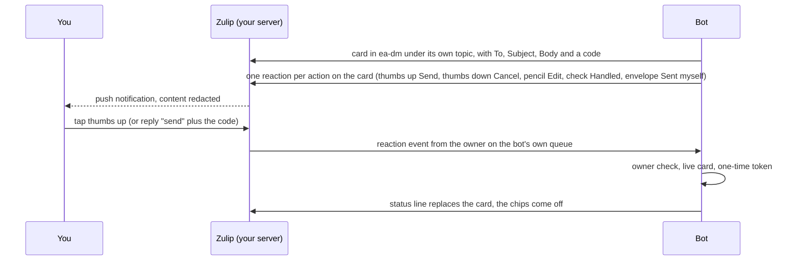
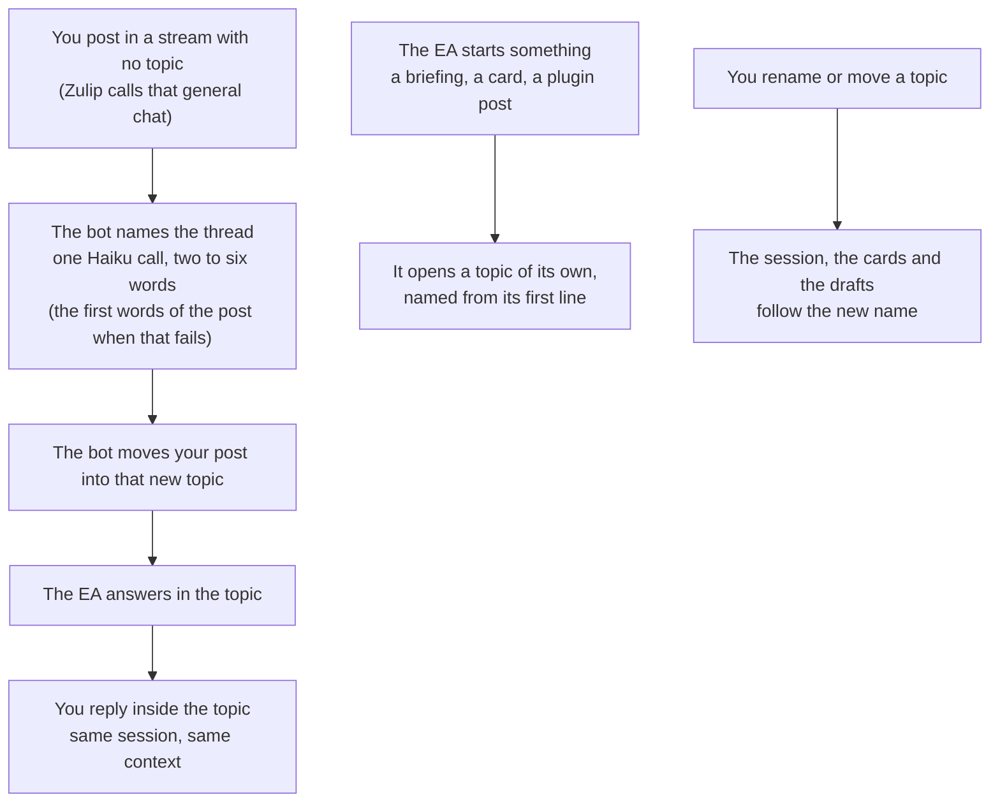

# Switching the EA between Slack and Zulip

The EA's chat platform is one config key, `chat.frontend` in
`~/.ea/config/ea-config.json`: `"web"` (recommended: the chat the bot
serves itself, with no chat server; [SETUP.md](SETUP.md#web-chat) "Web
chat"), `"zulip"` (self-hosted, so the conversation stays on your
machine too) or `"slack"` (what an install with no `chat` block runs).
The web chat can also mirror Zulip (`"shadow": "web"`). The core, the
ledger, the drafts and the resident are the same on all three. This
page is the switch between Slack and Zulip, the rollback, what carries
over, and the checks to run. How the layer works is in [ARCHITECTURE.md](ARCHITECTURE.md)
("Chat front-end layer"); how the gate is anchored on each platform is in
[SECURITY.md](SECURITY.md) (Layer 4).

## Before the switch

The Zulip server runs and the realm is bootstrapped. Both are in
[deploy/zulip/README.md](../deploy/zulip/README.md) (sections 1 to 5):
the stack is up, the owner exists, and
`scripts/zulip_bootstrap.py --check` prints OK for every item. The
bootstrap's stdout gave you two things: the `chat` block and the line
`ZULIP_API_KEY=<bot key>`. The venv the bot runs from has the `zulip`
package (`requirements.txt` lists it).

## Switch to Zulip

1. Add the `ZULIP_API_KEY=<bot key>` line to `~/.ea-private/secrets.env`
   (owner `0600`). Never put it in `~/.ea/.env`, which ea-bot can write.
2. Paste the `chat` block into `~/.ea/config/ea-config.json` with
   `"frontend": "zulip"` (the bootstrap prints it that way), then copy it
   to the owner copy the bot trusts: `preprocessor/owner_trust.py seed --chat`
   (or `sudo bash deploy/harden-permissions.sh`). `scripts/zulip_switch.sh`
   writes both.
3. Restart the bot. The unit name stays:
   ```bash
   sudo systemctl restart ea-chat-bot.service
   ```
4. Confirm the startup log line:
   ```bash
   journalctl -u ea-chat-bot -n 40 --no-pager | grep 'frontend='
   ```
   Expect `frontend=zulip stream=ea (private, subscribed) owner=<id>`,
   no traceback, and `pgrep -af ea-chat-bot.py | wc -l` printing 1.
5. Post `usage` in the `ea` stream with no topic, then in `ea-dm`. Each
   message moves into a topic of its own, gets the eyes reaction, then
   the check, and the report arrives in that topic.

## Switch back to Slack

Set `"frontend": "slack"` in the `chat` block and restart
`ea-chat-bot.service`. Leave the Zulip block and the key where they are;
the Slack frontend ignores them. The Slack tokens and the `EA_SLACK_*`
lines in `.env` were never removed, so nothing else changes. Confirm with
`usage` in the Slack EA channel.

A code rollback is separate: `git revert <sha>` (the post-commit hook
redeploys), or
`git -C /home/ea-bot/ea-system reset --hard <prev> && sudo systemctl restart ea-chat-bot.service`.
The frontend's new state is additive (`chat-cards.json` and
`zulip-queue.json` in `/home/<you>/.ea-private/`), so a rollback restores
nothing.

## What carries over

Everything keyed by a draft, a project, a ledger row or a time:

- the obligations ledger and the project store;
- Outlook and Gmail drafts, and the staged files in `~/.ea/state`;
- the resident pane and its session;
- quiet hours, preferences, autonomy tiers and every other config;
- cron agents and plugins: they post through `slack_notifier`, a shim
  over `chat_notify`, which follows `chat.frontend` and posts each
  message as a new topic in the stream `chat.zulip.notify` names for its
  channel key.

## What does not carry over

- **Slack rooms.** `#ea-<project>` and `#tmp-<id8>` channels stay on
  Slack. Reopen a room on Zulip with `open a channel for <project>`; it
  becomes a private stream. The Slack rows stay in the channel registry
  for a switch back.
- **Per-thread sessions.** Zulip thread keys (`stream:<id>:topic:<topic>`)
  are new keys, so a Slack thread does not continue in a Zulip topic.
  The old rows age out of the registry in 7 days and still work if you
  switch back before then.
- **Live Slack lock cards.** A card posted on Slack cannot be confirmed
  from Zulip. Ask again for any pending draft, event or scheduled send,
  and the card is posted in `ea-dm`.
- **App Home and its modals.** Slack only. On Zulip there is no Edit
  modal on a draft card; ask for the change in the thread and the EA
  revises the draft with `update-draft`.

## What a confirmation looks like

A card is a message in `ea-dm` under a topic of its own. The bot adds
one reaction per action to it, so approval is one tap; the code in the
text is the fallback for a client without reactions.



Only the owner's reaction or code counts; the bot's own chips never do,
and a card older than 48 hours is refused.

## Threads without naming topics

A Zulip topic is a thread; the EA makes one for you. Post in a stream's
general chat with no topic, and the bot moves your post into a new topic
and answers there. The topic's name is a short title (two to six words,
from one Haiku call with no tools and no saved session; a project room's
name goes in as context), with " (2)" and so on when the name is in use.
When the call fails or takes over 20 seconds, the post's first words
name the topic instead. Naming takes about three seconds, so the post
sits in general chat briefly before it moves. To continue, reply inside
that topic. Every post the EA starts (a briefing, a plugin post, a
confirmation card) is a new topic too, named from its first line, so the
stream reads like a Slack channel whose threads each have a title. A
room's own context (the project pack a new room opens with, a session
room's notice, the link back to the thread that asked for the room)
goes to general chat instead, so your first post in a new room starts
its own topic.



This needs two settings, both the defaults on this realm. Each stream
allows named topics and general chat (`topics_policy` inherit or
`allow_empty_topic`; the bootstrap sets `allow_empty_topic` on `ea`,
`ea-scheduling` and `ea-dm`, and its `--check` fails on a stream that
forbids either). The bot may move other users' messages between topics
(the realm's "Who can move messages to another topic" includes it); if
the server refuses a move, the post stays in general chat, the reply
goes there, and the bot log names the message.

A post sent while the bot is stopped is picked up by the restart
catch-up in general chat and answered there, not moved.

Renaming a topic, moving it to another stream, or merging it into
another topic keeps the conversation. The next message there resumes the
same session, and a pending card, draft or scheduling request follows
it to the new name. A reply the EA was already writing lands in the new
topic too, so the old name never reappears. Moving only some messages
out of a topic splits it: the messages left behind keep the old
conversation, and the moved ones start a new one. A move made while the
bot is stopped is not followed.

## Smoke commands

Against the live server, with a fresh private directory (it never touches
the running bot's card registry or queue file):

```bash
cd $HOME/ea-system
.venv/bin/python3 scripts/zulip_smoke.py --site http://zulip.localhost:8080 \
    --bot-email ea-bot@zulip.localhost --bot-key "$ZULIP_API_KEY" \
    --owner-email <owner email> --owner-key "$OWNER_KEY"
```

It prints PASS, FAIL or SKIP for inbound, reply markup, every status
reaction (with the resolved emoji table), file upload and download,
room create, invite, describe, archive and unarchive, the permalink,
three cards in `ea-dm` (confirmed by reaction, by `cancel <code>` and by
the bare code) plus a bot-posted code that must be ignored, and queue
resume across a restart. It exits 1 on any FAIL.

The realm check and the unit tests, which need no server:

```bash
python3 scripts/zulip_bootstrap.py --site http://zulip.localhost:8080 \
    --owner-email <owner email> --owner-key "$OWNER_KEY" --check
.venv/bin/python3 -m pytest -q tests/test_zulip_frontend.py \
    tests/test_chat_cards.py tests/test_chat_notify.py tests/test_chat_read.py
```

The live integration test runs only when the `EA_ZULIP_TEST_*` variables
are set:

```bash
.venv/bin/python3 -m pytest tests/integration/test_zulip_live.py -q
```

After a switch in either direction, the Slack-side checks still apply:
`python3 scripts/ea-doctor.py` and, with the environment sourced,
`python3 preprocessor/chat_read.py --hours 1`.

## The scripted version

`scripts/zulip_switch.sh` walks the owner through the steps above and asks
before each one: Tailscale Serve on port 8443 for the server, the realm's
external host, a new owner password, the bot's site setting, the realm
check, the room carry-over (`scripts/zulip_migrate_rooms.py`, which keeps
each specialist's session id), the switch itself with the live test, and
what to do on the devices. `--status` reports, `--rollback` puts the bot
back on Slack. A nightly backup of the realm runs from the owner's crontab
(`deploy/zulip/backup.sh` into `/home/<you>/zulip-backups`, seven days kept,
inside the daily mirror).

## The server's env file and two-factor sign-in

The stack's env file holds the database, queue and cache passwords and
the Django secret key. It lives in the owner-private directory,
`~/.ea-private/zulip.env` (mode `600`), outside the repo checkout.
`deploy/zulip/env.sh` looks for it in this order: `ZULIP_ENV_FILE`, then
`~/.ea-private/zulip.env`, then the gitignored fallback
`deploy/zulip/.env`, which prints a warning to move it.
`deploy/zulip/compose.sh` runs `docker compose` with that `--env-file`,
and `scripts/zulip_switch.sh` reads the same file. The shipped compose
file also sets `TWO_FACTOR_AUTHENTICATION_ENABLED`: a web sign-in asks
for a TOTP code after the account enrolls. The bot signs in with its API
key, so two-factor sign-in does not change it.

Owner steps, once, on an install that still has `deploy/zulip/.env`:

1. Move the env file out of the checkout:
   ```bash
   mv ~/ea-system/deploy/zulip/.env ~/.ea-private/zulip.env
   chmod 600 ~/.ea-private/zulip.env
   git -C ~/ea-system log --all --oneline -- deploy/zulip/.env   # expect no output
   ```
   If the log shows a commit, the secrets were in git: change each one
   (the postgres password needs an `ALTER ROLE` first, see `.env.example`).
2. Restart the stack. Compose recreates the `zulip` container with the
   new setting; the volumes, and so the realm, stay:
   ```bash
   deploy/zulip/compose.sh up -d
   deploy/zulip/compose.sh exec -u zulip zulip /home/zulip/deployments/current/manage.py \
     shell -c "from django.conf import settings; print(settings.TWO_FACTOR_AUTHENTICATION_ENABLED)"
   ```
   Expect `True`, and no warning about the env file's place or mode.
3. Enroll your account. Sign in on the web, open Personal settings,
   Account and privacy, and select the two-factor link (the page is
   `/account/two_factor/`). Scan the code with an authenticator app and
   keep the backup codes in your password manager.
4. Check the result. A sign-in from a private browser window asks for a
   code. `usage` in the `ea` stream still gets an answer (the bot). Zulip
   marks two-factor sign-in as beta: sign the desktop and phone apps in
   again and confirm that they connect.

### Tailscale ACL: the Zulip port for your own devices only

Tailscale Serve publishes the server on this host's tailnet address,
port 8443 (`scripts/zulip_switch.sh` step 1). Without a rule, every
device on the tailnet reaches it. In the admin console (Access controls),
give this host a tag and accept port 8443 only from your own devices.
Replace `<you>@<domain>` with your Tailscale login and keep the rules
you already need for other ports (ssh, the decks); remove the default
allow-all rule only when those rules are in place.

```jsonc
{
  "tagOwners": {
    "tag:ea-host": ["<you>@<domain>"],
  },
  "acls": [
    // The Zulip server (Tailscale Serve on 8443): your own devices only.
    {"action": "accept", "src": ["<you>@<domain>"], "dst": ["tag:ea-host:8443"]},
  ],
  "tests": [
    {"src": "<you>@<domain>", "accept": ["tag:ea-host:8443"]},
    {"src": "<another-user>@<domain>", "deny": ["tag:ea-host:8443"]},
  ],
}
```

Tag the host with `sudo tailscale up --advertise-tags=tag:ea-host` (with
the flags it already runs with), or in the console's machine menu. A
`src` user rule matches the devices that user signed in; a shared or
tagged device of someone else does not match. The `tests` block fails
the save if a later edit opens the port to another member: name one in
the `deny` test, or drop that test when you are the only member.

## Notifications

The server is registered with Zulip's mobile push service with
`PUSH_NOTIFICATION_REDACT_CONTENT = True` (the phone learns that a message
arrived and fetches the text from this server) and submits no usage
statistics; the settings live in `deploy/zulip/docker-compose.yml`, and
`manage.py register_server --agree-to-terms-of-service` inside the
container performs the registration. The owner's account has push,
desktop and sound notifications on for every EA stream, and every
confirmation card opens with the owner's mention. A phone gets push only
after the Zulip app has signed in to the server once. The current
mobile app registers through the end-to-end-encrypted path, so the
registration is a row in `zerver_device` (`Device` in
`zerver.models.devices`, `push_token_id` set, no error code), not in
the legacy `PushDeviceToken` table, which stays empty. Delivery shows in
the container's `/var/log/zulip/workers.log` as "Sent E2EE mobile push
notifications for user <id>: ... via APNs" (or FCM) after each message
that qualifies: a direct message, a mention, or a message in a stream
with push notifications on.
